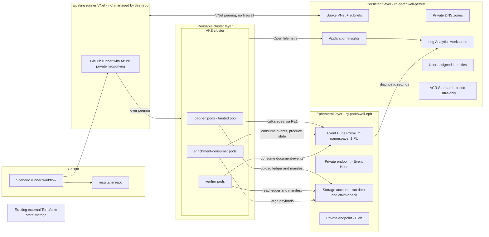

# eventhubs-kafka-dotnet: blueprint

Status: approved by Hari on 2026-10-11.
Inventory frozen: 2026-10-11. Amended once, by Hari on 2026-10-12 (amendment 1, section 12). Item types changed since, by Hari's decisions: C11 to D ([PR #218](https://github.com/collaborationwithothers/eventhubs-kafka-dotnet/pull/218)), and H01 to D with K09's reason corrected ([#224](https://github.com/collaborationwithothers/eventhubs-kafka-dotnet/issues/224)). The same #224 change adds the D01 and G01 notes and corrects the C11 citation in section 12, removes H01 from the run items in ADR-013 and FM-01, and adds the note after query Q1 ([decision record](https://github.com/collaborationwithothers/eventhubs-kafka-dotnet/issues/224#issuecomment-6450522624), item 2). Anything else found later goes to v1.1.

The ADR-003, ADR-012 and ADR-013 amendments follow [Hari-approved #80 revision 4](https://github.com/collaborationwithothers/eventhubs-kafka-dotnet/issues/80#issuecomment-6235834239); Hari's merge of this pull request records approval of these amendments.

Conventions used in this document:
- **Fact** means stated by a cited source, with the source's last-updated date.
- **Inference** means reasoning from facts, not yet tested.
- **Estimate** means a planning number, not a measurement. No number in this document is a measurement. Measured results only appear after the harness has run, with method.

---

## 1. Thesis

This repo proves to Azure architect hiring managers that Hari validates vendor guidance empirically: for .NET services using the Kafka protocol on Azure Event Hubs, what the documentation says, what actually happens, what breaks when the guidance is ignored, how each failure surfaces in a .NET service, and how operations detects it.

---

## 2. Business case

**Parchwell** is a fictional UK legal SaaS company. It runs a multi-tenant document-processing platform for UK law firms. Each law firm is a tenant. All figures below are fictional design inputs chosen so that the inventory scenarios arise naturally; none are measurements.

### Workload

A matter is one legal case or transaction. Firms load documents into matters, sometimes thousands at once (disclosure in litigation, data rooms in corporate deals). Each document produces five lifecycle events: `uploaded`, `ocr-started`, `ocr-finished`, `classified`, `indexed`. A compacted topic holds each document's current state. A document deletion produces a tombstone on that topic.

### Production-scale profile (design input)

| Input | Value |
|---|---|
| Tenants | 250 law firms; skewed, the top 10 firms produce about half the volume |
| Documents per business day | 400,000 across all tenants |
| Events per document | 5 |
| Events per day | about 2,000,000, mostly 08:00 to 19:00 UK time |
| Peak burst | one firm loads 20,000 documents into one matter over about 10 minutes |
| Concurrent bursts | up to 3 firms at once |
| Status event size | 1 to 4 KB |
| OCR-result event size (text inline) | median 150 KB, p99 900 KB, about 1% over 1 MB |
| Consumer processing time | status 5 ms; enrichment 200 ms to 5 s; rare outliers of 6 minutes |
| Quiet periods | 22:00 to 06:00 near zero; individual tenants idle well past 240 s during the day |

Why some values exist:
- The 6-minute outliers exceed the 300,000 ms default `max.poll.interval.ms`.
- The over-1 MB tail triggers the Event Hubs request size limit and justifies claim-check (ADR-006).
- Tenant idle periods over 240 s trigger the Azure idle-connection cutoff.
- The burst shape makes processing unit (PU) saturation a natural business event, not an artificial load test.

### Build-scale profile (what the harness runs)

Same shape, scaled down: 10 tenants, bursts of 2,000 documents. A separate saturation profile ramps load until Event Hubs pushes back, because the saturation point of 1 PU for this shape is unknown until measured (inventory item H07).

### Ordering requirement

Events must be ordered per document. Order across documents in a matter has no business meaning. The one matter-wide action, legal hold, is protected by a state check, not by stream order (ADR-001, failure mode FM-10).

---

## 3. Architecture



### Persistent layer

Holds everything that costs little or nothing while idle, or that must survive teardown. A spoke VNet with subnets for AKS nodes and private endpoints, peered directly to Hari's existing runner VNet, which hosts the GitHub runner with Azure private networking. There is no hub and no firewall in the path. The runner VNet is not managed by this repo. Private DNS for `privatelink.servicebus.windows.net` and `privatelink.blob.core.windows.net` must resolve from both the spoke and the runner VNet. Both zones are platform prerequisites created outside this repo by `scripts/prerequisites.ps1` (ADR-010); this repo links them to the spoke and writes records into them. Teams that run behind a hub firewall: see [docs/networking/hub-firewall.md](networking/hub-firewall.md). The Log Analytics workspace, so run history survives teardown. User-assigned managed identities for each workload. Terraform state uses Hari's existing external storage account, with Entra authentication, shared keys disabled and private access. This repo consumes supplied backend configuration and does not own that account or its networking ([decision on #112](https://github.com/collaborationwithothers/eventhubs-kafka-dotnet/issues/112#issuecomment-6318488448)). The persistent layer also holds an ACR Standard registry with public access and Entra-only pulls and pushes ([registry decision](https://github.com/collaborationwithothers/eventhubs-kafka-dotnet/issues/109#issuecomment-6313841552)). The spoke VNet is persistent because recreating it would mean recreating both sides of the peering every session, and the runner side lives outside this repo. Spoke address space must not overlap the runner VNet or anything else peered to it. Workspace-based Application Insights is persistent; lifecycle and retention follow ADR-020.

### Event Hubs Premium namespace

Premium tier, 1 PU, UK South, availability zones (Fact: Premium has zone support from the first PU; source S4). `disableLocalAuth = true`, public network access disabled, minimum TLS 1.2 (Fact: Premium supports TLS 1.2 or greater; S4). Three event hubs (Kafka topics), all provisioned by Terraform through ARM, not by the Kafka AdminClient (ADR-002):

| Event hub | Purpose | Cleanup policy | Partitions (design input) |
|---|---|---|---|
| `document-events` | lifecycle events | delete, 7 days retention | 32 |
| `document-state` | latest state per document | compact | 32 |
| `document-events-dlq` | poison messages | delete, 7 days retention | 4 |

Limits that shape this (Fact, S3, updated 2026-02-06): 1 MB maximum publication on Premium, applied whether a single event or a batch; 100 partitions per event hub with 200 per PU at namespace level; 100 consumer groups per event hub; 1,000 Kafka consumer groups per namespace; 10,000 brokered connections per PU; 90 days maximum retention; compacted event hub size 250 GB per partition.

### Private endpoints

One private endpoint for the Event Hubs namespace and one for Blob, both in the private-endpoint subnet, with DNS zone groups writing A records into the persistent zones. Kafka traffic uses port 9093 over SASL_SSL (Fact: the bootstrap server is `<namespace>.servicebus.windows.net:9093` in S1, and S2 lists port 9093 as the port that must not be blocked). TLS is required for all Kafka traffic to Event Hubs (Fact: S15). No source documents a listener on 9092, the Apache Kafka plaintext default; that absence is inference until A05 confirms it.

### AKS cluster

Free tier control plane at build scale (no SLA; acceptable for a test harness). OIDC issuer and workload identity enabled. Azure CNI overlay. Entra integration with local accounts disabled and Azure RBAC for Kubernetes authorisation. AKS belongs to infra/cluster and is reused under ADR-020. C1's plan pins the supported Kubernetes version; the adopted minimum is 1.34. Three node pools on normal (not spot) capacity, all `Standard_D4ds_v5`:

| Pool | Nodes | Purpose |
|---|---|---|
| `system` | 1 | system pods only (`CriticalAddonsOnly` taint) |
| `workload` | 1 | enrichment-consumer (a client under test) and the verifier (harness, ADR-015). The verifier starts only after the load generator finishes (ADR-013); an item that measures enrichment-consumer while the verifier runs must state the shared node in its plan |
| `loadgen` | 1, scale to N for saturation runs | load generation only, tainted so it never shares a node with clients under test |

Normal pools, not spot: a spot eviction mid-run looks like a client failure and contaminates results (ADR-008).

### Workloads (.NET 10, Confluent.Kafka 2.16.0 pinned)

Fact: Confluent.Kafka 2.16.0 was released 2026-10-07, targets net8.0 and net10.0, and depends on librdkafka.redist 2.16.0 or later (S12). Every result records the exact Confluent.Kafka and librdkafka versions.

- **`Parchwell.Kafka` (shared library).** The guidance as code: an Event Hubs configuration builder with every setting traceable to an inventory item; the Entra OAUTHBEARER token refresh handler (ADR-003); the librdkafka statistics to OpenTelemetry bridge (ADR-007); graceful shutdown (flush on stop, close on stop, commit on partition revoke). Each setting's XML doc comment links to its inventory item and result.
- **`loadgen`.** Deterministic, seeded producer. Reads a workload profile file and emits lifecycle events with tenant, document id, a per-key sequence number, its own instance ID and a unique application attempt ID in headers. Records every produce attempt's outcome in a ledger (ADR-012). Same seed, same schedule, every run.
- **`enrichment-consumer`.** The consumer under test. Simulates processing time per event type from the profile, can be told to fail a set percentage of messages, writes the document's latest state to `document-state`, writes large payloads to Blob and references them (ADR-006).
- **`verifier`.** The oracle: the component that classifies produce attempts only after their run is complete and valid. A separate consumer reading `document-events`; oracles for the other topics are decided when an item needs them. Validates the independent attempt inventory, then joins the consumed messages with the ledger into four outcome classes: ok, loss, phantom (consumed although the ledger says delivery failed) and reported failure. It also counts duplicates and reorders (ADR-012). Reads `document-events` between high watermarks (the current end offset of each partition) recorded before and after the load generator runs, and rejects ambiguous late-write runs (ADR-013). Invalid or incomplete runs retain diagnostic records without authoritative outcome totals.

### Scenario runner

The scenario workflow owns infrastructure commands and runs the worker and judge Jobs described in ADR-020. It uses the existing private-network runner and GitHub OIDC identity. AGENTS.md hard safety rules 8 and 9 own trigger and dispatch restrictions. The approved candidate is proposed for publication through a verdict pull request; the workflow does not directly authorize a result.

### Observability

Single Azure Monitor backbone (ADR-007). Workspace-based Application Insights receives OpenTelemetry from every workload through the Azure Monitor exporter. Event Hubs diagnostic settings send resource logs to resource-specific tables (Fact: tables include `AZMSKafkaCoordinatorLogs`, `AZMSKafkaUserErrorLogs`, `AZMSApplicationMetricLogs`, `AZMSRunTimeAuditLogs`, `AZMSDiagnosticErrorLogs`; runtime audit logs are Premium-only; S10) and platform metrics to `AzureMetrics`. Application Insights, Container Insights, exporter participation and retention follow ADR-020. Automated KQL collection is removed; section 10 queries remain unvalidated operator examples.

---

## 4. Key decisions

### ADR-001: Partition key is `tenantId-documentId`

**Context.** Per-document order matters; cross-document order does not. A 20,000-document burst from one firm must not be processed by a single consumer.

**Options considered.**
1. Key by matter (`tenantId-matterId`). Preserves matter order. A burst lands on one partition, so one consumer processes it alone while the others idle (hot partition).
2. Key by document (`tenantId-documentId`). Preserves per-document order. A burst spreads across all partitions.
3. Null key with round-robin or sticky partitioning. Maximum spread, no ordering at all.

**Decision.** Option 2.

**Consequences.**
- Burst throughput scales with partitions and consumers.
- One firm's burst now touches every partition, so other firms' events queue behind it everywhere (noisy-neighbour impact widens). Measured by C19. The structural fix is lane separation (ADR-009, deferred).
- Legal hold cannot rely on stream order; the delete handler checks hold state in the authoritative store (FM-10).
- Partition count changes remap keys (Fact: S5), so partition scale-up on `document-events` breaks per-document order for in-flight documents (D02).

### ADR-002: Terraform owns topics; partition counts are fixed for compacted hubs

**Context.** Two Microsoft pages disagree. The client configuration page (S1, updated 2026-01-28) lists "Kafka AdminClient for topic management" as not available. The partitions page (S5) says to use the AlterTopics API, for example via the kafka-topics CLI, to increase partition count.

**Options considered.**
1. Kafka AdminClient from application code.
2. Terraform through ARM (`azurerm_eventhub`).
3. Both: Terraform creates, AdminClient alters.

**Decision.** Option 2, regardless of what D01 finds. Partition count on `document-state` is fixed at creation; changing it means create-new, backfill, and cut over, not scale-up in place. This is provisional pending E04.

**Consequences.**
- Topic configuration is reviewed in pull requests and drift-detected by `terraform plan`.
- Applications get no topic-creation rights, which tightens RBAC (ADR-003).
- If E04 shows partition scale-up on a compacted hub is safe, the fixed-count rule relaxes in v1.1. If it shows state splitting, the rule becomes a headline finding.

### ADR-003: Entra-only authentication with AKS workload identity and a custom OAUTHBEARER refresh handler

**Context.** Microsoft's Kafka configuration page lists SASL PLAIN with a connection string as the required connection settings (Fact: S1). Microsoft's Kafka developer guide lists OAuth samples for Java and Go (Fact: S11); I found no Microsoft sample for Confluent.Kafka with Entra, and none for AKS workload identity. librdkafka has a built-in `sasl.oauthbearer.metadata.authentication.type = azure_imds` (Fact: S6), which authenticates through the Azure Instance Metadata Service. AKS workload identity uses a projected service account token exchanged with Entra, not IMDS (inference from how workload identity works; F02 tests it).

**Options considered.**
1. SAS connection strings (PLAIN).
2. librdkafka built-in OIDC client credentials (`sasl.oauthbearer.method = oidc`) with a client secret.
3. librdkafka `azure_imds`.
4. Confluent.Kafka `SetOAuthBearerTokenRefreshHandler` calling `WorkloadIdentityCredential` from Azure.Core 1.53.0+ (in the `Azure.Identity` namespace; no Azure.Identity package reference is required) for scope `https://<namespace>.servicebus.windows.net/.default` ([Azure.Core 1.60.0](https://nuget.org/packages/Azure.Core/1.60.0)).

**Decision.** Option 4. Local authentication disabled on the namespace. One user-assigned identity per workload: `loadgen` gets Azure Event Hubs Data Sender on `document-events` only; `enrichment-consumer` gets Data Receiver on `document-events` and Data Sender on `document-state` and the DLQ; `verifier` gets Data Receiver only on Event Hubs. Storage roles for `loadgen` and `verifier` are in ADR-012. The verifier keeps Storage Blob Data Reader on `ledger` and receives Storage Blob Data Contributor on a separate verifier-only container in the same ephemeral storage account. Only the verifier workload identity writes that container. Its start-line notes and run results are written create-only; it cannot write the ledger evidence it judges.

Test-only exception adopted on [issue #240](https://github.com/collaborationwithothers/eventhubs-kafka-dotnet/issues/240#issuecomment-6490720216): only an explicitly approved live probe batch 2 environment may add Azure Event Hubs Data Sender and Data Receiver at its ephemeral namespace scope to probe. Event-hub-scoped control identities, verifier identity, Blob permissions and network isolation remain unchanged. The namespace-role flag defaults to false; legacy probes cannot enable it.

**Consequences.**
- No secrets anywhere in the cluster or the repo.
- The refresh handler is the repo's own code, so its failure modes are the repo's responsibility (F03, FM-06).
- Federated credentials must be recreated per cluster, because the OIDC issuer URL changes when the cluster is recreated. Identities remain persistent; cluster-specific federated credentials belong to infra/cluster under ADR-020.
- SAS scenarios are out of scope (F05 only tests that SAS is rejected).

### ADR-004: Premium with private endpoint only; persistent network layer

**Context.** Parchwell holds UK law firms' client documents. Public data-plane exposure is not acceptable.

**Options considered.**
1. Public endpoint with IP firewall rules.
2. Private endpoint with public network access disabled.
3. Dedicated tier for single-tenant isolation.

**Decision.** Option 2 on Premium. Dedicated rejected on cost and minimum scale for zone redundancy (Fact: Dedicated needs 8 CUs for availability zone support; S4).

**Consequences.**
- All clients, including the test runner, must be inside the VNet or peered.
- Private DNS becomes a failure domain (A06, FM-07).
- Kafka over private endpoint behaviour is assumed identical to public; A06 and the baseline runs confirm it.

### ADR-005: At-least-once delivery with store-after-process offsets and idempotent consumers

**Context.** Microsoft's configuration page lists transactions and exactly-once semantics as not supported (Fact: S1); its transactions guide says Kafka transactions are in public preview on Premium and Dedicated (Fact: S18). The two pages conflict (section 12, conflict 6). The same page's Java table says to keep `enable.idempotence` enabled "for exactly-once producer semantics" (Fact: S1). librdkafka's default for `enable.idempotence` is `false` (Fact: S6). Offset commits are throttled to 2 calls per second per partition (Fact: S2).

**Options considered.**
1. Transactions: rejected for v1. Microsoft's pages conflict on whether they are supported, and the most favourable reading is public preview, which this repo does not build its baseline on. B05 tests what actually happens on the Premium namespace.
2. Auto-commit with default auto offset store: offsets can be committed before processing finishes, so a crash loses messages.
3. Synchronous commit per message: hits the commit throttle.
4. Auto-commit with `enable.auto.offset.store = false`, storing each offset only after processing (Fact: this pattern is recommended in librdkafka's description of `max.poll.interval.ms`; S6). Consumers deduplicate by `documentId` plus sequence number.

**Decision.** Option 4. Producer idempotence setting is decided by B04's result, not assumed.

**Consequences.**
- Duplicates are expected after rebalances and crashes; the verifier counts them, consumers absorb them.
- Commit frequency is bounded by `auto.commit.interval.ms`, not message rate.
- Exactly-once claims are explicitly not made.

### ADR-006: Claim-check for large payloads

**Context.** Requests over 1,046,528 bytes close the connection (Fact: S1). The limit applies to batches too (Fact: S3). librdkafka's `message.max.bytes` and `batch.size` both default to 1,000,000, and librdkafka notes the producer "may exceed the maximum size by one message" (Fact: S6). OCR outputs have a tail over 1 MB (design input).

**Options considered.**
1. Inline everything; split oversized text across several events.
2. Inline everything; reject oversized documents.
3. Claim-check: payloads over a threshold go to Blob; the event carries a reference.

**Decision.** Option 3. Inline threshold 256 KB as a design starting point, tuned from B01 and B02 results.

**Consequences.**
- Events stay well below the limit, so batching cannot accidentally cross it.
- A second store joins the failure domain: the event can arrive before the blob is readable, or the blob can be deleted under retention while the event survives (FM-11).
- Blob access is Entra-only with shared key disabled, over private endpoint.

### ADR-007: Single Azure Monitor backbone

**Context.** Microsoft states that Kafka throttling delays are mostly not logged in the ThrottledRequests metric; the `throttle_time_ms` in the produce or fetch response is the real indicator (Fact: S2). librdkafka exposes per-broker throttle time as rolling window statistics (`brokers.<name>.throttle`) and per-partition `consumer_lag` (Fact: S7).

**Options considered.**
1. Azure Monitor only: OpenTelemetry to Application Insights, Event Hubs diagnostics, one Log Analytics workspace.
2. Managed Prometheus and Managed Grafana.
3. Both.

**Decision.** Option 1. `statistics.interval.ms = 15000` as a starting point; statistics are flattened to OpenTelemetry metrics with low-cardinality dimensions. Amended by ADR-020: telemetry placement and fixed settings follow that decision; KQL joins remain operator examples and are not collected evidence.

**Consequences.**
- One KQL query can join client-observed throttling with platform metrics; that join is an operator correlation example; verdict evidence still follows each item's decision rules.
- KQL detection rules are directly reusable by Azure-centric operations teams.
- Log Analytics charges per GB ingested (Fact: GBP 2.173667 per GB after the first 5 units in UK South; S9). High-cardinality per-partition metrics are the cost risk; ingestion per run hour becomes a measured number.
- Managed Prometheus is deferred, recorded in section 6.

### ADR-008: AKS-only harness on normal node pools, tainted load pool, seeded workload

**Context.** The harness must produce reproducible, comparable results.

**Options considered.**
1. Load from Azure Container Apps, clients on AKS.
2. Everything on AKS, spot pools.
3. Everything on AKS, normal pools, load generation on a separate tainted pool.

**Decision.** Option 3, with a deterministic seeded workload published as a profile file.

**Consequences.**
- One identity path (workload identity) and one network path.
- Spot evictions cannot masquerade as client failures.
- Load pods cannot steal CPU or network from clients under test on the same node.
- Higher cost per running hour than spot, so teardown discipline carries more weight.

### ADR-009 (option, deferred): Bulk and interactive lanes

**Context.** ADR-001 spreads a bulk load across all partitions, so a single-document upload by a lawyer can queue behind another firm's bulk load.

**Option.** Separate topics for bulk and interactive uploads, with separate consumer groups and capacity.

**Status.** Recorded, not built in v1. C19 measures the noisy-neighbour effect without lanes; that measurement is the evidence for or against building them.

### ADR-010: Platform prerequisites live outside this repo's Terraform

**Context.** The GitHub runner's VNet was created by hand and is shared with Hari's other repos. Clients in the spoke and the runner must both resolve the Event Hubs and Blob private endpoints to private addresses. A VNet can be linked to only one private DNS zone of a given name, so whichever repo owns `privatelink.blob.core.windows.net` decides for every repo that uses this runner.

**Options considered.**
1. This repo creates and owns both zones. Self-contained, but every later repo that needs the runner to reach a private endpoint depends on this repo's Terraform state.
2. A platform Terraform repo imports the runner VNet and owns the zones. The cleanest end state, but a new repo of scope unrelated to this thesis.
3. Zones created once by a committed script, outside every repo's Terraform, alongside the hand-built runner VNet. Each repo references the zones and manages only its own links and records.

**Decision.** Option 3. `scripts/prerequisites.ps1` creates resource group `rg-platform-privatedns`, both zones, and their links to the runner VNet, and protects each zone. Both sides of the spoke-to-runner peering are created by this repo's persistent-layer Terraform (decided 2026-10-11). Terraform runs as an app registration that Hari creates and grants permissions to; the identity and its role assignments are outside this repo. This repo's Terraform reads the zones as data sources, creates the spoke links, and lets private endpoint DNS zone groups write the A records. A `create_private_dns_zones` variable (default `false`) lets a standalone deployer create the zones inside this repo instead.

**Protection, and why not a resource group lock.** Microsoft states that locks are inherited by child resources, so a delete lock on the zone or its resource group would block deleting record sets (Fact: S16). Each session's teardown deletes the private endpoints, and with them their A records, so such a lock would break `terraform destroy` every session. Instead, following S16, a `CanNotDelete` lock on each zone's SOA record set, which blocks deleting the zone while leaving other record sets free to change. S16 notes record-set locks can only be created with Azure PowerShell, which is why the script is PowerShell.

**Consequences.**
- Repos stay independent of each other's Terraform state.
- Platform drift is invisible to `terraform plan`. A deleted runner-VNet link makes the runner resolve public addresses and fail against a namespace with public access disabled (FM-07).
- Rebuilding the platform means re-running the script, so it must stay idempotent and in the repo.
- Exit path: if a platform repo ever exists, it adopts the zones with Terraform `import` blocks; this repo changes nothing but the data source location.


### ADR-011: Terraform with Azure Verified Modules where they cover the need

**Context.** Hari's direction (2026-10-11): peerings and private DNS A records are created by Terraform, using Azure Verified Modules (AVM) where possible. AVM modules are Microsoft-maintained Terraform modules with a common interface for private endpoints, diagnostic settings, role assignments and locks. Some are young and do not yet expose every property this repo needs.

**Options considered.**
1. Plain `azurerm` and `azapi` resources throughout.
2. AVM modules for every component, accepting their gaps.
3. AVM modules where they expose what the design needs; a plain `azapi` or `azurerm` resource where they do not, with each gap recorded here.

**Decision.** Option 3. Every module is pinned to an exact version. The initial mapping was checked on 2026-10-11 against the Terraform Registry (S17); the pins and compaction fallback below follow the [approved #112 implementation plan](https://github.com/collaborationwithothers/eventhubs-kafka-dotnet/issues/112#issuecomment-6318201099) and its immutable upstream sources:

| Component | AVM module | Version | Use and known gaps |
|---|---|---|---|
| Spoke VNet, subnets, both peerings | `Azure/avm-res-network-virtualnetwork/azurerm` | 0.22.2 | `create_reverse_peering = true` creates the runner-side peering; [pinned source](https://github.com/Azure/terraform-azurerm-avm-res-network-virtualnetwork/tree/c08763d616fc9f1932075a70d53fa826dfbdc72f) |
| Existing-zone links and optional standalone zones | `Azure/avm-res-network-privatednszone/azurerm`, link submodule | 0.5.0 | The link takes the existing zone's `parent_id`; [pinned source](https://github.com/Azure/terraform-azurerm-avm-res-network-privatednszone/tree/da8b7599c740d344de310ffa8cbe32c61322a809) |
| Event Hubs namespace, delete topics, endpoint | `Azure/avm-res-eventhub-namespace/azurerm` | 0.1.1 | Sets TLS 1.2 and passes capacity to AzureRM; its topic input lacks cleanup policy, so only `document-state` falls back to `azurerm_eventhub` with Compact retention; [module source](https://github.com/Azure/terraform-azurerm-avm-res-eventhub-namespace/tree/b72cbf565e698f3443803fef13831c0d35f91cea), [provider support](https://github.com/hashicorp/terraform-provider-azurerm/blob/5782a75422c68a0d0804ac16d97dcaf3df5ee2fa/internal/services/eventhub/eventhub_resource.go) |
| Ephemeral Blob storage and endpoints | `Azure/avm-res-storage-storageaccount/azurerm` | 0.10.0 | Owns ephemeral ledger, verifier and claim-check containers; [pinned source](https://github.com/Azure/terraform-azurerm-avm-res-storage-storageaccount/tree/5695e5ec21744a3765051677d9e82bfba16b5d98) |
| AKS cluster | `Azure/avm-res-containerservice-managedcluster/azurerm` | 0.8.5 | Fixed pool and workload-identity inputs; [pinned source](https://github.com/Azure/terraform-azurerm-avm-res-containerservice-managedcluster/tree/4bc0128b057d10d5ed146a53d8c77933fd00ead8) |
| Container Insights collection | `Azure/avm-res-insights-datacollectionrule/azurerm` | 0.1.0 | Container-Insights-only DCR; AKS AVM 0.8.5's bundled monitoring also creates deferred Managed Prometheus resources. The DCR AVM has no association interface, so `azurerm_monitor_data_collection_rule_association` attaches it to AKS. Sources: [DCR module](https://github.com/Azure/terraform-azurerm-avm-res-insights-datacollectionrule/tree/e9fbba53e7839d0c90ef920ae13bfbadbdd1294f), [AKS monitoring bundle](https://github.com/Azure/terraform-azurerm-avm-res-containerservice-managedcluster/blob/4bc0128b057d10d5ed146a53d8c77933fd00ead8/modules/monitoring/main.tf), [AzureRM association](https://github.com/hashicorp/terraform-provider-azurerm/blob/v4.81.0/website/docs/r/monitor_data_collection_rule_association.html.markdown). |
| Workload and control-plane identities | `Azure/avm-res-managedidentity-userassignedidentity/azurerm` | 0.5.3 | Persistent identities; cluster-specific federation uses plain `azurerm_federated_identity_credential` in the cluster root because the AVM attaches federation to the identity it creates; [pinned source](https://github.com/Azure/terraform-azurerm-avm-res-managedidentity-userassignedidentity/tree/ccb48fc77306879fecd04bd2a8a74b035acdc01d) |
| Log Analytics workspace | `Azure/avm-res-operationalinsights-workspace/azurerm` | 0.5.1 | Persistent workspace; [pinned source](https://github.com/Azure/terraform-azurerm-avm-res-operationalinsights-workspace/tree/b4ffa3ff87ac09ff6de3b7014c44b4d213aa302b) |
| Application Insights | `Azure/avm-res-insights-component/azurerm` | 0.4.0 | Persistent workspace-based component; [pinned source](https://github.com/Azure/terraform-azurerm-avm-res-insights-component/tree/848161e9cb89f4ef5a73d363e984e8dcdad0151d) |
| Container registry | `Azure/avm-res-containerregistry-registry/azurerm` | 0.8.0 | Standard, public, no anonymous or admin access; [pinned source](https://github.com/Azure/terraform-azurerm-avm-res-containerregistry-registry/tree/4a032f5cf4607536008c217efdc3f06dda45f33c), [approved exception](https://github.com/collaborationwithothers/eventhubs-kafka-dotnet/issues/109#issuecomment-6313841552) |

Resource placement is amended by ADR-020; existing module pins are unchanged by this documentation PR.

The additional AKS control-plane identity receives Network Contributor only on the AKS subnet. The kubelet identity receives AcrPull only on the persistent registry; the deploying workflow identity receives AcrPush there. These infrastructure roles are separate from the three workload identities and their data roles ([approved implementation contract](https://github.com/collaborationwithothers/eventhubs-kafka-dotnet/issues/112#issuecomment-6318201099)). Shared tag and external-backend rules are owned by [Terraform engineering standards](engineering/terraform.md).

**A records.** Created by Terraform through each private endpoint's DNS zone group (the `private_endpoints` input with `private_dns_zone_resource_ids` on the Event Hubs and storage modules). The zone group writes the A record when the private endpoint is created and removes it when the endpoint is destroyed, so the record cannot drift from the endpoint's IP. The `private_dns_a_record` submodule is available but not used, because a hand-declared record duplicates what the zone group manages.

**Consequences.**
- Common interfaces for private endpoints, diagnostics and role assignments across components.
- Two providers (`azurerm` and `azapi`) in one configuration, because several AVM modules use `azapi`.
- Young modules can change inputs between minor versions. Exact pins, and upgrades only in their own pull requests.
- Each gap found during the build is recorded in this ADR's table, which is itself a finding for readers using AVM with Event Hubs.

### ADR-012: The oracle is a per-message ledger, joined into four outcome classes

**Context.** The verifier must say what happened to every message: delivered and seen, lost, or failed. Consumed messages alone cannot say that. A message the verifier never sees is loss only if the producer was told it was delivered. A message the verifier does see may have been reported to the producer as failed. Section 3 previously referred to a "loadgen manifest" without defining it. This ADR replaces it.

**Options considered.**
1. Schedule-only manifest. Derive from the seed the keys and sequence numbers the load generator will send. Cheap, but it carries no delivery outcome, so it cannot tell loss from a failure the application was told about.
2. Per-message ledger written by the load generator. One row per message, with the outcome from its delivery report.
3. Ledger in a Kafka topic. Shares the failure domain under test: a fault that loses messages can also lose ledger rows.
4. Ledger written to Blob per message during the run. A second network dependency in the produce path, adding latency and failures to the thing being measured.

**Decision.** Option 2.
- The load generator writes one ledger row per application produce attempt: its instance ID, a unique attempt ID, key, sequence number, delivery outcome and persistence status. An application retry gets a new attempt ID, even when the key and sequence number are unchanged (B10).
- Before each `Produce` call, the producing code registers the attempt ID, key and sequence number in a separate in-memory attempt inventory. This registration bypasses the delivery callback, its buffer and the local ledger writer. After production stops, the inventory is sealed and saved directly as a run manifest, separately from the ledger. A crash before saving it fails the Job; a missing manifest invalidates the run. This is our bookkeeping contract, not a Kafka capability claim.
- Before upload, the load generator reads the persisted ledger back and requires its attempt IDs to match the sealed inventory exactly, with matching keys and sequence numbers and one final row per attempt. The manifest includes the inventory and its independently computed attempt count. The verifier downloads both files and repeats the set, count and row checks; a dropped failed row therefore invalidates the run even if no corresponding message was consumed.
- The row is recorded inside the delivery handler passed to `Produce`, not after awaiting `ProduceAsync` (reason under ADR-013). The handler only appends the row to an in-memory buffer; a background writer moves rows to the local file, and the load generator drains that buffer before the upload. The handler runs on the client's poll path, which also serves token refresh (amendment 1, F01), so it must not wait on file I/O (inference).
- `Produce` can also throw `ProduceException` synchronously, for example on `Local_QueueFull` (Fact: S19). The caller catches it and records a failed row for that attempt through the same buffer. The v2.16.0 implementation frees the callback handle on enqueue failure and throws before any delivery callback for that attempt (Fact: S19). Application-logic errors invalidate the run rather than becoming measured delivery failures.
- Every message carries the load generator's instance ID and attempt ID in headers. Producer registration and expected Job identity follow ADR-020. Any additional registered producer instance invalidates the repeat even if it produced no messages; a pod that fails before registration is outside that guarantee.
- The ledger sits behind `ILedgerStore`, a seam at our own boundary, not around Confluent.Kafka (docs/engineering/dotnet.md).
- During the run the ledger is written to a local file. The validated ledger and sealed run manifest are uploaded at the end to a single `ledger` container in the claim-check storage account (ADR-006). Either upload failing fails the load generator Job.
- Ledger roles, decided by Hari on 2026-10-13, both scoped to the `ledger` container: the load generator's identity gets Storage Blob Data Contributor; the verifier's identity gets Storage Blob Data Reader. Contributor grants read, write and delete, and Reader grants read and list (Fact: S26). No role on that page grants blob write without blob read (inference from S26, which does not state it). A custom role granting only blob write on the container was considered; Hari chose the built-in Contributor role on 2026-10-13, accepting that the load generator can also read and delete blobs in the `ledger` container, and, because the role also carries container write and delete actions (S26), most likely delete the container itself (inference), to avoid defining and maintaining a custom role. These are additions to the role list in ADR-003.
- A separate verifier-only container in the same ephemeral storage account holds the start-line notes and verifier results. The verifier identity has Storage Blob Data Contributor scoped to that container only and retains Storage Blob Data Reader scoped to `ledger`. The load generator receives no access to the verifier-only container. These are additions to ADR-003's workload role list. Contributor includes read, write and delete permissions (Fact: [pinned Storage Blob Data Contributor definition](https://github.com/MicrosoftDocs/azure-docs/blob/c2cc198a3d464afe137f93060257ef06049e0151/articles/role-based-access-control/built-in-roles/storage.md#storage-blob-data-contributor)); create-only writes are an application contract, not a restriction supplied by that role. The verifier does not overwrite or delete notes, results or ledger artifacts. The container and its scoped role assignment are provisioned with the ephemeral layer, separately from the verifier implementation (#80, revision 4).
- The oracle covers `document-events`, the topic the load generator writes. The oracles for `document-state` and `document-events-dlq`, which `enrichment-consumer` writes, are decided when an inventory item first needs them.
- The verifier checks every manifest entry, ledger row and consumed message against the single registered instance bound to the expected producer Job. It joins them on instance ID and attempt ID, and checks that their key and sequence number agree. The classes describe produce attempts only after the run passes the validity and completion gates in ADR-013:

| Class | Ledger says | Consumed |
|---|---|---|
| ok | delivered | yes |
| loss | delivered | no |
| phantom | failed | yes |
| reported failure | failed | no |

- The verifier also counts duplicates (one key and sequence number consumed more than once) and reorders (a key's sequence numbers consumed out of order).
- A run is invalid, and produces no classification, if any of these hold:
  - the ledger or sealed run manifest is missing;
  - the verifier finds other than exactly one registered producer instance, or a ledger row or consumed message has an instance ID other than the expected one;
  - a consumed message has no ledger row, or its key and sequence number disagree with that row;
  - the inventory, independently recorded attempt count and persisted ledger do not agree, an attempt ID has more than one row, or the buffer or local writer loses a row;
  - the late-write guard in ADR-013 cannot establish eligibility for a completed classification.

**Consequences.**
- Every class is a statement about Event Hubs and the client, not about the harness. Harness bookkeeping faults invalidate the run instead of appearing as findings. That is why a consumed message with no ledger row is not counted as a phantom.
- The classes do not judge. "Reported failure" is a count; whether it is acceptable is decided by the scenario's `expected.yaml` (ADR-014). The word "expected" is reserved for those hypotheses.
- Section 7's loss target now means the loss class. A reported failure is not loss: the application was told.
- The ledger and manifest uploads can fail. A missing file invalidates the run.
- The claim-check storage account is in the ephemeral layer, so the ledger is deleted at `terraform destroy`. The verifier's counts are what reach `results/`. Retention follows ADR-020.
- When the claim-check role for `enrichment-consumer` is added, it must be scoped to its separate claim-check container, without access to the `ledger` container (#44, item 2).
- A01 keeps one producer per repeat. Any future multi-producer scenario needs an approved oracle amendment before execution; #155 owns the parked throttling question.

### ADR-013: A run is the window between high watermarks recorded before and after the load generator

**Context.** "Not consumed" (ADR-012) is only decidable once the verifier knows it has read everything the run produced, and nothing from another run. Each scenario configuration is repeated at least 5 times (section 7) on the same topics, so earlier repeats' messages stay in them. The run needs a defined start and a defined end. The high watermark of a partition is the offset of the latest message available for consumption, plus one (Fact: S19); it marks the current end of the partition.

**Options considered.**
1. Idle timeout. The verifier stops after a period with no messages. When a fetch request's throttling delay exceeds the request timeout, Event Hubs responds with an empty set of records and no error code (Fact: S2). An idle period can therefore mean throttling rather than the end, and loss and throttling would look the same.
2. Delivered count from the ledger. Stop after the number of delivered messages is consumed. Duplicates and phantoms make the count wrong in both directions: the verifier stops early or never.
3. High watermarks recorded after the load generator exits.

**Decision.** Option 3, with a start line recorded the same way.
- Before the load generator starts, a start step records the high watermark of every `document-events` partition. This is the run's start line. The step runs the verifier's image with the verifier's identity.
- The load generator calls `Flush` until librdkafka's out queue (messages produced but not yet given a delivery report) is empty, then exits. `Flush` waits for all outstanding produce requests and delivery report callbacks; its timeout overload returns the out queue length; `message.timeout.ms` also affects the maximum time a call to `Flush` may block (Fact: S19).
- The workflow sequences verification after the load generator Job has terminated. The verifier and phase judge enforce required receipts, sealed manifest and ledger/inventory agreement under ADR-020; Job termination alone is not success.
- As its first step, before consuming, the verifier records the high watermark of every `document-events` partition again. This is the run's end line.
- For D02, a partition present at the end but absent at the start gets a start offset of 0, the initial partition offset (Fact: S19). If that offset is no longer available, the out-of-range rule below invalidates the run. A partition recorded at the start but missing at the end also invalidates the run.
- Both lookups use the verifier's identity and Data Receiver role (ADR-003). That Data Receiver permits this offset lookup is an inference: Microsoft's built-in roles page describes the role as allowing "receive access to Azure Event Hubs resources", with the single data action `receive/action` (Fact: S27); it does not map that action to Kafka operations. The first live run confirms it, and if it fails, the fix is a decision for Hari, not a wider role.
- The verifier assigns each partition at its start line and consumes only offsets at or above that line and below its recorded end line. A partition whose start and end lines are equal is already complete. Other partitions are complete when their positions reach the end line; any fetched record at or beyond that line is excluded from classification. With an explicit offset, `Assign` sets the start offset (Fact: S19, the `Assign` and `Seek` documentation). `auto.offset.reset` still applies when the desired offset is out of range (Fact: S25), and its default, `largest`, would silently skip to the end. The verifier therefore sets `auto.offset.reset = error`, a documented value (S25), so a start line that is no longer in the partition fails the run instead of being skipped. It also sets `enable.auto.commit = false`, whose default is `true` (S25), because it reads by assignment, not from committed offsets. Confluent.Kafka requires a `group.id` on every consumer, including one that only assigns (Fact: S19). The verifier uses one fixed `group.id`, `parchwell-verifier`, for every run, so it adds at most one consumer group to the namespace, not one per run (C13). It sets `isolation.level = read_committed` explicitly; this is librdkafka's default and returns transactional messages only once committed (Fact: S25). Each setting is tagged with the inventory item whose behaviour it guards against: `auto.offset.reset` with C15, `enable.auto.commit` with C10, `group.id` with C13, `isolation.level` with B05.
- A safety stop ends the verifier if the watermarks are not reached within its configured deadline. Initial estimate: 10 minutes, approved by Hari on 2026-10-14; basis: a bounded wait for the A01 reference slice, with no runtime measurements yet. This is a harness budget, not a claim about Event Hubs performance. The verifier PR (#9, PR 7) revisits it against measured drain times. A stopped run is incomplete and produces no completed outcome classification; it cannot count unread messages as loss.
- Late-write guard: the initial oracle invalidates a run if an accepted `Produce` call ends in an asynchronous delivery failure, a producer request times out or is retried, or a transport failure makes persistence uncertain, even if a later retry succeeds. Synchronous pre-enqueue rejections still enter the ledger as failed attempts (ADR-012). This deliberately conservative rule avoids converting an unseen late append into a reported failure, or missing a late duplicate after a successful retry.
- The producer records these guard conditions independently of the ledger writer and retains them in the sealed manifest. It preserves delivery persistence status; `PossiblyPersisted` means transmitted without acknowledgement, while `Persisted` means written and acknowledged (Fact: S29). A missing status or `PossiblyPersisted` invalidates the run. The status field must remain enabled; Confluent.Kafka substitutes `PossiblyPersisted` when it is disabled (Fact: S29). This harness requirement is tagged A01/B10.
- Guard evidence includes producer broker counters `req_timeouts`, `txretries`, `txerrs` and `rxerrs`, which are documented as cumulative counts of request timeouts, retries, transmission errors and receive errors (Fact: S29). Any observed non-zero counter invalidates the run. The harness retains broker error evidence throughout production and statistics through the post-drain sample. For the initial oracle, coverage of "every broker instance used" is assessed by a stable set of broker names whose native `source` is `learned`, `configured` or `logical`, from the first persisted report through the first post-drain report, together with the expected-broker and post-drain coverage checks in #80 revision 4. A change in that set invalidates the run. Missing broker coverage, missing required fields, counter resets and the named incomplete-evidence cases in that plan invalidate the run; absent evidence cannot be treated as zero. This is an accepted sampled-coverage criterion, not proof of every broker lifetime. A broker handle created and destroyed entirely between two reports may be unobserved even when the sampled name set is stable; that residual risk is accepted for this oracle. Statistics are asynchronous and may be inconsistent across totals (Fact: S29), so a zero aggregate or an idle waiting period is not proof that a timed-out write cannot still arrive. If the harness cannot establish the plan's coverage criterion, it rejects the run rather than inferring finality.
- For an invalid or incomplete run, the verifier records the status and reason, retains raw records for diagnosis, leaves authoritative outcome counts absent, and exits non-zero (ADR-017). The judge cannot accept authoritative message totals from that run. A01, B09 and H07 may therefore retain timing/throttling observations while the oracle is untestable for outcome totals; an improved oracle requires a reviewed plan before those totals can be accepted. Hypotheses are not changed to conceal this limitation.

**Consequences.**
- Each repeat sees only its own messages, except for the late writes below, so the duplicate-run rule (ADR-012) applies to one repeat's window.
- An idle fetch cannot complete verification. Throttling may instead exhaust the safety deadline, which leaves the run incomplete.
- For asynchronously accepted attempts, a completed `Flush` means every delivery callback has recorded its row in the buffer. Synchronous failures are recorded by the caller (ADR-012). The load generator must also drain the writer and successfully upload the complete ledger before its Job succeeds. With `ProduceAsync`, the returned task comes from a `TaskCompletionSource` created with `TaskCreationOptions.RunContinuationsAsynchronously` (Fact: S19), so code awaiting it can still be pending when `Flush` returns (inference). That is why ADR-012 requires the handler.
- Why the guard rejects ambiguous runs: under throttling, Event Hubs delays produce requests (Fact: S2). A ProduceRequest times out after the lesser of `socket.timeout.ms` and the remaining `message.timeout.ms` for the first message in the batch (Fact: S25). The client-side timeout `RD_KAFKA_RESP_ERR__TIMED_OUT` is retryable and possibly persisted (Fact: S28). Retries are bounded by the retry count and `message.timeout.ms`; `retries` defaults to 2147483647 (Fact: S25). A late append after the recorded end line could otherwise be missed by this repeat and, if it precedes the next start line, by both repeats (inference). The guard prevents accepting outcome totals for that ambiguous run; it does not claim to prevent the append. If an old-instance message nevertheless appears in a later window, that later run is also invalid (ADR-012). Whether Event Hubs appends after returning Policy Violation is not documented; asynchronous failures are rejected without assuming it cannot.
- Under `read_committed` (Decision), a message from an aborted transaction would then be classed as loss, and an open transaction may hold the verifier short of the high watermark until the safety stop (both inference; neither is stated by a cited source). B05's transaction configurations therefore need their own oracle rule, decided in B05's plan.
- This rule is for topics with the delete cleanup policy. On a compacted topic, compaction removes earlier values per key, so "not consumed" means something else there. A01 does not use one.
- Invalid and incomplete statuses, reasons and worker exit outcomes must be preserved in the evidence pack (docs/agents/factory.md, "Evidence pack"). They cannot be replaced with zero outcome counts. Run-scoped diagnostics and post-run retention follow ADR-020.

### ADR-014: Scenarios are a definition file and an expected-outcome file per item; workers resolve deployment settings in-process

**Context.** Scenarios are data, run by one harness (AGENTS.md, "Scope"). The definition must say what runs and, separately, what is predicted, so the prediction can be protected. Deployments must match the definition exactly.

**Options considered.**
1. Code per scenario. Rejected by AGENTS.md.
2. One file holding both the run definition and the hypotheses. The hypotheses cannot then be protected as a path of their own.
3. Hand-written Helm values per scenario. Two sources of truth that can drift: a reviewer approves the definition while a different deployment runs.
4. A definition file and an expected-outcome file per item, with Helm values generated from them.
5. Separate definition and expected-outcome files, with workers resolving packaged definitions and profiles in-process.

**Decision.** Option 5, superseding generated Helm values under ADR-020.
- `scenarios/<ID>/scenario.yaml` is the definition: the profile, the configurations as deltas from the baseline (ADR-015), the fault, the repeat count and the measures.
- `scenarios/<ID>/expected.yaml` holds the hypotheses. It is a protected path: the `main-protection` ruleset requires Hari's review for it, and `.github/CODEOWNERS` mirrors the list. It is approved with the item's plan.
- Workload profiles shared by several items live in `scenarios/profiles/`.
- Workers resolve scenario.yaml, its referenced workload profile and the baseline inside their own image. The chart receives the identifiers and infrastructure values defined in ADR-020. expected.yaml is used only to assess results after the run and cannot affect deployment.

**Consequences.**
- Every deviation from the baseline is visible as a delta in one file.
- Changing a prediction needs Hari, so a run cannot be made to pass by editing what was expected (AGENTS.md, "Verdict integrity").
- The scenario loader and resolver remain in Parchwell.Scenarios; the values generator is removed by C7.

### ADR-015: The baseline is Microsoft's guidance, every setting the harness depends on explicit and tagged; preview features never enter it

**Context.** Every scenario is a delta from one baseline configuration in `Parchwell.Kafka`. Microsoft's pages disagree with each other and with librdkafka in several places (section 12, "Documentation conflicts"). A01 is an example: the stated default for `request.timeout.ms` differs between Microsoft and librdkafka. The baseline needs a rule for those conflicts that does not depend on judgement per setting.

**Options considered.**
1. librdkafka defaults, with Microsoft's guidance applied as deltas.
2. Microsoft's guidance, with settings left at defaults where Microsoft says nothing.
3. Microsoft's guidance, with every setting the harness depends on set explicitly, even when the value equals a default.

**Decision.** Option 3.
- Every setting the harness depends on is set explicitly and tagged with its inventory ID.
- Where Microsoft's pages conflict, the baseline takes the value Microsoft labels as recommended or required for librdkafka. Labels in Microsoft's Java table do not apply to a librdkafka client. If no page labels a value for librdkafka, the baseline takes the librdkafka default, set explicitly.
- Preview features never enter the baseline.
- The baseline covers the producer configuration in the load generator and the consumer configuration in `enrichment-consumer`, the Kafka settings the inventory tests. The verifier's settings are harness settings. Its settings go through the same configuration builder, are set explicitly, and are tagged with the inventory item each one guards against (ADR-013).

**Consequences.**
- A change of default in a later librdkafka version cannot silently change a setting the harness depends on.
- Results describe what a team following Microsoft's guidance gets, which is the repository's thesis (section 1).
- `enable.idempotence` is labelled only in Microsoft's Java table (S1), so until B04 decides it (ADR-005) the baseline sets the librdkafka default, `false` (S25), explicitly.
- Kafka transactions stay out of the baseline whichever of Microsoft's pages is right: the most favourable reading is public preview (ADR-005, conflict 6). B05 tests them as a delta.
- A01's baseline must be rebuilt around `socket.timeout.ms` first (#14).

### ADR-016: Component tests cause outcomes for real with Testcontainers Kafka and Toxiproxy; loss is simulated, and says so

**Context.** The verifier is the oracle, so a defect in it publishes wrong results. Each outcome class (ADR-012) must be shown to be detected, not only computed. Component tests run against a local broker and test harness logic only, never Event Hubs behaviour (docs/engineering/dotnet.md).

**Options considered.**
1. Unit tests of the join only. Fast, but they never show the classes arising from a real client and broker.
2. Component tests that cause every class for real. No reliable method for causing actual broker loss has been established for this harness (below).
3. Unit tests of the join, plus component tests that cause phantom, reported failure and duplicate outcomes for real, plus one component test that simulates loss in the ledger.

**Decision.** Option 3.
- Unit tests cover the join for all four classes, duplicates and reorders.
- Component tests use a Kafka broker in a container (Testcontainers) behind Toxiproxy, a TCP proxy for simulating network conditions (Fact: S21). Toxiproxy's faults are called toxics; they include latency, timeout and reset_peer (Fact: S21). The toxics are applied between the client and the broker to cause phantom, reported-failure and duplicate outcomes.
- Loss is covered by one component test that simulates it in the ledger. Alongside real produced messages, the fixture inserts synthetic delivered rows for messages it never sends, with corresponding synthetic attempt entries in the sealed inventory and count. This deliberately consistent fixture passes bookkeeping validation so the real start line, end line, consumer and join can detect loss. The test, its name and its injected data say it is simulated; it does not represent real producer acknowledgement.

**Consequences.**
- Why loss is simulated: loss means the broker acknowledged a write and then lost it. No reliable way to cause that in the proposed single-broker test cluster has been established. Toxiproxy interrupts the network path rather than deleting acknowledged broker data, so the planned faults target reported failures or phantoms. (Inference; not tested.)
- The simulated test proves the harness detects loss end to end, through the real consumer, watermarks and join. It proves nothing about Event Hubs, and nothing in `results/` cites it.
- Classification tests exercise the join on recorded inputs. Full-run tests separately enforce the late-write and inventory gates: a phantom or reported-failure record may be retained for diagnosis while its run is invalid under ADR-013. Tests must cover a dropped ledger row whose message was never consumed, an ambiguous asynchronous failure, a retried request that later succeeds, missing guard evidence, and a safety stop; none may yield a successful verifier Job or authoritative outcome totals.
- Simulating loss by deleting produced records with `DeleteRecordsAsync`, which deletes records older than the offsets given (Fact: S20), was considered and rejected. It also deletes the run's start line, so under ADR-013's `auto.offset.reset = error` the run fails instead of showing loss (inference from S20 and S25). Decided by Hari, 2026-10-13.
- Whether Toxiproxy can produce a phantom with Confluent.Kafka 2.16.0 is the question of the phantom spike (#9, PR 3). If it cannot, this ADR is revised before the verifier is built.
- Testcontainers and Toxiproxy packages are new dependencies, so the pull requests that add them go to Hari (AGENTS.md, "Code Review Rules").

### ADR-017: Workers are Generic Host apps run as Kubernetes Jobs, and set a non-zero exit code on failure

**Context.** The load generator and verifier run once per run and end. The experiment must record whether each one succeeded. On .NET 6 and later, an unhandled exception in a `BackgroundService` is logged and stops the host by default (Fact: S22). Microsoft documents that before .NET 11 the task returned by `RunAsync` completed successfully in that case, which usually meant the application exited with code 0, and that .NET 11 changes this (Fact: S23). That .NET 10 has the previous behaviour is inferred from the change being introduced in .NET 11. On .NET 10 a failed worker can therefore look successful.

**Options considered.**
1. Deployments. They are for processes that keep running, not for a run that completes.
2. Jobs with the default host behaviour. A failure usually exits 0, and the Job counts it as a success.
3. Jobs whose workers set an explicit non-zero exit code on any failure.

**Decision.** Option 3.
- The load generator and verifier are Generic Host apps, each with its own container image, run as Kubernetes Jobs. The start-line step uses the verifier image in a separate Job and follows the same exit-code and retry rules (#44, item 3).
- Each worker sets an explicit non-zero exit code whenever it fails. The verifier must also exit non-zero for an invalid run, an incomplete run or a safety stop, after recording the status and reason. These are failures of experimental completion even when no exception was thrown.
- Each Job sets `backoffLimit: 0` and `restartPolicy: Never`. The default `backoffLimit` is 6 (Fact: S24), so a default Job retries a failed pod. The load generator also uses the ADR-020 pod replacement policy.

**Consequences.**
- Completion authority and post-run evidence follow ADR-020's last-action receipts and verifier judge. Invalid or incomplete evidence never authorizes outcome counts, regardless of process exit.
- A retried load generator would be a second instance. `backoffLimit: 0` prevents retries, but Kubernetes documents that even a Job with parallelism 1 and completions 1 may sometimes start the same program twice (Fact: S24). ADR-020's registered-instance rule rejects additional registered producers; an instance that fails before registration is outside that guarantee.
- The workflow collects pod exits for people; the accepted absence of a post-receipt process-exit rejection is recorded in ADR-020.
- On .NET 11, `RunAsync` fails when a `BackgroundService` fails, and the application typically exits non-zero (S23). That covers `BackgroundService` exceptions only, so the explicit exit code stays.


### ADR-018: Either tool implements; Codex reviews every pull request; the factory runs on plans, not metered keys

**Context.** The factory operating model approved on 2026-10-12 bound the two tools to fixed roles: Claude Code implements, Codex reviews. Hari's Claude Max plan has usage limits, and when they are reached the factory has no implementer. Hari's requirement (2026-10-13): either Claude Code or Codex must be able to implement an issue. The reviewer then has to be decided. Six ADRs for issue #8 are on branch `claude/issue-8-code-half-adrs`, not yet merged, and take the six numbers after ADR-011, so this decision takes ADR-018.

What the tools offer, verified 2026-10-13 (S47 on 2026-10-14):
- Codex's GitHub Action takes an API key and runs `codex exec` (S30, S31). Its GitHub integration reviews a pull request automatically or on `@codex review`; a security review runs automatically when enabled in Codex settings, or on `@codex security review` (S47); any other `@codex` comment starts a legacy cloud chat with the pull request as context; it posts as the bot `chatgpt-codex-connector` (S32). No issue or label trigger is documented. Its current cloud environments start from the app, mobile, Slack or Teams; no GitHub event, API or CLI trigger is documented, and the GitHub integration runs on "Codex Cloud (Legacy)", which OpenAI says it plans to deprecate, with no date (S33). Inferred from S30 to S33, not stated by any of them: the only documented way to start a Codex implementation task from a GitHub event without a person is the GitHub Action, on an API key (reviews start on their own, S32).
- Codex plan usage is shared: "Local messages and cloud chats share your plan's usage allowance", and "Weekly limits may also apply" (S34). Codex code review has refused reviews with "You have reached your Codex usage limits for code reviews" while the account's dashboard showed 73% of the weekly allowance remaining (Pro plan, 2026-10-09; a second report at 48%). The issue is open and unassigned (S35).
- Claude Code's GitHub Action authenticates with an API key, a subscription OAuth token ("runs use your Claude subscription instead of API billing"), or Microsoft Foundry through OIDC, among other providers it lists (S36). Codex CLI runs against Azure OpenAI in Foundry through a `model_providers.azure` entry in `config.toml`, including `codex exec` in GitHub Actions, with an API key only: "Entra ID support is currently not available for Codex" (S37).
- GitHub Copilot code review reads `AGENTS.md` (since 2026-06-18) and `CLAUDE.md` and `REVIEW.md` (since 2026-07-17) (S38, S39). Since 2026-08-27 it reviews bot-authored pull requests automatically when the organization policy allowing members without a licence to use code review is on, and will "bill the usage directly to your organization" (S40). Under the default Member billing option, "If the member's quota is exhausted, the code review fails"; the Organization option bills the organization and needs AI-credit paid usage enabled (S44). It can approve pull requests in public preview since 2026-09-01, off by default (S41). Its models are not named and not selectable: GitHub's documentation, as quoted in S42, says it "uses a carefully tuned mix of models" and "Model switching is not supported". For scale only, on the legacy premium-request billing that applies to Copilot Pro and Pro+, not to this organization's Business plan, a review costs 13 requests against 300 per month on Pro (S43). The organization has Copilot Business with one seat at USD 19 per month (S46).
- A study of 248,641 agent-authored pull requests that received an AI review (CodAGE, a dataset of coding-agent GitHub events, January 2024 to April 2026) found 208,145, about 84%, reviewed by the same product that wrote them. It measured who reviewed whom, not review quality; the risk it names is correlated blind spots. For OpenAI Codex it found no difference in review output between same-product and cross-product pairs (0.89 against 0.91 comments per pull request). Its recommendation is that the reviewing agent be a different product from the author, enforced by a required status check that reads the pull request's authoring signature (S45).

**Options considered.**
1. Keep the 2026-10-12 binding. Rejected: it is the binding that leaves the factory idle when Claude is capped.
2. Both tools in GitHub Actions on metered API keys through Microsoft Foundry, each reviewing the other's pull requests. Removes plan limits from the factory and bills both tools to the Azure subscription next to the Event Hubs spend. Rejected by Hari for cost: it adds metered token spend on top of the plans already paid for. It also conflicts with GOVERNANCE hard safety rule 3: Codex on Foundry authenticates with an API key only (S37), which puts an Azure credential in the agent session. Choosing it later needs a governance change first.
3. GitHub Copilot code review as the gate for every pull request, either tool implementing. Always available whichever tool implemented; reads AGENTS.md. Rejected by Hari for cost: reviews of the factory's bot-authored pull requests are billed to the organization (S40), and, inferred from S44 rather than stated, need AI-credit paid usage enabled on it, which is spend beyond the seat already paid for; and the reviewer's model family cannot be verified, so it does not give the independence that option 2 gives.
4. Either tool implements, chosen per issue; Codex reviews every pull request, including the ones Codex wrote; both tools run on Hari's plans (Claude Max, ChatGPT Pro). No new spend. Same-vendor review on Codex-authored pull requests, accepted as a measured risk.

**Decision.** Option 4. Hari names the implementing tool when he approves the plan. The branch prefix, `claude/` or `codex/`, names it for readers. The merge workflow planned under issue #17 will read the `Co-Authored-By` trailers on the pull request's commits, following S45's advice to read the authoring signature, which every agent commit already carries, and will label the pull request `same-vendor-review` when any remaining commit, after the merge commits and untrailed commits by Hari's account that AGENTS.md "Implementer and reviewer" tells it to ignore, carries a Codex trailer or no tool trailer, and will remove the label on a later push when none does; agents never apply or remove that label. A wrong trailer, and an untrailed commit under Hari's account, are not detected. The merge rule requires a completed Codex review of the head commit (issue #17); when none has arrived within the timeout in docs/agents/factory.md "Escalation", the pull request escalates to Hari and does not merge, whatever the cause. Every such event, and every escape (a valid P0 or P1 finding the cold review should have caught; defined in docs/agents/factory.md by PR #38), is computed by the script planned under issue #17, split by same-vendor and cross-vendor (docs/agents/factory.md "Escapes"), so the risk accepted here is measured rather than assumed. Hari's reasoning on the pause risk: the pause happens only when Codex review does not post; ChatGPT Pro being exhausted is unlikely in any given period, and the S35 refusals, which occur with allowance remaining, are the likelier cause; the timeout escalation handles both causes the same way.

**Consequences.**
- The factory pauses, rather than merging unreviewed, whenever Codex review does not post. The rate of that is unknown until measured; S35 shows it is not zero. If the pilot finds that Codex posts only a reaction on a clean pull request (issue #17), no clean pull request satisfies the merge rule until the merge workflow obtains a completed review (docs/agents/factory.md "Escalation").
- Codex-authored pull requests have no reviewer from another vendor. Protected paths and the verifier still need Hari's approval, so the oracle and the public claims are never exposed to same-vendor review alone.
- The weekly spot-check (docs/agents/factory.md, "Measuring the gate") takes `same-vendor-review` pull requests first.
- GitHub Copilot code review stays switched off. The reason recorded on 2026-10-12, that it answers to none of the rules in AGENTS.md, was wrong (S38); the reasons now are that its threads block agent merges through conversation resolution, and cost.
- Exit path: if the measured escape rate on same-vendor pull requests exceeds the cross-vendor rate, or the pause rate costs Hari more than the metered spend would, option 2 is the next step, after the governance change that hard safety rule 3 requires. The implementer roles stay; Claude gains the reviewer role for Codex-authored pull requests, and credentials move to metered keys.
- A Codex implementation path in GitHub Actions does not exist yet. Until one is built, Codex implements only in sessions Hari starts himself, as on [cdc-platform-azure](https://github.com/collaborationwithothers/cdc-platform-azure).

### ADR-019: The verifier is the only authoritative judge of a live run's captured evidence; its checks come from the item's decision rules; only checked evidence is published

**Context.** ADR-012 puts one check in two places on purpose: the load generator reads the persisted ledger back against the sealed inventory before upload, and the verifier repeats the set, count and row checks. ADR-013 already has the verifier record a run as invalid when producer guard counters are non-zero or statistics evidence is missing or incomplete. No ADR says who judges the rest of a run's evidence, such as lifecycle events, capability claims and resolved settings, or where the statistics checks themselves run. The #68 plan, decision 7, said "Readers must reject missing, inconsistent or incomplete evidence" without a closed list (https://github.com/collaborationwithothers/eventhubs-kafka-dotnet/issues/68#issuecomment-6201728123). The load generator merged in #70 and #71 also validates that evidence's content, in `src/Parchwell.LoadGen/Run/Evidence/RunEvidenceReader.cs` at the end of the run and again in `src/Parchwell.LoadGen/Run/Publication/RunArtifactIndex.cs` at publication. The postmortem in #72 found that most of #70's extra review rounds produced P2 hardening findings on one hand-written validator, and names two causes this ADR addresses: a validator with no closed scope, and validation placed in two components. It leaves this decision to Hari as action A5, before the verifier plan (#9, PR 7). Hari approves this decision by merging this ADR; the merge is the record.

**Options considered.**
1. Freeze. Keep the load generator's content checks, add no new ones, and give the verifier its own closed list. Two checkers of the same evidence must then agree forever.
2. Move. The verifier alone judges the evidence the load generator captures about the client. The load generator keeps the checks on its own bookkeeping and on transfer.
3. Share. One implementation that both workers call. Likely a new project, which is a P1 under the Code Review Rules, and it still needs a closed list.
4. Also cut the load generator's ADR-012 ledger read-back to a byte-for-byte round trip. Needs an amendment to ADR-012 and a code change, for little gain: a faulted ledger store and the verifier's repeat already catch a lost row (inference).

**Decision.** Option 2.
- Bookkeeping evidence is the ledger, the sealed inventory, the run manifest, run identity and worker status. Captured evidence is the client statistics, request lifecycle and capability evidence, including the resolved settings (`statistics.jsonl`, `request-lifecycle.jsonl` and `capabilities.json`).
- The load generator keeps every check on bookkeeping evidence that docs/operations/loadgen-contract.md defines in "Identity and final rows", "Independent manifest and read-back" and "Worker inputs and completion", including ADR-012's ledger read-back. That includes envelope parsing of every file (the paragraph starting "Local evidence uses schema version 1"). The index checks in "Publication and reader acceptance" also stay: name set, byte lengths, SHA-256 hashes, budgets, run identity, completion flags, and the agreement between the manifest's guard observations and the ledger rows (`RunArtifactIndex.cs`; the contract does not yet describe it). Completion authority is amended by ADR-020: the judge reads last-action receipts, and pod exit records are diagnostic.
- A check on the content of captured evidence beyond envelope parsing is a content check. The checks in "Statistics and request capability evidence" are content checks, and so is their repeat at publication. They include the A01 probe evaluator (`PureProbeEvaluator`), the parsing of native statistics JSON stored inside an envelope, and publication's check that the manifest holds the guard observations captured evidence requires. Capture-time controls are not content checks and stay: the size ceilings on captured reports and files, writer and queue faults, and the failed final exit when a required capture file cannot be written. Statistics whose envelopes parse but whose content is malformed, incomplete or missing broker coverage do not fail the load generator's exit. The load generator publishes them with a diagnostic, and the verifier judges them under ADR-013, so their raw records reach the verifier for diagnosis. Where the section rule above and this subject rule disagree, this subject rule decides. From this ADR's merge, no new content check is added to `Parchwell.LoadGen`.
- Once the removal pull request below merges, the verifier is the only component that judges whether a live run's captured evidence is valid and complete. Until then, the load generator's existing content checks are a temporary second gate. The verifier also judges a probe run's captured evidence for a scenario's probe gate. For bookkeeping evidence it repeats ADR-012's set, count and row checks and enforces the invalid-run conditions in ADR-012 and ADR-013; the load generator's other bookkeeping checks have no second judge. ADR-020 moves the former Runner completion checks to the verifier judge. This does not change a gate or a component-environment evaluator that an item's approved plan defines with its own "Enforced checks", such as A01's H2/H3 component evaluator (#14).
- The verifier's checks are a closed list with four sources: the invalid-run conditions in ADR-012 and ADR-013 that the verifier can observe after it starts; the item-independent checks below; the checks that the item's approved "Decision rules" (docs/agents/factory.md, plan template) and expected.yaml need for the evidence they read, including the evidence of a "recorded only" hypothesis; and the probe gate predicate in scenario.yaml. The probe check is derived from that predicate; expected.yaml only assesses its result, because ADR-014 does not let expected.yaml affect deployment. For a plan approved before the "Decision rules" field existed, its rules are those its text and its expected.yaml state. Where neither defines when that evidence is complete, for example a bare "recorded only", the verifier plan names the completeness check in its "Enforced checks" and Hari approves it with that plan; the verifier does not add checks beyond that list. The verifier and judge enforce the required publication, identity and completion evidence under ADR-020; a missing manifest, ledger or successful completion receipt cannot authorize a complete repeat. A01's aggregation policy across repeats is recorded in [scenario-contract.md](operations/scenario-contract.md); [expected.yaml](../scenarios/A01/expected.yaml) remains assessment-only under ADR-014. The verifier plan writes that list in its "Enforced checks" field. A check none of these four sources needs is dropped, not moved.
- The verifier makes two checks for every item, whatever its decision rules:
  1. Configuration fidelity. The effective producer settings in the captured evidence match the scenario's selected configuration and the baseline (ADR-014, ADR-015). A mismatch invalidates the run.
  2. Broker count. The verifier records the broker connection count for each Kafka client whose statistics the run captures, and every evidence pack publishes it (Inventory amendment 1, row D04, "Broker connections per client"). The verifier plan defines which statistics entries count, citing the pinned librdkafka statistics documentation, and when a missing count invalidates the run.

  Adding a check to this list needs a change to this ADR.
- A verdict pull request carries the contents that docs/agents/factory.md "Evidence pack" lists. Beyond those and the outputs of the two item-independent checks, captured evidence is published only where a decision rule reads it and the verifier checks it. For a complete, valid run this applies within the Evidence pack's "candidate-derived results per repeat" too: they carry verifier outputs and only the captured fields a decision rule reads, not whole captured files. This does not change ADR-013: for an invalid or incomplete run, the verifier retains raw records for diagnosis, and the Evidence pack's diagnostic records stay. Run-scoped evidence and post-run retention follow ADR-020.

**Consequences.**
- The verifier plan's "Enforced checks" field carries the verifier's list, so AGENTS.md "Before opening a pull request" rule 10 applies to findings against it as to any plan.
- The load generator's existing content checks stay in place until a later pull request removes them, with the matching text in docs/operations/loadgen-contract.md. That pull request is opened under its own issue after the verifier (#9, PR 7) merges, so the verifier's list is written before the old checks go. It deletes tests together with the code they test, which the Code Review Rules flag as P1, so Hari merges it.
- Beyond the Evidence pack contents, a setting or other captured value reaches the public pack only when a decision rule reads it, so the pack is narrower than what the load generator captures. A setting that a result depends on is published by making a decision rule read it, not by labelling it unverified.
- A01's approved plan (#14, revision 4) lists only the H2/H3 component evaluator under "Enforced checks". Its probe gate check and the two item-independent checks must be added to the verifier plan's "Enforced checks" before the probe runs.
- Today `RunExecutor` turns incomplete statistics into a worker failure before publication when statistics evidence is required (`src/Parchwell.LoadGen/Run/Execution/RunExecutor.cs`). The removal pull request changes that to publish with a diagnostic, as the Decision requires.
- Configuration fidelity covers producer settings only. Consumer configuration fidelity for C-series items comes from each item's decision rules until this ADR is amended.
- [docs/agents/factory.md "Evidence pack"](agents/factory.md#evidence-pack) lists the broker counts required by check 2.
- ADR-012's duplicate ledger check stays. It is small and fully specified, so the two copies are unlikely to drift (opinion); the verifier's repeat is the authoritative one.
- ADR-013 counts "incomplete evidence" among its invalid-run conditions without listing what is incomplete. The verifier plan's "Enforced checks" must name each case, or that open term reopens the list.

### ADR-020: The workflow owns the infrastructure lifecycle; no .NET code orchestrates

**Context.** The #138 requirements replace Runner-owned infrastructure orchestration with workflow steps. The adopted entry decision accepts the failed A01 run and source diagnosis as redesign input; they do not validate the new design.

**Options considered.**

1. Keep infrastructure commands and their orchestration in Parchwell.Runner.
2. Retain Runner reserve, generation-check and record commands around workflow-owned commands.
3. Remove Parchwell.Runner and let workflows own infrastructure, with workers and a verifier judge communicating through run-scoped Blob artifacts.

**Decision.** Option 3, under the adopted [#138 requirements](https://github.com/collaborationwithothers/eventhubs-kafka-dotnet/issues/138#issuecomment-6382769026) and [A1-A19](https://github.com/collaborationwithothers/eventhubs-kafka-dotnet/issues/138#issuecomment-6383206899), [adopted by Hari](https://github.com/collaborationwithothers/eventhubs-kafka-dotnet/issues/138#issuecomment-6383731545), as amended by its later [probe](https://github.com/collaborationwithothers/eventhubs-kafka-dotnet/issues/138#issuecomment-6384660536) and [entry](https://github.com/collaborationwithothers/eventhubs-kafka-dotnet/issues/138#issuecomment-6384675649) decisions.

- No production .NET code in this repository starts a CLI tool or uses the Kubernetes API in any form. There is no in-cluster orchestrator. Tests may start only this repository's own built workers as processes.
- Workflows own Terraform, AKS credentials, Helm, Kubernetes Job execution, pod logs and pod JSON. Their scripts live under infra/scripts and support both macOS and the Ubuntu runner. Hari may run a whole phase by hand as subscription owner; his manual destroy needs no generation guard. Agent-session infrastructure restrictions remain in AGENTS.md.
- There are three Terraform roots. Hari applies infra/persistent. The workflow applies infra/cluster in its own resource group and state key, starts the reused AKS cluster before applying that root when the cluster exists, and never destroys that root. On the first dispatch there is no cluster to start; applying the root creates it. Each job applies and destroys infra/ephemeral. There is no state migration and no cluster replacement guard. Cleanup timing and sweeper policy are owned by AGENTS.md hard safety rule 6.
- The shared parchwell-ephemeral workflow concurrency group replaces the generation guard. There is no check-generation command. Each run deletes and recreates its parchwell namespace. Kubernetes version selection is specified in C1's approved plan; the adopted minimum is 1.34.
- Workers read scenario.yaml and its referenced profile from their image and resolve Kafka settings in-process. The chart receives scenario/configuration selection, Terraform outputs, run and Job identities, image references and explicit worker bounds. It receives no generated profile or Kafka comparison document. expected.yaml remains assessment-only under ADR-014.
- Each executed A01 phase attempts all five repeat slots, with zero replacements, before judgement. Each repeat runs the start-line, load generator and verifier Jobs in that order, with bounded workflow waits and pod log/JSON collection. A probe that does not pass prevents the gated full phases under the approved scenario policy; it does not cause a higher load or an extra producer.
- Live admission and the release blob are removed ([requirement 17](https://github.com/collaborationwithothers/eventhubs-kafka-dotnet/issues/138#issuecomment-6382769026)). The load generator Job uses backoffLimit: 0, restartPolicy: Never and podReplacementPolicy: Failed, with one completion and one parallel pod. Start-line binds to the expected load generator Job name. Every load generator writes a registration marker under its instance prefix before constructing a Kafka producer, records its pod name and instance ID, and exits non-zero without constructing a producer if registration fails. The verifier enumerates registered instances and rejects any repeat with other than exactly one, under its own reason code. An instance that fails before registering is not detected; it never constructed a producer ([A6 and A19](https://github.com/collaborationwithothers/eventhubs-kafka-dotnet/issues/138#issuecomment-6383206899)).
- Start-line retains its independent broker inventory. The verifier compares that inventory with captured producer statistics after the run: every inventory broker must appear; statistics may name additional brokers. Sampled coverage and late-write safeguards remain in ADR-013 ([A7](https://github.com/collaborationwithothers/eventhubs-kafka-dotnet/issues/138#issuecomment-6383206899)).
- The phase judge is a mode of the verifier, runs as the final Job and writes candidate.json to the verifier-owned Blob container. The workflow downloads it. Worker success for judgement comes from completion receipts written as the worker's last action, after Kafka cleanup and Blob writes. A process that fails after its receipt is no longer rejected by an independent Runner exit-code check; pod JSON records exits for people. This is an accepted loss, not proof that late process failures cannot happen.
- The judge requires the expected five repeat identities and the approved publication, identity and result checks. Phase message counts are published only when every repeat is complete_valid. Missing or invalid message evidence never becomes zero. Probe usability is separate from authorization of message counts; the approved probe policy is in [scenario-contract.md](operations/scenario-contract.md) and [expected.yaml](../scenarios/A01/expected.yaml).
- The cost ledger, reservation, reconciliation, budget alert and result cost field are removed. The ADR-012 message ledger remains during the run. KQL collection and persistent raw-evidence export are removed; Event Hubs diagnostics remain enabled.
- After a run, retain the candidate result, Actions log and per-repeat pod logs and pod JSON as public Actions artifacts, using the approved 90-day artifact retention policy. Experiment data, including the message ledger, manifests, start-line and verifier results, remains in ephemeral Blob storage only for the run. Raw run evidence has no additional archive prerequisite before persistent run storage is removed. Existing historical reservations are not retroactively settled by this change.
- Application Insights belongs to infra/persistent, Container Insights is enabled on AKS, and load generator/verifier OpenTelemetry goes to Application Insights. Microsoft.OpenTelemetry is the adopted package choice; telemetry settings are fixed in the chart for every scenario. The exporter is part of the measured system. Log Analytics retention remains 30 days. Telemetry is not a new source of verdict authority.

**Consequences.**

- Infrastructure changes no longer require a .NET orchestration change. Actions logs expose infrastructure step and command failures.
- The worker, chart, lifecycle and judge implementation lands in the #138 children. This ADR records the target design before that cutover; it does not claim those implementations or live gates have passed.
- Gate 1 precedes planning worker/Job code against the new cluster. Gate 2 and the full A01 protocol are required for #138 completion. An approved untestable_at_build_scale probe outcome is an acceptable final live result; inconclusive evidence is not promoted to complete.
- Protected merges and expected-outcome approval remain Hari's responsibility. No higher probe peak, additional producer, altered threshold or adaptive stage control is authorized.

---

## 5. Failure modes

Each entry links to the inventory items that test it. Detection queries are in section 10.

**FM-01: Throttling invisible on the dashboard.**
- Trigger: load beyond what the PUs can absorb.
- Blast radius: all producers and consumers on the namespace.
- Detection: client-side `kafka.broker.throttle.max_ms` rising while platform `ThrottledRequests` stays flat (Fact basis: S2). Query Q1.
- Mitigation: alert on client throttle, not platform metric; scale PUs; producer backpressure.
- Not protected against: sustained overload beyond 16 PUs (Fact: Premium maximum; S3).
- Inventory: B09, C05, H07. H01 traces this failure mode from documentation ([write-up](traces/H01.md)).

**FM-02: Idle connection dropped by Azure.**
- Trigger: a tenant idle for more than 240 s, then a produce (Fact: Azure closes idle connections after 240 s; S1).
- Blast radius: that client's first sends after the idle period.
- Detection: delivery failures or latency spikes after idle; broker `disconnects` and `connects` counters.
- Mitigation: `socket.keepalive.enable = true`, `metadata.max.age.ms = 180000`, and whatever A04 shows about `connections.max.idle.ms`.
- Not protected against: network paths that drop keepalives.
- Inventory: A02, A03, A04.

**FM-03: Oversized request closes the connection.**
- Trigger: a single event, or a batch of individually valid events, over the request limit.
- Blast radius: every message in the in-flight request.
- Detection: delivery errors and disconnects correlated with large messages.
- Mitigation: claim-check (ADR-006); explicit `message.max.bytes` and `batch.size` below the limit.
- Not protected against: a producer outside `Parchwell.Kafka` that bypasses the configuration builder.
- Inventory: B01, B02.

**FM-04: Rebalance storm.**
- Trigger: processing longer than `max.poll.interval.ms`, timeouts set too low, or rolling deploys.
- Blast radius: the whole consumer group stops consuming during each rebalance.
- Detection: `kafka.cgrp.rebalance_cnt` rising, lag rising, no errors (Fact basis: "no exception or error" when stuck rebalancing; S2). Query Q3.
- Mitigation: store-after-process with bounded processing time; slow work handed off rather than done in the poll loop; static membership if C06 shows it works.
- Not protected against: a consumer bug that blocks the poll loop indefinitely.
- Inventory: C01, C02, C03, C04, C06, C07.

**FM-05: Poison message.**
- Trigger: an event the consumer cannot process.
- Blast radius: the partition it sits on stalls.
- Detection: repeated processing failures for one offset; lag on one partition only.
- Mitigation: bounded retries, then DLQ with original headers.
- Not protected against: a poison event that crashes the process before the DLQ write.
- Inventory: C17.

**FM-06: Token acquisition or refresh fails.**
- Trigger: Entra outage, deleted federated credential, missing role.
- Blast radius: every client using that identity, once its current token expires.
- Detection: refresh-handler error metric; `AZMSRunTimeAuditLogs` authentication failures (columns to confirm at first run).
- Mitigation: refresh well before expiry; alert on refresh failure, not on eventual disconnect.
- Not protected against: a prolonged Entra outage.
- Inventory: F01, F03, F04.

**FM-07: Private DNS resolves the public address.**
- Trigger: missing VNet link, zone group, or a custom DNS forwarder misconfiguration, with public access disabled.
- Blast radius: every client in the affected network.
- Detection: connection failures at bootstrap; `AZMSVnetConnectionEvents`.
- Mitigation: DNS zone groups and spoke links managed by Terraform; runner-VNet links created by `scripts/prerequisites.ps1` and protected by the SOA lock (ADR-010); a startup probe in every workload and a first step in the scenario workflow that resolve the namespace and fail fast on a public address.
- Not protected against: DNS changes outside Terraform.
- Inventory: A06.

**FM-08: Partition added, keys remapped.**
- Trigger: partition count increase on a keyed topic.
- Blast radius: ordering for every key that moves; for compacted topics, possibly the correctness of state.
- Detection: verifier reorder counts after the change; state comparison for compacted topics.
- Mitigation: no partition scale-up on keyed topics without draining (Fact basis: S5); fixed counts on compacted topics (ADR-002).
- Not protected against: someone changing partition count outside Terraform.
- Inventory: D02, E04.

**FM-09: Missed tombstone.**
- Trigger: a consumer offline for longer than the tombstone retention time.
- Blast radius: deleted documents survive in that consumer's local state.
- Detection: periodic reconciliation against the authoritative store.
- Mitigation: rebuild local state from the start of the compacted topic after long downtime.
- Not protected against: a reconciliation job that is itself not running.
- Inventory: E03.

**FM-10: Delete processed before legal hold.**
- Trigger: hold and delete events for documents in the same matter land on different partitions (ADR-001).
- Blast radius: a document under hold is deleted. Legal consequence, not just a data defect.
- Detection: audit of deletes against hold history.
- Mitigation: the delete handler checks current hold state in the authoritative store before acting.
- Not protected against: the authoritative store itself being stale.
- Inventory: E06.

**FM-11: Claim-check reference broken.**
- Trigger: event consumed before the blob write is visible, or blob deleted before the event is consumed.
- Blast radius: the affected documents' enrichment.
- Detection: blob-not-found counter.
- Mitigation: write blob before producing the event; blob retention at least event retention plus replay window.
- Not protected against: manual deletion of blobs.
- Inventory: B11.

**FM-12: Regional outage.**
- Trigger: UK South unavailable.
- Blast radius: the whole platform.
- Detection: client connection failures; replication lag metric if geo-replication is enabled.
- Mitigation: geo-replication with customer-initiated promotion, if UK West supports it (open item).
- Not protected against: in v1, the application tier itself; the harness runs in one region.
- Inventory: G01, G02, G03, G04.

Deliberately not protected in v1, across the design: egress data exfiltration from AKS (no egress firewall at build scale); customer-managed keys; a compromised workload identity acting within its granted roles.

---

## 6. Trade-offs

| Traded | For | The opposite wins when |
|---|---|---|
| Matter-level ordering | Burst throughput (ADR-001) | Cross-document order carries business meaning, or bursts are rare and small |
| Noisy-neighbour isolation | Simpler topology, no lanes in v1 | C19 shows interactive latency breaching target during bursts |
| Kafka-native topic management | Reviewed, drift-detected IaC (ADR-002) | Teams self-serve topics at a rate that makes pull requests a bottleneck |
| Exactly-once | Simplicity, and availability on Event Hubs (ADR-005) | The platform supports transactions, and duplicates are costly to absorb |
| Inline payloads | Request-size safety (ADR-006) | Payloads are uniformly small, or a second store is operationally unacceptable |
| Prometheus storage economics | One query language, one place to correlate (ADR-007) | The organisation already standardises on Prometheus and Grafana across many clusters |
| Cheap spot capacity | Clean, reproducible measurements (ADR-008) | The workload is batch, interruption-tolerant, and not being measured |
| Public endpoint simplicity | Data-plane isolation (ADR-004) | Clients outside Azure cannot reach the VNet and private connectivity is not available |
| Standard tier cost | Premium isolation, partition scale-up, compaction size, runtime audit logs | Throughput fits Standard, and these features are not needed |

---

## 7. Performance

Targets only. No results exist yet. Each result will state method: profile file, seed, repeat count, Confluent.Kafka and librdkafka versions, PU count, node size, date.

| Target | Value |
|---|---|
| Message loss | zero, per verifier, on every non-failure scenario |
| Per-document reordering | zero, per verifier, outside scenarios that deliberately change partitions |
| Duplicates | allowed; counted and reported, never silently absorbed |
| Burst drain at build scale | 2,000-document burst (10,000 events) drained to zero lag within 5 minutes on 1 PU (target, unverified) |
| Interactive event latency during a burst | p99 produce-to-consume under 2 s, excluding simulated processing time (target) |
| Repeat count | at least 5 runs per scenario configuration; results reported as distributions, not single values |

Open measurement: H07, the PU saturation point for this workload shape. Production capacity planning depends on it.

---

## 8. Cost

The unit prices and planning envelopes below are historical estimates dated 2026-10-11, not current limits or actuals. Prices are UK South retail list prices in GBP from the Azure Retail Prices API on that date (S8, S9).

### Unit prices

| Item | Price |
|---|---|
| Event Hubs Premium, per PU | GBP 0.9691 per hour (about GBP 707 per 730-hour month) |
| `Standard_D4ds_v5` Linux, pay-as-you-go | GBP 0.197743 per hour |
| Log Analytics, Analytics Logs ingestion | GBP 2.173667 per GB after the first 5 units |
| Log Analytics, Analytics Logs retention | GBP 0.098117 per GB per month |
| Event Hubs geo-replication data transfer, Zone 1 | GBP 0.0679 per GB |
| AKS Free tier control plane | no charge (not re-verified in this pass; confirm) |
| Private endpoints | not yet priced; small, confirm |

### Build scale

Harness running cost (1 PU, 3 nodes): about GBP 1.56 per hour, plus Log Analytics ingestion and private endpoints.

- Always-on would be about GBP 1,140 per month. Lifecycle cleanup follows AGENTS.md hard safety rule 6.
- Estimate for the v1 build: about 330 harness hours (about 175 scenario-run hours plus about 150 hours of development and debugging), about GBP 520 compute, plus saturation runs on more PUs and nodes, geo-replication runs at double PUs, and Log Analytics. Planning envelope: GBP 800 to 1,200 across the whole v1 build. Low confidence.

### Re-validation (decided 2026-10-11)

- Full inventory re-run quarterly. Estimate: about 175 harness hours, roughly GBP 270 or more per run.
- Canary subset on each Confluent.Kafka release. The subset is chosen at v1 from items whose result depends on client behaviour (candidates: A01, A04, B02, B04, B08, C05, C08, F01). Estimate: well under 10 percent of a full run.
- Scheduled runs wait for Hari's approval on a protected GitHub environment before any apply, so a schedule never spends money unattended.
- A changed result opens an issue automatically and marks the affected README row as re-validating.

### Production scale

Not estimable honestly until H07 measures the PU saturation point. Structure: PUs times GBP 707 per month; doubled for geo-replication (Fact: the secondary gets the same number of PUs and both are billed; S13) plus replicated GB; plus AKS on Standard tier; plus Log Analytics.

### Actuals

ADR-020 removes cost from results and removes reservation/reconciliation; the historical estimates above are not spending caps.

---

## 9. Security and identity

- **Data plane: Entra only.** Local (SAS) authentication disabled on the namespace. OAUTHBEARER through a custom refresh handler using `WorkloadIdentityCredential` (ADR-003).
- **Least privilege.** Role assignments follow ADR-003, including its explicitly selected test-only probe exception. No identity can create or delete topics. Assignments live in Terraform. The two ledger roles are scoped to the `ledger` container, not the storage account (ADR-012).
- **Workload identity.** One user-assigned identity per workload, federated to a single Kubernetes service account in a single namespace. Federated credentials recreated per cluster.
- **Control plane.** AKS local accounts disabled; Entra integration with Azure RBAC for Kubernetes. Terraform apply runs through the protected scenario environment requiring Hari's approval. Destroy-only recovery also trusts the main-only `parchwell-sweeper` environment without required reviewers, using a second federated credential on the same app. Hari creates both external prerequisites; no new identity or role assignment is introduced ([decision #114/6332413257](https://github.com/collaborationwithothers/eventhubs-kafka-dotnet/issues/114#issuecomment-6332413257)).
- **Network.** Public network access disabled on Event Hubs and Storage. Private endpoints only. AKS API server access through authorised IP ranges covering Hari's address and the runner VNet's egress address (private cluster deferred; it adds friction for local kubectl without changing the data-plane posture). Workflow access and dispatch restrictions are owned by AGENTS.md hard safety rules 8 and 9.
- **Audit.** Premium runtime audit logs (`AZMSRunTimeAuditLogs`) record data-plane access per identity.
- **Storage.** The ephemeral account is configured with shared keys disabled and Entra-only access. The existing external state backend must meet the same authentication and private-access prerequisites before deployment; its settings are not managed or established by these Terraform mocks ([backend rule](engineering/terraform.md#checks-ci-required)).
- **Deploying identity.** Terraform runs as an app registration created and permissioned by Hari, federated to GitHub OIDC as above. Its role assignments, including those on `rg-platform-privatedns` and the runner VNet, are outside this repo.
- **Not covered in v1.** Customer-managed keys; egress firewall; Azure Policy enforcement of the above. Deferred, listed in section 12.

---

## 10. Operations

### Deploy

Deployment follows ADR-020's three roots and workflow-owned lifecycle. Hari applies infra/persistent; workflows apply infra/cluster and apply/destroy infra/ephemeral. Worker settings are resolved in-process under ADR-014. The #138 lifecycle and phase children provide the executable workflow and macOS instructions.

### Observe

Every query below is unvalidated until the first run. Collection is not part of workflow evidence under ADR-020. Metric names are the ones `Parchwell.Kafka` will emit. Application Insights OpenTelemetry metrics land in `AppMetrics`, with dimensions in `Properties`.

**Q1: Client-observed throttling versus platform throttling metric (FM-01).**
```kusto
let window = 1h;
let client = AppMetrics
    | where TimeGenerated > ago(window)
    | where Name == "kafka.broker.throttle.max_ms"
    | summarize clientThrottleMaxMs = max(Max) by bin(TimeGenerated, 1m);
let platform = AzureMetrics
    | where TimeGenerated > ago(window)
    | where ResourceProvider == "MICROSOFT.EVENTHUB" and MetricName == "ThrottledRequests"
    | summarize platformThrottled = sum(Total) by bin(TimeGenerated, 1m);
client
| join kind=fullouter platform on TimeGenerated
| project TimeGenerated = coalesce(TimeGenerated, TimeGenerated1), clientThrottleMaxMs, platformThrottled
| order by TimeGenerated asc
```

The Event Hubs metrics reference marks `ThrottledRequests` as not exportable through diagnostic settings ("DS Export" `No`, [line 73](https://github.com/MicrosoftDocs/azure-monitor-docs/blob/6b3769e284c0234a021a3ff9c86c821414ad3eb0/articles/azure-monitor/reference/supported-metrics/microsoft-eventhub-namespaces-metrics.md)). Inference: the metric does not reach `AzureMetrics`, so `platformThrottled` stays empty even when the namespace throttles; read it from Azure Monitor metrics instead. #155 reported another such metric in `AzureMetrics`, so this is not confirmed ([H01 write-up](traces/H01.md)).

**Q2: Consumer lag per partition.**
```kusto
AppMetrics
| where TimeGenerated > ago(30m)
| where Name == "kafka.partition.consumer_lag"
| extend topic = tostring(Properties["topic"]),
         partition = toint(Properties["partition"]),
         consumerGroup = tostring(Properties["group"])
| summarize lag = max(Max) by bin(TimeGenerated, 1m), topic, partition, consumerGroup
| order by TimeGenerated asc
```

**Q3: Rebalance storm (FM-04).**
```kusto
AppMetrics
| where TimeGenerated > ago(1h)
| where Name == "kafka.cgrp.rebalance_cnt"
| extend clientId = tostring(Properties["client_id"])
| summarize rebalances = max(Max) - min(Min) by bin(TimeGenerated, 5m), clientId
| where rebalances > 2
```

**Q4: Verifier integrity per scenario.**
```kusto
AppMetrics
| where TimeGenerated > ago(2h)
| where Name in ("parchwell.verifier.ok", "parchwell.verifier.loss", "parchwell.verifier.phantom", "parchwell.verifier.reported_failure", "parchwell.verifier.duplicate", "parchwell.verifier.reorder")
| extend scenario = tostring(Properties["scenario"])
| summarize total = sum(Sum) by scenario, Name
| order by scenario asc, Name asc
```

**Q5: Kafka errors reported by the service.**
```kusto
AZMSKafkaUserErrorLogs
| where TimeGenerated > ago(1h)
| summarize occurrences = count() by EventhubName, Message
| order by occurrences desc
```

**Q6: Data-plane access audit (FM-06).** Columns to confirm at first run.
```kusto
AZMSRunTimeAuditLogs
| where TimeGenerated > ago(1h)
| take 50
```

**Q7: Geo-replication lag (FM-12).** Microsoft documents this for the `AzureDiagnostics` destination (S13); the resource-specific equivalent in `AZMSApplicationMetricLogs` is to be confirmed.
```kusto
AzureDiagnostics
| where TimeGenerated > ago(1h)
| where Category == "ApplicationMetricsLogs"
| where ActivityName_s == "ReplicationLag"
```

Missed scheduled runs are detected by GitHub Actions workflow failure notifications, not Azure Monitor, because the ephemeral layer does not exist between runs.

### Tear down

Cleanup ownership and timing follow AGENTS.md hard safety rules 2 and 6. The workflow destroys the ephemeral layer and stops the reused cluster; infra/cluster is not destroyed by the workflow.

### Recover

- Failed ephemeral apply: recover through the authorized workflow cleanup path; no agent-session apply or destroy. Cluster recovery follows the lifecycle implementation.
- Stuck consumer group: delete pods, confirm rebalance in Q3, confirm lag recovering in Q2.
- Lost state in `document-state` consumers: rebuild from the beginning of the compacted topic.
- Promotion (if geo-replication is enabled): customer-initiated; procedure written from G01 results.

---

## 11. Demo path

Under 5 minutes, no Azure subscription needed:

1. README top: the results table, one row per inventory item: guidance, observed behaviour, verdict (confirmed, contradicted, undocumented, untestable), link.
2. Open one contradicted item, for example A01 (`request.timeout.ms` default). Read: claim, method, observed result, the Confluent.Kafka symptom, the KQL that detects it.
3. Open its `results/` JSON to see raw numbers, versions, and date.
4. Watch the recorded run for that scenario (GIF in the scenario folder).

Optional, longer: reproduce any scenario in your own subscription with `make scenario S=<id>`, after applying the persistent layer.

---

## 12. Scope cuts

### v1 scope

- Frozen inventory below, every item traced across design, .NET code, Terraform, security, symptom, detection, and runbook, or marked out of scope or untestable with a reason.
- Event Hubs Premium only, UK South, private endpoints, Entra only.
- Confluent.Kafka on .NET 10 only.

### Explicitly deferred (v1.1 or later)

Standard and Dedicated tiers. SAS authentication. AMQP interoperability. Kafka Connect and Debezium. Schema registry (Azure Schema Registry or Confluent). KEDA autoscaling of consumers on lag. Event Hubs Capture. Customer-managed keys. Egress firewall. Managed Prometheus and Grafana. Hub-and-spoke with a hub Azure Firewall: the required rules and the Kafka-specific risks are documented in [docs/networking/hub-firewall.md](networking/hub-firewall.md) but not tested. Bulk and interactive lanes (ADR-009). Multi-region application deployment. A Java client comparison.

### Documentation conflicts found while blueprinting

These are the highest-value items in the inventory, because they are where a reader following the docs today can go wrong:

1. **A01.** Microsoft states the librdkafka default `request.timeout.ms` is 5000 (S1). librdkafka's own configuration reference lists the default as 30000 (S6). Amendment 1 adds: librdkafka documents `request.timeout.ms` as broker-enforced, while the client's own wait is `socket.timeout.ms` (catalogue finding 6).
2. **D01.** Microsoft's configuration page says the AdminClient cannot manage topics (S1). Microsoft's partitions page says to use AlterTopics to add partitions (S5).
3. **B04.** Microsoft's Java table says to keep idempotence enabled "for exactly-once producer semantics" and states a default of `true` (S1); the same page lists exactly-once semantics as not supported (S1); librdkafka's default is `false` (S6).
4. **A04.** Microsoft's librdkafka table omits `connections.max.idle.ms` (S1); librdkafka applies an Azure-specific heuristic when it is left at default (S6). Amendment 1 adds: the heuristic only fires when the bootstrap address contains "azure", which `servicebus.windows.net` does not (K-36).
5. **F01, F02.** Microsoft's required connection settings are SAS-based (S1); its OAuth samples are Java and Go (S11); librdkafka's built-in Azure option uses IMDS (S6), which AKS workload identity does not use (inference).
6. **B05.** Microsoft's configuration page lists Kafka transactions as "Not currently supported" (S1); its transactions guide says they are "in Public preview in Premium, and Dedicated tier" (S18). Found during amendment 1 review, 2026-10-13.

### Frozen inventory

Legend. Type: T = tested, D = traced from documentation and design (cheap or impossible to test at build scale, reason stated), X = out of scope (reason stated). Size: S, M, L (see section 14).

**A. Connection, timeouts, network**

| ID | Item | Source | Type | Size |
|---|---|---|---|---|
| A01 | `request.timeout.ms`: documented default 5000 versus librdkafka 30000; behaviour at each and at the recommended 60000 under throttling | S1, S6 | T | M |
| A02 | `socket.keepalive.enable` default `false` versus required `true` | S1, S6 | T | M |
| A03 | `metadata.max.age.ms` default 900000 versus required under 240000 | S1, S6 | T | S |
| A04 | `connections.max.idle.ms` absent from Microsoft's librdkafka table; librdkafka Azure heuristic at default | S1, S6 | T | M |
| A05 | Port 9093 blocked by an NSG; confirm no listener on 9092 | S2, S15 | T | S |
| A06 | Private DNS resolves the public address with public access disabled | S13 (inference for Kafka) | T | M |

**B. Producer**

| ID | Item | Source | Type | Size |
|---|---|---|---|---|
| B01 | Single event over the request limit | S1, S3 | T | S |
| B02 | Batch of individually valid events over the limit; librdkafka may exceed `message.max.bytes` by one message | S3, S6 | T | M |
| B03 | Compression other than gzip: message format version error | S1, S2 | T | S |
| B04 | Idempotent producer on Event Hubs; documentation conflict | S1, S6 | T | M |
| B05 | `transactional.id` set: failure surface | S1, S6 | T | S |
| B06 | `acks = 1` versus `all`: durability and throughput | S1 | T | M |
| B07 | `linger.ms` (librdkafka default 5 ms) latency versus throughput | S1, S6 | T | S |
| B08 | `consistent_random` (CRC32) versus `murmur2_random` (Java-compatible): same key, different partition | S6 | T | M |
| B09 | Produce throttling at PU saturation; Policy Violation when delay exceeds `request.timeout.ms` | S2 | T | L |
| B10 | `message.timeout.ms` expiry plus application retry: duplicates | S6 | T | M |
| B11 | Claim-check ordering and retention (FM-11) | design | T | M |

**C. Consumer and consumer groups**

| ID | Item | Source | Type | Size |
|---|---|---|---|---|
| C01 | `session.timeout.ms` 30000 recommended versus 45000 default | S1, S6 | T | S |
| C02 | `heartbeat.interval.ms` changed from default | S1 | T | S |
| C03 | Processing exceeds `max.poll.interval.ms` (6-minute outlier) | S1, S6 | T | M |
| C04 | No records and constant rebalancing, no error | S2 | T | M |
| C05 | Fetch throttling: empty record set, no error code | S2 | T | L |
| C06 | Static membership (`group.instance.id`) during rolling deploys | S1, S6 | T | M |
| C07 | Eager versus `cooperative-sticky` assignment under bursts | S6 | T | M |
| C08 | `group.protocol = consumer` (KIP-848) support on Event Hubs | S6 | T | S |
| C09 | Offset commits throttled at 2 per second per partition; commit-per-message | S2 | T | M |
| C10 | Store-after-process versus default auto offset store: loss and duplicates on crash | S6 | T | M |
| C11 | Offset metadata over 1,024 bytes | S2 | D: the pinned client exposes no commit metadata ([managed API](https://github.com/confluentinc/confluent-kafka-dotnet/blob/v2.16.0/src/Confluent.Kafka/TopicPartitionOffset.cs), [native conversion](https://github.com/confluentinc/confluent-kafka-dotnet/blob/v2.16.0/src/Confluent.Kafka/Impl/SafeKafkaHandle.cs#L1342-L1373)) | S |
| C12 | `group.id` over 256 characters | S2 | T | S |
| C13 | 1,000 Kafka consumer groups per namespace | S3 | T | S |
| C14 | Zombie consumer sharing a `group.id` | S1 | T | M |
| C15 | Offsets expire beyond retention; librdkafka `auto.offset.reset` default `largest` skips silently | S1, S6 | T | M |
| C16 | 5,000 concurrent receive requests per event hub | S3 | D: needs client counts beyond build scale | S |
| C17 | Poison message and DLQ (FM-05) | design | T | M |
| C18 | Graceful shutdown on SIGTERM: flush, close, commit on revoke | design | T | M |
| C19 | Noisy tenant: interactive latency during another firm's burst | design | T | M |

**D. Topic management and capacity**

| ID | Item | Source | Type | Size |
|---|---|---|---|---|
| D01 | AdminClient CreateTopics, CreatePartitions, DescribeConfigs; documentation conflict | S1, S5 | T | M |
| D02 | Partition added to `document-events`: key remap, reorder, rebalance after metadata refresh | S5 | T | L |
| D03 | 200 partitions per PU at namespace level | S3 | T | S |
| D04 | 10,000 brokered connections per PU | S3 | D: needs connection counts beyond build scale | S |
| D05 | 100 event hubs per PU | S3 | D: documentation trace only | S |

**D01 note** ([#224 decision 2](https://github.com/collaborationwithothers/eventhubs-kafka-dotnet/issues/224#issuecomment-6438353573)). If D01 shows that Kafka `CreateTopics` creates event hubs on the namespace, D01 adds one check to its live run: it keeps creating one-partition topics until the client returns an error, and records that error. On the 1 PU namespace the 98th create would be the 101st event hub; [the D05 write-up](traces/D05.md) gives the arithmetic. If `CreateTopics` fails, the check does not run.

**E. Log compaction**

| ID | Item | Source | Type | Size |
|---|---|---|---|---|
| E01 | Tombstone (null value) produce and consume in Confluent.Kafka | S14 | T | S |
| E02 | Several values per key visible between compaction runs | S14 | T | M |
| E03 | Consumer offline beyond tombstone retention misses a delete (FM-09) | S14 | T | M |
| E04 | Partition added to a compacted event hub: allowed? does state split? | S5, S14 (inference) | T | L |
| E05 | 250 GB per partition on compacted hubs | S3, S14 | D: beyond build scale | S |
| E06 | Legal hold race (FM-10) | design | T | M |

**F. Identity and access**

| ID | Item | Source | Type | Size |
|---|---|---|---|---|
| F01 | OAUTHBEARER with AKS workload identity through a Confluent.Kafka refresh handler | S11, S6 | T | L |
| F02 | librdkafka `azure_imds` under workload identity | S6 | T | S |
| F03 | Token refresh failure: Entra unreachable, federated credential deleted | design | T | M |
| F04 | Missing data-plane role: error surface | S2 | T | S |
| F05 | SAS PLAIN attempt with local auth disabled | S1 | T | S |
| F06 | Role scope: event hub versus namespace | design | T | S |

**G. Disaster recovery**

| ID | Item | Source | Type | Size |
|---|---|---|---|---|
| G01 | Planned promotion: client errors, producer rejection, consumer pause, librdkafka rebootstrap | S13, S6 | T if UK West supports geo-replication, else D | L |
| G02 | Forced promotion with asynchronous replication: loss and duplicates within maximum lag | S13 | as G01 | L |
| G03 | Replication lag reaches maximum: primary throttles ingress | S13 | as G01 | M |
| G04 | One private DNS zone per region | S13 | D: single-region harness | S |
| G05 | Geo-disaster recovery (metadata-only alias) | S2 | X: geo-replication supersedes it on Premium | - |

**G01 note** ([#224 decision 3](https://github.com/collaborationwithothers/eventhubs-kafka-dotnet/issues/224#issuecomment-6438353573)). G01's evidence will record each node pool's LocalDNS mode. S13 states that after promotion "the private endpoint keeps working without any change" and that "Each region resolves the namespace name to its local endpoint, regardless of which region is primary" (geo-replication.md lines 259 and 267, azure-docs commit `6da87e3`). Inference: promotion does not change the DNS answer a pod receives through the private endpoint, so G01 does not expect a LocalDNS cache to serve a stale address; [the K09 write-up](traces/K09.md) gives the reasoning.

**H. Operations and observability**

| ID | Item | Source | Type | Size |
|---|---|---|---|---|
| H01 | Throttling absent from ThrottledRequests; detect from client statistics | S2, S7 | D: without a throttle event there is nothing to detect ([#155 decision 2](https://github.com/collaborationwithothers/eventhubs-kafka-dotnet/issues/155#issuecomment-6442094735)) | S |
| H02 | Client `consumer_lag` versus `AZMSApplicationMetricLogs` ConsumerLag | S7, S10 | T | M |
| H03 | UnknownServerException | S2 | D: cannot be triggered deliberately | S |
| H04 | Kafka client older than 1.0 | S2 | X: Confluent.Kafka 2.16 only | - |
| H05 | AMQP-encoded headers unreadable by Kafka consumers | S2 | X: no AMQP producer in v1 | - |
| H06 | Basic tier TopicAuthorizationException | S2 | X: Premium only | - |
| H07 | PU saturation point for the Parchwell workload shape | design | T | L |
| H08 | Scheduled re-validation run fails to start | design | T | S |

Totals: 66 items. Tested or traced with effort: 62 (S 26, M 28, L 8). Out of scope: 4.

### Inventory amendment 1 (approved by Hari, 2026-10-12)

Reason: the frozen list covered Kubernetes behaviour only through C04, C06, C07 and C18. A sourced review of 58 practices and failure modes at the Kafka client, Kubernetes and Event Hubs boundary ([docs/research/kubernetes-kafka-clients.md](research/kubernetes-kafka-clients.md)) found gaps. Each of the 58 was sorted by one rule: covered by an existing item, folded into it; specific to Kafka or Event Hubs, reproducible at build scale and not covered, a new tested item; generic Kubernetes or .NET behaviour, an engineering rule for this harness and a guide section (the rules are written into docs/engineering/ with the code half, where they are designed against the real manifests and identities); not reproducible at build scale, a traced item.

**K. Kubernetes runtime (new)**

| ID | Item | Source | Type | Size |
|---|---|---|---|---|
| K01 | Probe design for Kafka workers: liveness, startup and readiness; restart storms during long processing or rebalances | K-11, K-12, K-13 | T | M |
| K02 | CPU limits: CFS throttling of librdkafka threads, missed heartbeats, error-free rebalances; `ProcessorCount` under a CPU limit | K-14, K-15 | T | M |
| K03 | Native memory against pod memory limits: librdkafka queues outside the GC heap, OOMKill before QueueFull; GC heap hard limit and GC mode | K-16 to K-19 | T | M |
| K04 | DNS `ndots:5` lookups for the Event Hubs name; re-resolution on reconnect once the `broker.address.ttl` cache expires, with one configuration at TTL 0 | K-39 | T | S |
| K05 | Scaling events: replicas above the partition count, CPU-based HPA flapping, rebalance per scale event | K-20, K-21 | T | M |
| K06 | Spot eviction notice against the termination grace period (Microsoft pages disagree) | K-31 | D: harness uses normal pools (ADR-008) | S |
| K07 | Zone spread of consumer group members | K-32 | D: a zone outage cannot be induced | S |
| K08 | VM freeze pauses: Microsoft describes them as lasting a few seconds; a rebalance follows only if a pause exceeds `session.timeout.ms` | K-33 | D: a platform freeze cannot be triggered | S |
| K09 | LocalDNS prerequisites and effects | K-40 | D: LocalDNS changes the DNS path for every item; Hari's [2026-10-28 ARM reading](https://github.com/collaborationwithothers/eventhubs-kafka-dotnet/issues/225#issuecomment-6461761513), taken with the cluster stopped, reports control plane and pools `system`, `workload` and `loadgen` at `1.36.5`, with no pool `localDNSProfile`; LocalDNS off is an inference ([trace and version-specific source](traces/K09.md)); moving to 1.37 defaults eligible AKS Standard pools without an explicit profile to `Preferred`, enabling LocalDNS when compatibility checks pass; a separate pool would avoid reimaging existing pools (inference) but adds a node and changes ADR-008 | S |
| K10 | SNAT port use for Entra egress | K-41 | D: exhaustion needs scale | S |

**Folded into existing items** (configurations or hypotheses added; the catalogue row is the source)

| Item | Added |
|---|---|
| A02 | Effective keepalive timers: `socket.keepalive.enable` sets SO_KEEPALIVE only and AKS defaults to 7200 s (K-35); configuration with pod sysctl `net.ipv4.tcp_keepalive_time` below 240; hypothesis: whether Event Hubs counts keepalive probes as activity (K-37) |
| A01 | Reframed: librdkafka's `request.timeout.ms` is broker-enforced; the client's per-request wait is the lesser of `socket.timeout.ms` and the remaining `message.timeout.ms` (catalogue finding 6). Configurations add `socket.timeout.ms`; hypothesis: the client's per-request wait is governed by `socket.timeout.ms` and a timed-out request is resent natively, decided in the component experiment; whether Event Hubs honours the broker-side `request.timeout.ms` is not decidable with the pinned client's available evidence (#75) |
| A04 | Reframed: the librdkafka Azure heuristic matches "azure" anywhere in `bootstrap.servers`; it does not fire for `servicebus.windows.net` unless the namespace name contains the string (K-36). This repo's namespace names must not contain it, enforced by Terraform validation, and the write-up states the condition. Detection through the statistics `disconnects` counter (K-38) |
| B04, B10 | Idempotence does not survive a pod restart (K-53) |
| B05 | Transactions: Microsoft's pages conflict (unsupported versus public preview on Premium); B05 tests whether a `transactional.id` producer works on the Premium namespace, not only its failure surface (K-53, conflict 6) |
| C03 | Pause and resume while processing; keep calling `Consume` (K-55); consumer token refresh runs only inside `Consume` (K-47); no commit on partitions lost (K-28) |
| C04 | Crash-looping consumer: restart back-off and a rebalance per restart (K-09) |
| C06 | Deployment versus StatefulSet for `group.instance.id` (K-23, K-25); duplicate ID fencing (K-24); rolling update surge (K-22); node drain and AKS upgrade with a PDB (K-29, K-30); static members do not send LeaveGroup (K-05) |
| C07 | Rolling update surge with cooperative assignment (K-22); eager to cooperative migration: Confluent documents two rolling restarts with both assignors listed, which librdkafka v2.16.0 rejects, so the test question is which migration librdkafka permits and what it costs (K-26); Confluent.Kafka handler limits under cooperative rebalancing (K-27) |
| C09 | Shutdown commits under the 2 per second per partition throttle, with auto-commit on (`Close` commits) and off (explicit commit) as separate configurations (K-56) |
| C10, C15 | Killed before the first auto-commit, with `auto.offset.reset` `largest` (K-57) |
| C14 | Job double start as a source of concurrent members (K-08, K-24) |
| C18 | Grace period shorter than flush plus close (K-03, K-04); shell-form `ENTRYPOINT` image (K-02); `Close` versus `Dispose` (K-05); commit on revoke versus lost (K-28); shutdown commit with auto-commit on and off (K-56) |
| D04 | Broker connections per client; record the broker count in every evidence pack (K-42) |
| F01 | Projected token TTL and re-read of the token file (K-44); token resource (K-45); token refresh is served by polling: the consumer only inside `Consume`, the producer through `Poll`, which the background poll thread calls only while `dotnet.producer.enable.background.poll` is true (K-47) |
| F02 | IMDS reachable from every pod, so `azure_imds` uses the node identity (K-49); hypothesis: librdkafka jwt-bearer grant with Entra federation (K-50) |
| F03 | Egress to `login.microsoftonline.com` (K-43); projected token TTL and kubelet refresh (K-44); refresh timing and retry on failure (K-46); hypothesis: Event Hubs re-authentication at token expiry (K-48) |
| F04 | Token resource mismatch (K-45) |
| H01 | The statistics `disconnects` counter as the reliable disconnect signal, since librdkafka hides idle-classified disconnect logs (K-38) |
| H02 | `client.id` from the pod name to join client statistics to Event Hubs logs (K-51) |

Totals after amendment 1: 76 items. Tested or traced with effort: 72 (S 32, M 32, L 8). Out of scope: 4. Guidance for operators is collected in docs/kubernetes.md, written as results arrive. A recommendation backed by a tested or traced item links to that item and its result; a generic Kubernetes or .NET recommendation (catalogue disposition "rule" or "guide") links to its primary source and, for rules, to docs/engineering/dotnet.md. No recommendation links to a result that does not exist.

---

## 13. Learning ledger

Rule 6 components, genuinely outside current mastery. "Learned" is filled in as built.

| Component | What must be understood | Learned |
|---|---|---|
| Kafka consumer group protocol on Event Hubs | Join, sync, heartbeat, rebalance; eager versus cooperative; static membership; KIP-848 | |
| librdkafka internals | Producer queues and batching, idempotent producer state, partitioners, statistics model | |
| Offset semantics | Store versus commit, auto-commit timing, reset behaviour, commit throttling | |
| Log compaction semantics | Dirty and clean segments, tombstone retention, interaction with partition changes | |
| OAUTHBEARER in librdkafka | Token refresh callback lifecycle, failure propagation, interaction with workload identity | |
| Experiment design | Seeded workloads, repeat counts, distributions, avoiding self-inflicted noise | |

---

## 14. Estimate

All figures are estimates with low confidence.

### Hours to v1

| Work | Hours |
|---|---|
| Inventory items: 26 S at 3 h, 28 M at 8 h, 8 L at 16 h, 4 X at 0.5 h | 432 |
| Inventory amendment 1: 6 S at 3 h, 4 M at 8 h; folded configurations about 24 h; docs/kubernetes.md about 8 h (basis below) | 82 |
| Terraform, persistent and ephemeral layers | 30 |
| `Parchwell.Kafka`, loadgen, enrichment-consumer, verifier | 50 |
| Statistics bridge, KQL queries, workbook | 20 |
| Scenario runner workflow and results pipeline | 25 |
| README, ADRs, diagrams, per-scenario write-ups | 30 |
| Subtotal | 669 |
| Contingency, 15 percent | 100 |
| **Total** | **about 770; range 580 to 830** |

Basis for amendment 1's two unsized lines (estimate, Claude with Hari, 2026-10-12, low confidence): the folded findings add roughly one configuration or hypothesis to each of the 22 existing items in the fold table; 21 of them at about 1 h each to define, run and write up, and A01 at about 3 h for its reframing, giving about 24 h; docs/kubernetes.md has about 12 sections linking existing results, at about 40 minutes each, giving about 8 h.

This is larger than the earlier estimate of 250 to 500 hours. The cause is the inventory: the earlier figure assumed 30 to 40 items; the frozen list has 66, and amendment 1 (2026-10-12) adds 10.

### Azure spend to v1

Planning envelope GBP 800 to 1,200, as in section 8. Recorded actuals replace this as the build proceeds.

ADR-020 removes per-item cost caps; these historical estimates are not limits.

---

### Open items to verify before or during build

1. Whether UK West supports Event Hubs geo-replication (decides whether G01 to G03 are tested or traced).
2. Whether partitions can be added to a compacted event hub (E04).
3. Not supported on our Event Hubs Premium namespace on 2026-10-28: the namespace did not advertise a KIP-848 ConsumerGroupHeartbeat API version usable by librdkafka 2.16.0, so the consumer-protocol subscriber did not join and this unsupported-API path raised no application error; this source-supported inference from pod logs answers [C08](../results/C08/2026-10-28.md).
4. Resource-specific table and column for replication lag; columns of `AZMSRunTimeAuditLogs`.
5. AKS Free tier control plane charge and private endpoint hourly price in UK South.
6. Runner VNet integration: the runner VNet's egress address for AKS authorised IP ranges; spoke address space that does not overlap the runner VNet.
7. Canary subset membership, fixed at v1.

---

### Sources

Captured 2026-10-11. "Updated" is the page's own last-updated date.

| ID | Source | Updated |
|---|---|---|
| S1 | [Apache Kafka client configurations for Azure Event Hubs](https://learn.microsoft.com/en-us/azure/event-hubs/apache-kafka-configurations) | 2026-01-28 |
| S2 | [Apache Kafka troubleshooting guide for Event Hubs](https://learn.microsoft.com/en-us/azure/event-hubs/apache-kafka-troubleshooting-guide) | 2025-06-06 |
| S3 | [Azure Event Hubs quotas and limits](https://learn.microsoft.com/en-us/azure/event-hubs/event-hubs-quotas) | 2026-02-06 |
| S4 | [Azure Event Hubs Premium overview](https://learn.microsoft.com/en-us/azure/event-hubs/event-hubs-premium-overview) | 2025-07-28 |
| S5 | [Dynamically add partitions to an event hub](https://learn.microsoft.com/en-us/azure/event-hubs/dynamically-add-partitions) | 2023-10-16 |
| S6 | [librdkafka CONFIGURATION.md](https://github.com/confluentinc/librdkafka/blob/master/CONFIGURATION.md) | master, read 2026-10-11 |
| S7 | [librdkafka STATISTICS.md](https://github.com/confluentinc/librdkafka/blob/master/STATISTICS.md) | master, read 2026-10-11 |
| S8 | Azure Retail Prices API, Event Hubs and Virtual Machines, UK South, GBP | read 2026-10-11 |
| S9 | Azure Retail Prices API, Log Analytics, UK South, GBP | read 2026-10-11 |
| S10 | [Azure Event Hubs monitoring data reference](https://learn.microsoft.com/en-us/azure/event-hubs/monitor-event-hubs-reference) | read 2026-10-11 |
| S11 | [Apache Kafka developer guide for Azure Event Hubs](https://learn.microsoft.com/en-us/azure/event-hubs/apache-kafka-developer-guide) | read 2026-10-11 |
| S12 | [Confluent.Kafka on NuGet](https://www.nuget.org/packages/Confluent.Kafka) | 2.16.0 released 2026-10-07 |
| S13 | [Geo-replication in Azure Event Hubs](https://learn.microsoft.com/en-us/azure/event-hubs/geo-replication) | 2026-07-11 |
| S14 | [Log compaction in Azure Event Hubs](https://learn.microsoft.com/en-us/azure/event-hubs/log-compaction) | 2025-05-19 |
| S15 | [What is Azure Event Hubs for Apache Kafka?](https://learn.microsoft.com/en-us/azure/event-hubs/azure-event-hubs-apache-kafka-overview) | read 2026-10-11 |
| S16 | [How to protect private DNS zones and records](https://learn.microsoft.com/en-us/azure/dns/dns-protect-private-zones-recordsets) | read 2026-10-11 |
| S17 | Terraform Registry module API and module READMEs: [virtual network](https://registry.terraform.io/modules/Azure/avm-res-network-virtualnetwork/azurerm), [private DNS zone](https://registry.terraform.io/modules/Azure/avm-res-network-privatednszone/azurerm), [Event Hubs namespace](https://registry.terraform.io/modules/Azure/avm-res-eventhub-namespace/azurerm); [AVM Terraform resource module index](https://azure.github.io/Azure-Verified-Modules/indexes/terraform/tf-resource-modules/) | read 2026-10-11 |
| S18 | [Kafka transactions in Azure Event Hubs](https://learn.microsoft.com/en-us/azure/event-hubs/apache-kafka-transactions) | read 2026-10-13 |
| S19 | Confluent.Kafka v2.16.0 source: `IProducer.Produce` synchronous exceptions, the enqueue-failure callback-handle cleanup in `Producer`, `IProducer.Flush`, `WatermarkOffsets.High`, `IConsumer.Assign` and `IConsumer.Seek` XML documentation, the `ProduceAsync` delivery shim, and the `group.id` check in `Consumer` ([IProducer.cs](https://github.com/confluentinc/confluent-kafka-dotnet/blob/v2.16.0/src/Confluent.Kafka/IProducer.cs), [WatermarkOffsets.cs](https://github.com/confluentinc/confluent-kafka-dotnet/blob/v2.16.0/src/Confluent.Kafka/WatermarkOffsets.cs), [Producer.cs](https://github.com/confluentinc/confluent-kafka-dotnet/blob/v2.16.0/src/Confluent.Kafka/Producer.cs), [IConsumer.cs](https://github.com/confluentinc/confluent-kafka-dotnet/blob/v2.16.0/src/Confluent.Kafka/IConsumer.cs), [Consumer.cs](https://github.com/confluentinc/confluent-kafka-dotnet/blob/v2.16.0/src/Confluent.Kafka/Consumer.cs)) | tag v2.16.0, read 2026-10-14 |
| S20 | Confluent.Kafka v2.16.0 source: `IAdminClient.DeleteRecordsAsync` XML documentation ([IAdminClient.cs](https://github.com/confluentinc/confluent-kafka-dotnet/blob/v2.16.0/src/Confluent.Kafka/IAdminClient.cs)) | tag v2.16.0, read 2026-10-14 |
| S21 | [Toxiproxy README at commit 94adfebb88bb6db251dea8aea4b23513e6aad084](https://github.com/Shopify/toxiproxy/blob/94adfebb88bb6db251dea8aea4b23513e6aad084/README.md) | commit pinned, read 2026-10-14; package version is chosen in the phantom spike |
| S22 | [.NET 6 breaking change: unhandled exceptions from a BackgroundService](https://learn.microsoft.com/en-us/dotnet/core/compatibility/core-libraries/6.0/hosting-exception-handling) | read 2026-10-14 |
| S23 | [.NET 11 breaking change: IHost.RunAsync and IHost.StopAsync throw when a BackgroundService fails](https://learn.microsoft.com/en-us/dotnet/core/compatibility/extensions/11/ihost-runasync-stopasync-throw-backgroundservice-failure) | read 2026-10-14 |
| S24 | [Kubernetes documentation: Jobs](https://kubernetes.io/docs/concepts/workloads/controllers/job/) | read 2026-10-14 |
| S25 | [librdkafka v2.16.0 CONFIGURATION.md](https://github.com/confluentinc/librdkafka/blob/v2.16.0/CONFIGURATION.md) | tag v2.16.0, read 2026-10-14 |
| S26 | [Azure built-in roles for Storage](https://learn.microsoft.com/en-us/azure/role-based-access-control/built-in-roles/storage) | read 2026-10-14 |
| S27 | [Azure built-in roles for Analytics: Azure Event Hubs Data Receiver](https://learn.microsoft.com/en-us/azure/role-based-access-control/built-in-roles/analytics) | read 2026-10-14 |
| S28 | [librdkafka v2.16.0 request source](https://github.com/confluentinc/librdkafka/blob/v2.16.0/src/rdkafka_request.c): `rd_kafka_err_action` and `rd_kafka_handle_Produce_error` timeout actions | tag v2.16.0, read 2026-10-14 |
| S29 | Confluent.Kafka v2.16.0 [PersistenceStatus.cs](https://github.com/confluentinc/confluent-kafka-dotnet/blob/v2.16.0/src/Confluent.Kafka/PersistenceStatus.cs), [DeliveryResult.cs](https://github.com/confluentinc/confluent-kafka-dotnet/blob/v2.16.0/src/Confluent.Kafka/DeliveryResult.cs) and [Producer.cs](https://github.com/confluentinc/confluent-kafka-dotnet/blob/v2.16.0/src/Confluent.Kafka/Producer.cs); librdkafka v2.16.0 [STATISTICS.md](https://github.com/confluentinc/librdkafka/blob/v2.16.0/STATISTICS.md): persistence status, status-field handling and broker request/error counters | tags v2.16.0, read 2026-10-14 |


| ID | Source | Updated |
|---|---|---|
| S30 | [Codex GitHub Action](https://learn.chatgpt.com/docs/github-action) | read 2026-10-13 |
| S31 | [openai/codex-action README at commit a8d8be6](https://github.com/openai/codex-action/blob/a8d8be6ee028bea4525bc722d16f36687b408c81/README.md) | read 2026-10-13 |
| S32 | [Review GitHub pull requests with Codex](https://learn.chatgpt.com/docs/third-party/github) | read 2026-10-13 |
| S33 | [Codex cloud environments](https://learn.chatgpt.com/docs/environments/cloud-environments) and [Codex Cloud (Legacy)](https://learn.chatgpt.com/docs/environments/cloud-environment) | read 2026-10-13 |
| S34 | [Codex pricing](https://chatgpt.com/codex/pricing/) | read 2026-10-13 |
| S35 | [openai/codex#52549, code review refused despite remaining quota](https://github.com/openai/codex/issues/52549) | opened 2026-10-09, read 2026-10-13 |
| S36 | [Claude Code GitHub Actions](https://code.claude.com/docs/en/github-actions) | read 2026-10-13 |
| S37 | [Codex with Azure OpenAI in Microsoft Foundry Models](https://learn.microsoft.com/azure/foundry/openai/how-to/codex) | read 2026-10-13 |
| S38 | [GitHub changelog 2026-06-18: Copilot code review AGENTS.md support](https://github.blog/changelog/2026-06-18-copilot-code-review-agents-md-support-and-ui-improvements/) | 2026-06-18 |
| S39 | [GitHub changelog 2026-07-17: Copilot code review customization](https://github.blog/changelog/2026-07-17-copilot-code-review-customization-and-configurability-improvements/) | 2026-07-17 |
| S40 | [GitHub changelog 2026-08-27: Copilot code review on bot-authored pull requests](https://github.blog/changelog/2026-08-27-copilot-code-review-resolution-reasons-and-expanded-capabilities) | 2026-08-27 |
| S41 | [GitHub changelog 2026-09-01: Copilot code review can approve pull requests](https://github.blog/changelog/2026-09-01-copilot-code-review-can-now-approve-pull-requests/) | 2026-09-01 |
| S42 | [GitHub community discussion #156147, quoting Copilot code review documentation on models](https://github.com/orgs/community/discussions/156147) | reply dated 2025-12-02, read 2026-10-13 |
| S43 | [Requests in GitHub Copilot (legacy premium-request billing)](https://docs.github.com/en/copilot/concepts/billing/copilot-requests) | read 2026-10-13 |
| S44 | [Configure automatic Copilot code review](https://docs.github.com/en/copilot/how-tos/use-copilot-agents/request-a-code-review/configure-automatic-review) | read 2026-10-13 |
| S45 | [Same Vendor Wrote and Reviewed 208,145 PRs. Split Them.](https://www.beri.net/article/ai-to-ai-code-review-same-vendor-reviewer-independence-gap) | read 2026-10-13 |
| S46 | The organization's Copilot settings page (github.com/organizations/collaborationwithothers/settings/copilot): Copilot Business, 1 seat, USD 19 per seat per month. Not public; screenshot shared by Hari | read 2026-10-13 |
| S47 | [Codex Security Review](https://learn.chatgpt.com/docs/security/security-review) | read 2026-10-14 |
