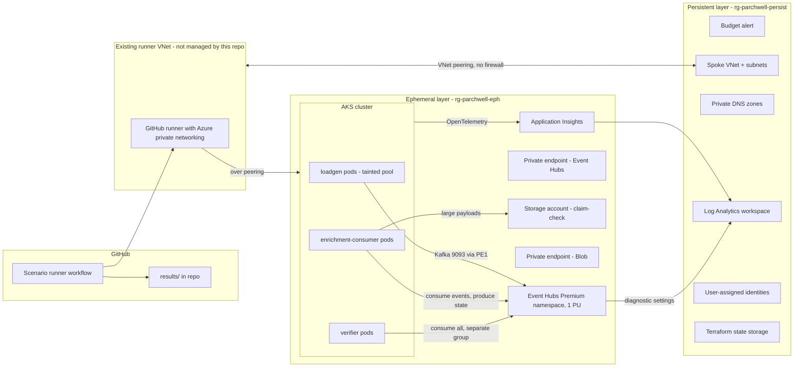

# eventhubs-kafka-dotnet: blueprint

Status: approved by Hari on 2026-10-11.
Inventory frozen: 2026-10-11. Amended once, by Hari on 2026-10-12 (amendment 1, section 12). Anything else found later goes to v1.1.

Conventions used in this document:
- **Fact** means stated by a cited source, with the source's last-updated date.
- **Inference** means reasoning from facts, not yet tested.
- **Estimate** means a planning number, not a measurement. No number in this document is a measurement. Measured results only appear after the harness has run, with method.

---

## 1. Thesis

This repo proves to Azure architect hiring managers that Hari validates vendor guidance empirically: for .NET services using the Kafka protocol on Azure Event Hubs, what the documentation says, what actually happens, what breaks when the guidance is ignored, how each failure surfaces in a .NET service, and how operations detects it.

---

## 2. Business case

**Parchwell** is a fictional UK legal SaaS company. It runs a multi-tenant document-processing platform for UK law firms. Each law firm is a tenant. All figures below are fictional design inputs chosen so that the inventory scenarios arise naturally; none are measurements.

### Workload

A matter is one legal case or transaction. Firms load documents into matters, sometimes thousands at once (disclosure in litigation, data rooms in corporate deals). Each document produces five lifecycle events: `uploaded`, `ocr-started`, `ocr-finished`, `classified`, `indexed`. A compacted topic holds each document's current state. A document deletion produces a tombstone on that topic.

### Production-scale profile (design input)

| Input | Value |
|---|---|
| Tenants | 250 law firms; skewed, the top 10 firms produce about half the volume |
| Documents per business day | 400,000 across all tenants |
| Events per document | 5 |
| Events per day | about 2,000,000, mostly 08:00 to 19:00 UK time |
| Peak burst | one firm loads 20,000 documents into one matter over about 10 minutes |
| Concurrent bursts | up to 3 firms at once |
| Status event size | 1 to 4 KB |
| OCR-result event size (text inline) | median 150 KB, p99 900 KB, about 1% over 1 MB |
| Consumer processing time | status 5 ms; enrichment 200 ms to 5 s; rare outliers of 6 minutes |
| Quiet periods | 22:00 to 06:00 near zero; individual tenants idle well past 240 s during the day |

Why some values exist:
- The 6-minute outliers exceed the 300,000 ms default `max.poll.interval.ms`.
- The over-1 MB tail triggers the Event Hubs request size limit and justifies claim-check (ADR-006).
- Tenant idle periods over 240 s trigger the Azure idle-connection cutoff.
- The burst shape makes processing unit (PU) saturation a natural business event, not an artificial load test.

### Build-scale profile (what the harness runs)

Same shape, scaled down: 10 tenants, bursts of 2,000 documents. A separate saturation profile ramps load until Event Hubs pushes back, because the saturation point of 1 PU for this shape is unknown until measured (inventory item H07).

### Ordering requirement

Events must be ordered per document. Order across documents in a matter has no business meaning. The one matter-wide action, legal hold, is protected by a state check, not by stream order (ADR-001, failure mode FM-10).

---

## 3. Architecture



### Persistent layer

Holds everything that costs little or nothing while idle, or that must survive teardown. The Azure budget alert (rule 5, applied before any other resource). A spoke VNet with subnets for AKS nodes and private endpoints, peered directly to Hari's existing runner VNet, which hosts the GitHub runner with Azure private networking. There is no hub and no firewall in the path. The runner VNet is not managed by this repo. Private DNS for `privatelink.servicebus.windows.net` and `privatelink.blob.core.windows.net` must resolve from both the spoke and the runner VNet. Both zones are platform prerequisites created outside this repo by `scripts/prerequisites.ps1` (ADR-010); this repo links them to the spoke and writes records into them. Teams that run behind a hub firewall: see [docs/networking/hub-firewall.md](networking/hub-firewall.md). The Log Analytics workspace, so run history survives teardown. User-assigned managed identities for each workload. Terraform state in a storage account with Entra authentication and shared key access disabled. The spoke VNet is persistent because recreating it would mean recreating both sides of the peering every session, and the runner side lives outside this repo. Spoke address space must not overlap the runner VNet or anything else peered to it.

### Event Hubs Premium namespace

Premium tier, 1 PU, UK South, availability zones (Fact: Premium has zone support from the first PU; source S4). `disableLocalAuth = true`, public network access disabled, minimum TLS 1.2 (Fact: Premium supports TLS 1.2 or greater; S4). Three event hubs (Kafka topics), all provisioned by Terraform through ARM, not by the Kafka AdminClient (ADR-002):

| Event hub | Purpose | Cleanup policy | Partitions (design input) |
|---|---|---|---|
| `document-events` | lifecycle events | delete, 7 days retention | 32 |
| `document-state` | latest state per document | compact | 32 |
| `document-events-dlq` | poison messages | delete, 7 days retention | 4 |

Limits that shape this (Fact, S3, updated 2026-02-06): 1 MB maximum publication on Premium, applied whether a single event or a batch; 100 partitions per event hub with 200 per PU at namespace level; 100 consumer groups per event hub; 1,000 Kafka consumer groups per namespace; 10,000 brokered connections per PU; 90 days maximum retention; compacted event hub size 250 GB per partition.

### Private endpoints

One private endpoint for the Event Hubs namespace and one for Blob, both in the private-endpoint subnet, with DNS zone groups writing A records into the persistent zones. Kafka traffic uses port 9093 over SASL_SSL (Fact: the bootstrap server is `<namespace>.servicebus.windows.net:9093` in S1, and S2 lists port 9093 as the port that must not be blocked). TLS is required for all Kafka traffic to Event Hubs (Fact: S15). No source documents a listener on 9092, the Apache Kafka plaintext default; that absence is inference until A05 confirms it.

### AKS cluster

Free tier control plane at build scale (no SLA; acceptable for a test harness). OIDC issuer and workload identity enabled. Azure CNI overlay. Entra integration with local accounts disabled and Azure RBAC for Kubernetes authorisation. Kubernetes version: latest GA minor at apply time, pinned in Terraform. Three node pools on normal (not spot) capacity, all `Standard_D4ds_v5`:

| Pool | Nodes | Purpose |
|---|---|---|
| `system` | 1 | system pods only (`CriticalAddonsOnly` taint) |
| `workload` | 1 | enrichment-consumer and verifier: the clients under test |
| `loadgen` | 1, scale to N for saturation runs | load generation only, tainted so it never shares a node with clients under test |

Normal pools, not spot: a spot eviction mid-run looks like a client failure and contaminates results (ADR-008).

### Workloads (.NET 10, Confluent.Kafka 2.16.0 pinned)

Fact: Confluent.Kafka 2.16.0 was released 2026-10-07, targets net8.0 and net10.0, and depends on librdkafka.redist 2.16.0 or later (S12). Every result records the exact Confluent.Kafka and librdkafka versions.

- **`Parchwell.Kafka` (shared library).** The guidance as code: an Event Hubs configuration builder with every setting traceable to an inventory item; the Entra OAUTHBEARER token refresh handler (ADR-003); the librdkafka statistics to OpenTelemetry bridge (ADR-007); graceful shutdown (flush on stop, close on stop, commit on partition revoke). Each setting's XML doc comment links to its inventory item and result.
- **`loadgen`.** Deterministic, seeded producer. Reads a workload profile file and emits lifecycle events with tenant, document id, and a per-key sequence number in headers. Same seed, same schedule, every run.
- **`enrichment-consumer`.** The consumer under test. Simulates processing time per event type from the profile, can be told to fail a set percentage of messages, writes the document's latest state to `document-state`, writes large payloads to Blob and references them (ADR-006).
- **`verifier`.** A separate consumer group reading every topic. Checks per-key sequence numbers against the loadgen manifest and emits counts of gaps (loss), duplicates, and reorders. This is what makes loss and reordering measurable instead of inferred.

### Scenario runner

A GitHub Actions workflow on Hari's existing GitHub-hosted runner with Azure private networking, which sits in the existing runner VNet and reaches the spoke over peering. The workflow triggers only on `workflow_dispatch` and `schedule`, never on pull requests, because the repo is public and fork pull requests must never run on a runner inside the network. Per scenario: `terraform apply` for the ephemeral layer, deploy the scenario's Helm values, run, collect KQL results, write `results/<scenario-id>/<utc-date>.json`, `terraform destroy`. Authentication to Azure through GitHub OIDC federation; no stored secrets.

### Observability

Single Azure Monitor backbone (ADR-007). Workspace-based Application Insights receives OpenTelemetry from every workload through the Azure Monitor exporter. Event Hubs diagnostic settings send resource logs to resource-specific tables (Fact: tables include `AZMSKafkaCoordinatorLogs`, `AZMSKafkaUserErrorLogs`, `AZMSApplicationMetricLogs`, `AZMSRunTimeAuditLogs`, `AZMSDiagnosticErrorLogs`; runtime audit logs are Premium-only; S10) and platform metrics to `AzureMetrics`.

---

## 4. Key decisions

### ADR-001: Partition key is `tenantId-documentId`

**Context.** Per-document order matters; cross-document order does not. A 20,000-document burst from one firm must not be processed by a single consumer.

**Options considered.**
1. Key by matter (`tenantId-matterId`). Preserves matter order. A burst lands on one partition, so one consumer processes it alone while the others idle (hot partition).
2. Key by document (`tenantId-documentId`). Preserves per-document order. A burst spreads across all partitions.
3. Null key with round-robin or sticky partitioning. Maximum spread, no ordering at all.

**Decision.** Option 2.

**Consequences.**
- Burst throughput scales with partitions and consumers.
- One firm's burst now touches every partition, so other firms' events queue behind it everywhere (noisy-neighbour impact widens). Measured by C19. The structural fix is lane separation (ADR-009, deferred).
- Legal hold cannot rely on stream order; the delete handler checks hold state in the authoritative store (FM-10).
- Partition count changes remap keys (Fact: S5), so partition scale-up on `document-events` breaks per-document order for in-flight documents (D02).

### ADR-002: Terraform owns topics; partition counts are fixed for compacted hubs

**Context.** Two Microsoft pages disagree. The client configuration page (S1, updated 2026-01-28) lists "Kafka AdminClient for topic management" as not available. The partitions page (S5) says to use the AlterTopics API, for example via the kafka-topics CLI, to increase partition count.

**Options considered.**
1. Kafka AdminClient from application code.
2. Terraform through ARM (`azurerm_eventhub`).
3. Both: Terraform creates, AdminClient alters.

**Decision.** Option 2, regardless of what D01 finds. Partition count on `document-state` is fixed at creation; changing it means create-new, backfill, and cut over, not scale-up in place. This is provisional pending E04.

**Consequences.**
- Topic configuration is reviewed in pull requests and drift-detected by `terraform plan`.
- Applications get no topic-creation rights, which tightens RBAC (ADR-003).
- If E04 shows partition scale-up on a compacted hub is safe, the fixed-count rule relaxes in v1.1. If it shows state splitting, the rule becomes a headline finding.

### ADR-003: Entra-only authentication with AKS workload identity and a custom OAUTHBEARER refresh handler

**Context.** Microsoft's Kafka configuration page lists SASL PLAIN with a connection string as the required connection settings (Fact: S1). Microsoft's Kafka developer guide lists OAuth samples for Java and Go (Fact: S11); I found no Microsoft sample for Confluent.Kafka with Entra, and none for AKS workload identity. librdkafka has a built-in `sasl.oauthbearer.metadata.authentication.type = azure_imds` (Fact: S6), which authenticates through the Azure Instance Metadata Service. AKS workload identity uses a projected service account token exchanged with Entra, not IMDS (inference from how workload identity works; F02 tests it).

**Options considered.**
1. SAS connection strings (PLAIN).
2. librdkafka built-in OIDC client credentials (`sasl.oauthbearer.method = oidc`) with a client secret.
3. librdkafka `azure_imds`.
4. Confluent.Kafka `SetOAuthBearerTokenRefreshHandler` calling `WorkloadIdentityCredential` (Azure.Identity) for scope `https://<namespace>.servicebus.windows.net/.default`.

**Decision.** Option 4. Local authentication disabled on the namespace. One user-assigned identity per workload: `loadgen` gets Azure Event Hubs Data Sender on `document-events` only; `enrichment-consumer` gets Data Receiver on `document-events` and Data Sender on `document-state` and the DLQ; `verifier` gets Data Receiver only.

**Consequences.**
- No secrets anywhere in the cluster or the repo.
- The refresh handler is the repo's own code, so its failure modes are the repo's responsibility (F03, FM-06).
- Federated credentials must be recreated per cluster, because the OIDC issuer URL changes when the cluster is recreated. Identities live in the persistent layer; federated credentials in the ephemeral layer.
- SAS scenarios are out of scope (F05 only tests that SAS is rejected).

### ADR-004: Premium with private endpoint only; persistent network layer

**Context.** Parchwell holds UK law firms' client documents. Public data-plane exposure is not acceptable.

**Options considered.**
1. Public endpoint with IP firewall rules.
2. Private endpoint with public network access disabled.
3. Dedicated tier for single-tenant isolation.

**Decision.** Option 2 on Premium. Dedicated rejected on cost and minimum scale for zone redundancy (Fact: Dedicated needs 8 CUs for availability zone support; S4).

**Consequences.**
- All clients, including the test runner, must be inside the VNet or peered.
- Private DNS becomes a failure domain (A06, FM-07).
- Kafka over private endpoint behaviour is assumed identical to public; A06 and the baseline runs confirm it.

### ADR-005: At-least-once delivery with store-after-process offsets and idempotent consumers

**Context.** Microsoft's configuration page lists transactions and exactly-once semantics as not supported (Fact: S1); its transactions guide says Kafka transactions are in public preview on Premium and Dedicated (Fact: S18). The two pages conflict (section 12, conflict 6). The same page's Java table says to keep `enable.idempotence` enabled "for exactly-once producer semantics" (Fact: S1). librdkafka's default for `enable.idempotence` is `false` (Fact: S6). Offset commits are throttled to 2 calls per second per partition (Fact: S2).

**Options considered.**
1. Transactions: rejected for v1. Microsoft's pages conflict on whether they are supported, and the most favourable reading is public preview, which this repo does not build its baseline on. B05 tests what actually happens on the Premium namespace.
2. Auto-commit with default auto offset store: offsets can be committed before processing finishes, so a crash loses messages.
3. Synchronous commit per message: hits the commit throttle.
4. Auto-commit with `enable.auto.offset.store = false`, storing each offset only after processing (Fact: this pattern is recommended in librdkafka's description of `max.poll.interval.ms`; S6). Consumers deduplicate by `documentId` plus sequence number.

**Decision.** Option 4. Producer idempotence setting is decided by B04's result, not assumed.

**Consequences.**
- Duplicates are expected after rebalances and crashes; the verifier counts them, consumers absorb them.
- Commit frequency is bounded by `auto.commit.interval.ms`, not message rate.
- Exactly-once claims are explicitly not made.

### ADR-006: Claim-check for large payloads

**Context.** Requests over 1,046,528 bytes close the connection (Fact: S1). The limit applies to batches too (Fact: S3). librdkafka's `message.max.bytes` and `batch.size` both default to 1,000,000, and librdkafka notes the producer "may exceed the maximum size by one message" (Fact: S6). OCR outputs have a tail over 1 MB (design input).

**Options considered.**
1. Inline everything; split oversized text across several events.
2. Inline everything; reject oversized documents.
3. Claim-check: payloads over a threshold go to Blob; the event carries a reference.

**Decision.** Option 3. Inline threshold 256 KB as a design starting point, tuned from B01 and B02 results.

**Consequences.**
- Events stay well below the limit, so batching cannot accidentally cross it.
- A second store joins the failure domain: the event can arrive before the blob is readable, or the blob can be deleted under retention while the event survives (FM-11).
- Blob access is Entra-only with shared key disabled, over private endpoint.

### ADR-007: Single Azure Monitor backbone

**Context.** Microsoft states that Kafka throttling delays are mostly not logged in the ThrottledRequests metric; the `throttle_time_ms` in the produce or fetch response is the real indicator (Fact: S2). librdkafka exposes per-broker throttle time as rolling window statistics (`brokers.<name>.throttle`) and per-partition `consumer_lag` (Fact: S7).

**Options considered.**
1. Azure Monitor only: OpenTelemetry to Application Insights, Event Hubs diagnostics, one Log Analytics workspace.
2. Managed Prometheus and Managed Grafana.
3. Both.

**Decision.** Option 1. `statistics.interval.ms = 15000` as a starting point; statistics are flattened to OpenTelemetry metrics with low-cardinality dimensions.

**Consequences.**
- One KQL query can join client-observed throttling with platform metrics; that join is the evidence for several inventory items.
- KQL detection rules are directly reusable by Azure-centric operations teams.
- Log Analytics charges per GB ingested (Fact: GBP 2.173667 per GB after the first 5 units in UK South; S9). High-cardinality per-partition metrics are the cost risk; ingestion per run hour becomes a measured number.
- Managed Prometheus is deferred, recorded in section 6.

### ADR-008: AKS-only harness on normal node pools, tainted load pool, seeded workload

**Context.** The harness must produce reproducible, comparable results.

**Options considered.**
1. Load from Azure Container Apps, clients on AKS.
2. Everything on AKS, spot pools.
3. Everything on AKS, normal pools, load generation on a separate tainted pool.

**Decision.** Option 3, with a deterministic seeded workload published as a profile file.

**Consequences.**
- One identity path (workload identity) and one network path.
- Spot evictions cannot masquerade as client failures.
- Load pods cannot steal CPU or network from clients under test on the same node.
- Higher cost per running hour than spot, so teardown discipline carries more weight.

### ADR-009 (option, deferred): Bulk and interactive lanes

**Context.** ADR-001 spreads a bulk load across all partitions, so a single-document upload by a lawyer can queue behind another firm's bulk load.

**Option.** Separate topics for bulk and interactive uploads, with separate consumer groups and capacity.

**Status.** Recorded, not built in v1. C19 measures the noisy-neighbour effect without lanes; that measurement is the evidence for or against building them.

### ADR-010: Platform prerequisites live outside this repo's Terraform

**Context.** The GitHub runner's VNet was created by hand and is shared with Hari's other repos. Clients in the spoke and the runner must both resolve the Event Hubs and Blob private endpoints to private addresses. A VNet can be linked to only one private DNS zone of a given name, so whichever repo owns `privatelink.blob.core.windows.net` decides for every repo that uses this runner.

**Options considered.**
1. This repo creates and owns both zones. Self-contained, but every later repo that needs the runner to reach a private endpoint depends on this repo's Terraform state.
2. A platform Terraform repo imports the runner VNet and owns the zones. The cleanest end state, but a new repo of scope unrelated to this thesis.
3. Zones created once by a committed script, outside every repo's Terraform, alongside the hand-built runner VNet. Each repo references the zones and manages only its own links and records.

**Decision.** Option 3. `scripts/prerequisites.ps1` creates resource group `rg-platform-privatedns`, both zones, and their links to the runner VNet, and protects each zone. Both sides of the spoke-to-runner peering are created by this repo's persistent-layer Terraform (decided 2026-10-11). Terraform runs as an app registration that Hari creates and grants permissions to; the identity and its role assignments are outside this repo. This repo's Terraform reads the zones as data sources, creates the spoke links, and lets private endpoint DNS zone groups write the A records. A `create_private_dns_zones` variable (default `false`) lets a standalone deployer create the zones inside this repo instead.

**Protection, and why not a resource group lock.** Microsoft states that locks are inherited by child resources, so a delete lock on the zone or its resource group would block deleting record sets (Fact: S16). Each session's teardown deletes the private endpoints, and with them their A records, so such a lock would break `terraform destroy` every session. Instead, following S16, a `CanNotDelete` lock on each zone's SOA record set, which blocks deleting the zone while leaving other record sets free to change. S16 notes record-set locks can only be created with Azure PowerShell, which is why the script is PowerShell.

**Consequences.**
- Repos stay independent of each other's Terraform state.
- Platform drift is invisible to `terraform plan`. A deleted runner-VNet link makes the runner resolve public addresses and fail against a namespace with public access disabled (FM-07).
- Rebuilding the platform means re-running the script, so it must stay idempotent and in the repo.
- Exit path: if a platform repo ever exists, it adopts the zones with Terraform `import` blocks; this repo changes nothing but the data source location.


### ADR-011: Terraform with Azure Verified Modules where they cover the need

**Context.** Hari's direction (2026-10-11): peerings and private DNS A records are created by Terraform, using Azure Verified Modules (AVM) where possible. AVM modules are Microsoft-maintained Terraform modules with a common interface for private endpoints, diagnostic settings, role assignments and locks. Some are young and do not yet expose every property this repo needs.

**Options considered.**
1. Plain `azurerm` and `azapi` resources throughout.
2. AVM modules for every component, accepting their gaps.
3. AVM modules where they expose what the design needs; a plain `azapi` or `azurerm` resource where they do not, with each gap recorded here.

**Decision.** Option 3. Every module is pinned to an exact version. Mapping, as checked on 2026-10-11 against the Terraform Registry (S17):

| Component | AVM module | Version checked | Use and known gaps |
|---|---|---|---|
| Spoke VNet, subnets, peering both ways | `Azure/avm-res-network-virtualnetwork/azurerm` | 0.22.2 (2026-08-28) | `peerings` with `create_reverse_peering = true` creates the runner-side peering from the same call. Uses the `azapi` provider |
| Spoke links to the manual DNS zones | `Azure/avm-res-network-privatednszone/azurerm`, submodule `private_dns_virtual_network_link` | 0.5.0 (2026-02-12) | Takes the existing zone's ID as `parent_id`, so it works against zones this repo does not own |
| Event Hubs namespace, event hubs, private endpoint | `Azure/avm-res-eventhub-namespace/azurerm` | 0.1.1 (2026-10-06) | Very new. Its README documents `capacity` for Standard throughput units only, and documents no input for minimum TLS or a compaction cleanup policy. If the build confirms those gaps, `document-state` and the TLS setting fall back to `azapi` resources |
| Claim-check storage, private endpoint | `Azure/avm-res-storage-storageaccount/azurerm` | to pin at build | |
| AKS cluster | `Azure/avm-res-containerservice-managedcluster/azurerm` | to pin at build | |
| Workload identities | `Azure/avm-res-managedidentity-userassignedidentity/azurerm` | to pin at build | |
| Log Analytics workspace | `Azure/avm-res-operationalinsights-workspace/azurerm` | to pin at build | |
| Application Insights | `Azure/avm-res-insights-component/azurerm` | to pin at build | |
| Budget alert | none found in the AVM resource module index | | Plain `azurerm` resource |

**A records.** Created by Terraform through each private endpoint's DNS zone group (the `private_endpoints` input with `private_dns_zone_resource_ids` on the Event Hubs and storage modules). The zone group writes the A record when the private endpoint is created and removes it when the endpoint is destroyed, so the record cannot drift from the endpoint's IP. The `private_dns_a_record` submodule is available but not used, because a hand-declared record duplicates what the zone group manages.

**Consequences.**
- Common interfaces for private endpoints, diagnostics and role assignments across components.
- Two providers (`azurerm` and `azapi`) in one configuration, because several AVM modules use `azapi`.
- Young modules can change inputs between minor versions. Exact pins, and upgrades only in their own pull requests.
- Each gap found during the build is recorded in this ADR's table, which is itself a finding for readers using AVM with Event Hubs.


### ADR-018: Either tool implements; Codex reviews every pull request; the factory runs on plans, not metered keys

**Context.** The factory operating model approved on 2026-10-12 bound the two tools to fixed roles: Claude Code implements, Codex reviews. Hari's Claude Max plan has usage limits, and when they are reached the factory has no implementer. Hari's requirement (2026-10-13): either Claude Code or Codex must be able to implement an issue. The reviewer then has to be decided. Six ADRs for issue #8 are on branch `claude/issue-8-code-half-adrs`, not yet merged, and take the six numbers after ADR-011, so this decision takes ADR-018.

What the tools offer, verified 2026-10-13:
- Codex's GitHub Action takes an API key and runs `codex exec` (S30, S31). Its GitHub integration reviews a pull request automatically or on `@codex review`; any other `@codex` comment starts a legacy cloud chat with the pull request as context; it posts as the bot `chatgpt-codex-connector` (S32). No issue or label trigger is documented. Its current cloud environments start from the app, mobile, Slack or Teams; no GitHub event, API or CLI trigger is documented, and the GitHub integration runs on "Codex Cloud (Legacy)", which OpenAI says it plans to deprecate, with no date (S33). Inferred from S30 to S33, not stated by any of them: the only documented way to start a Codex implementation task from a GitHub event without a person is the GitHub Action, on an API key (reviews start on their own, S32).
- Codex plan usage is shared: "Local messages and cloud chats share your plan's usage allowance", and "Weekly limits may also apply" (S34). Codex code review has refused reviews with "You have reached your Codex usage limits for code reviews" while the account's dashboard showed 73% of the weekly allowance remaining (Pro plan, 2026-10-09; a second report at 48%). The issue is open and unassigned (S35).
- Claude Code's GitHub Action authenticates with an API key, a subscription OAuth token ("runs use your Claude subscription instead of API billing"), or Microsoft Foundry through OIDC, among other providers it lists (S36). Codex CLI runs against Azure OpenAI in Foundry through a `model_providers.azure` entry in `config.toml`, including `codex exec` in GitHub Actions, with an API key only: "Entra ID support is currently not available for Codex" (S37).
- GitHub Copilot code review reads `AGENTS.md` (since 2026-06-18) and `CLAUDE.md` and `REVIEW.md` (since 2026-07-17) (S38, S39). Since 2026-08-27 it reviews bot-authored pull requests automatically when the organization policy allowing members without a licence to use code review is on, and will "bill the usage directly to your organization" (S40). Under the default Member billing option, "If the member's quota is exhausted, the code review fails"; the Organization option bills the organization and needs AI-credit paid usage enabled (S44). It can approve pull requests in public preview since 2026-09-01, off by default (S41). Its models are not named and not selectable: GitHub's documentation, as quoted in S42, says it "uses a carefully tuned mix of models" and "Model switching is not supported". For scale only, on the legacy premium-request billing that applies to Copilot Pro and Pro+, not to this organization's Business plan, a review costs 13 requests against 300 per month on Pro (S43). The organization has Copilot Business with one seat at USD 19 per month (S46).
- A study of 248,641 agent-authored pull requests that received an AI review (CodAGE, a dataset of coding-agent GitHub events, January 2024 to April 2026) found 208,145, about 84%, reviewed by the same product that wrote them. It measured who reviewed whom, not review quality; the risk it names is correlated blind spots. For OpenAI Codex it found no difference in review output between same-product and cross-product pairs (0.89 against 0.91 comments per pull request). Its recommendation is that the reviewing agent be a different product from the author, enforced by a required status check that reads the pull request's authoring signature (S45).

**Options considered.**
1. Keep the 2026-10-12 binding. Rejected: it is the binding that leaves the factory idle when Claude is capped.
2. Both tools in GitHub Actions on metered API keys through Microsoft Foundry, each reviewing the other's pull requests. Removes plan limits from the factory and bills both tools to the Azure subscription next to the Event Hubs spend. Rejected by Hari for cost: it adds metered token spend on top of the plans already paid for.
3. GitHub Copilot code review as the gate for every pull request, either tool implementing. Always available whichever tool implemented; reads AGENTS.md. Rejected by Hari for cost: reviews of the factory's bot-authored pull requests are billed to the organization (S40), and, inferred from S44 rather than stated, need AI-credit paid usage enabled on it, which is spend beyond the seat already paid for; and the reviewer's model family cannot be verified, so it does not give the independence that option 2 gives.
4. Either tool implements, chosen per issue; Codex reviews every pull request, including the ones Codex wrote; both tools run on Hari's plans (Claude Max, ChatGPT Pro). No new spend. Same-vendor review on Codex-authored pull requests, accepted as a measured risk.

**Decision.** Option 4. Hari names the implementing tool when he approves the plan. The branch prefix, `claude/` or `codex/`, names it for readers. The merge workflow planned under issue #17 will read the `Co-Authored-By` trailers on the pull request's commits, following S45's advice to read the authoring signature, which every agent commit already carries, and will label the pull request `same-vendor-review` when any remaining commit, after the merge commits and untrailed commits by Hari's account that AGENTS.md "Implementer and reviewer" tells it to ignore, carries a Codex trailer or no tool trailer, and will remove the label on a later push when none does; agents never apply or remove that label. A wrong trailer, and an untrailed commit under Hari's account, are not detected. The merge rule requires a completed Codex review of the head commit (issue #17); when none has arrived within the timeout in docs/agents/factory.md "Escalation", the pull request escalates to Hari and does not merge, whatever the cause. Every such event, and every escape (a valid P0 or P1 finding the cold review should have caught; defined in docs/agents/factory.md by PR #38), is recorded under issue #17 split by same-vendor and cross-vendor, so the risk accepted here is measured rather than assumed. Hari's reasoning on the pause risk: the pause happens only when Codex review does not post; ChatGPT Pro being exhausted is unlikely in any given period, and the S35 refusals, which occur with allowance remaining, are the likelier cause; the timeout escalation handles both causes the same way.

**Consequences.**
- The factory pauses, rather than merging unreviewed, whenever Codex review does not post. The rate of that is unknown until measured; S35 shows it is not zero. If the pilot finds that Codex posts only a reaction on a clean pull request (issue #17), no clean pull request satisfies the merge rule until the merge workflow obtains a completed review (docs/agents/factory.md "Escalation").
- Codex-authored pull requests have no reviewer from another vendor. Protected paths and the verifier still need Hari's approval, so the oracle and the public claims are never exposed to same-vendor review alone.
- The weekly spot-check (docs/agents/factory.md, "Measuring the gate") takes `same-vendor-review` pull requests first.
- GitHub Copilot code review stays switched off. The reason recorded on 2026-10-12, that it answers to none of the rules in AGENTS.md, was wrong (S38); the reasons now are that its threads block agent merges through conversation resolution, and cost.
- Exit path: if the measured escape rate on same-vendor pull requests exceeds the cross-vendor rate, or the pause rate costs Hari more than the metered spend would, option 2 is the next step. The implementer roles stay; Claude gains the reviewer role for Codex-authored pull requests, and credentials move to metered keys.
- A Codex implementation path in GitHub Actions does not exist yet. Until one is built, Codex implements only in sessions Hari starts himself, as on [cdc-platform-azure](https://github.com/collaborationwithothers/cdc-platform-azure).

---

## 5. Failure modes

Each entry links to the inventory items that test it. Detection queries are in section 10.

**FM-01: Throttling invisible on the dashboard.**
- Trigger: load beyond what the PUs can absorb.
- Blast radius: all producers and consumers on the namespace.
- Detection: client-side `kafka.broker.throttle.max_ms` rising while platform `ThrottledRequests` stays flat (Fact basis: S2). Query Q1.
- Mitigation: alert on client throttle, not platform metric; scale PUs; producer backpressure.
- Not protected against: sustained overload beyond 16 PUs (Fact: Premium maximum; S3).
- Inventory: B09, C05, H01, H07.

**FM-02: Idle connection dropped by Azure.**
- Trigger: a tenant idle for more than 240 s, then a produce (Fact: Azure closes idle connections after 240 s; S1).
- Blast radius: that client's first sends after the idle period.
- Detection: delivery failures or latency spikes after idle; broker `disconnects` and `connects` counters.
- Mitigation: `socket.keepalive.enable = true`, `metadata.max.age.ms = 180000`, and whatever A04 shows about `connections.max.idle.ms`.
- Not protected against: network paths that drop keepalives.
- Inventory: A02, A03, A04.

**FM-03: Oversized request closes the connection.**
- Trigger: a single event, or a batch of individually valid events, over the request limit.
- Blast radius: every message in the in-flight request.
- Detection: delivery errors and disconnects correlated with large messages.
- Mitigation: claim-check (ADR-006); explicit `message.max.bytes` and `batch.size` below the limit.
- Not protected against: a producer outside `Parchwell.Kafka` that bypasses the configuration builder.
- Inventory: B01, B02.

**FM-04: Rebalance storm.**
- Trigger: processing longer than `max.poll.interval.ms`, timeouts set too low, or rolling deploys.
- Blast radius: the whole consumer group stops consuming during each rebalance.
- Detection: `kafka.cgrp.rebalance_cnt` rising, lag rising, no errors (Fact basis: "no exception or error" when stuck rebalancing; S2). Query Q3.
- Mitigation: store-after-process with bounded processing time; slow work handed off rather than done in the poll loop; static membership if C06 shows it works.
- Not protected against: a consumer bug that blocks the poll loop indefinitely.
- Inventory: C01, C02, C03, C04, C06, C07.

**FM-05: Poison message.**
- Trigger: an event the consumer cannot process.
- Blast radius: the partition it sits on stalls.
- Detection: repeated processing failures for one offset; lag on one partition only.
- Mitigation: bounded retries, then DLQ with original headers.
- Not protected against: a poison event that crashes the process before the DLQ write.
- Inventory: C17.

**FM-06: Token acquisition or refresh fails.**
- Trigger: Entra outage, deleted federated credential, missing role.
- Blast radius: every client using that identity, once its current token expires.
- Detection: refresh-handler error metric; `AZMSRunTimeAuditLogs` authentication failures (columns to confirm at first run).
- Mitigation: refresh well before expiry; alert on refresh failure, not on eventual disconnect.
- Not protected against: a prolonged Entra outage.
- Inventory: F01, F03, F04.

**FM-07: Private DNS resolves the public address.**
- Trigger: missing VNet link, zone group, or a custom DNS forwarder misconfiguration, with public access disabled.
- Blast radius: every client in the affected network.
- Detection: connection failures at bootstrap; `AZMSVnetConnectionEvents`.
- Mitigation: DNS zone groups and spoke links managed by Terraform; runner-VNet links created by `scripts/prerequisites.ps1` and protected by the SOA lock (ADR-010); a startup probe in every workload and a first step in the scenario workflow that resolve the namespace and fail fast on a public address.
- Not protected against: DNS changes outside Terraform.
- Inventory: A06.

**FM-08: Partition added, keys remapped.**
- Trigger: partition count increase on a keyed topic.
- Blast radius: ordering for every key that moves; for compacted topics, possibly the correctness of state.
- Detection: verifier reorder counts after the change; state comparison for compacted topics.
- Mitigation: no partition scale-up on keyed topics without draining (Fact basis: S5); fixed counts on compacted topics (ADR-002).
- Not protected against: someone changing partition count outside Terraform.
- Inventory: D02, E04.

**FM-09: Missed tombstone.**
- Trigger: a consumer offline for longer than the tombstone retention time.
- Blast radius: deleted documents survive in that consumer's local state.
- Detection: periodic reconciliation against the authoritative store.
- Mitigation: rebuild local state from the start of the compacted topic after long downtime.
- Not protected against: a reconciliation job that is itself not running.
- Inventory: E03.

**FM-10: Delete processed before legal hold.**
- Trigger: hold and delete events for documents in the same matter land on different partitions (ADR-001).
- Blast radius: a document under hold is deleted. Legal consequence, not just a data defect.
- Detection: audit of deletes against hold history.
- Mitigation: the delete handler checks current hold state in the authoritative store before acting.
- Not protected against: the authoritative store itself being stale.
- Inventory: E06.

**FM-11: Claim-check reference broken.**
- Trigger: event consumed before the blob write is visible, or blob deleted before the event is consumed.
- Blast radius: the affected documents' enrichment.
- Detection: blob-not-found counter.
- Mitigation: write blob before producing the event; blob retention at least event retention plus replay window.
- Not protected against: manual deletion of blobs.
- Inventory: B11.

**FM-12: Regional outage.**
- Trigger: UK South unavailable.
- Blast radius: the whole platform.
- Detection: client connection failures; replication lag metric if geo-replication is enabled.
- Mitigation: geo-replication with customer-initiated promotion, if UK West supports it (open item).
- Not protected against: in v1, the application tier itself; the harness runs in one region.
- Inventory: G01, G02, G03, G04.

Deliberately not protected in v1, across the design: egress data exfiltration from AKS (no egress firewall at build scale); customer-managed keys; a compromised workload identity acting within its granted roles.

---

## 6. Trade-offs

| Traded | For | The opposite wins when |
|---|---|---|
| Matter-level ordering | Burst throughput (ADR-001) | Cross-document order carries business meaning, or bursts are rare and small |
| Noisy-neighbour isolation | Simpler topology, no lanes in v1 | C19 shows interactive latency breaching target during bursts |
| Kafka-native topic management | Reviewed, drift-detected IaC (ADR-002) | Teams self-serve topics at a rate that makes pull requests a bottleneck |
| Exactly-once | Simplicity, and availability on Event Hubs (ADR-005) | The platform supports transactions, and duplicates are costly to absorb |
| Inline payloads | Request-size safety (ADR-006) | Payloads are uniformly small, or a second store is operationally unacceptable |
| Prometheus storage economics | One query language, one place to correlate (ADR-007) | The organisation already standardises on Prometheus and Grafana across many clusters |
| Cheap spot capacity | Clean, reproducible measurements (ADR-008) | The workload is batch, interruption-tolerant, and not being measured |
| Public endpoint simplicity | Data-plane isolation (ADR-004) | Clients outside Azure cannot reach the VNet and private connectivity is not available |
| Standard tier cost | Premium isolation, partition scale-up, compaction size, runtime audit logs | Throughput fits Standard, and these features are not needed |

---

## 7. Performance

Targets only. No results exist yet. Each result will state method: profile file, seed, repeat count, Confluent.Kafka and librdkafka versions, PU count, node size, date.

| Target | Value |
|---|---|
| Message loss | zero, per verifier, on every non-failure scenario |
| Per-document reordering | zero, per verifier, outside scenarios that deliberately change partitions |
| Duplicates | allowed; counted and reported, never silently absorbed |
| Burst drain at build scale | 2,000-document burst (10,000 events) drained to zero lag within 5 minutes on 1 PU (target, unverified) |
| Interactive event latency during a burst | p99 produce-to-consume under 2 s, excluding simulated processing time (target) |
| Repeat count | at least 5 runs per scenario configuration; results reported as distributions, not single values |

Open measurement: H07, the PU saturation point for this workload shape. Production capacity planning depends on it.

---

## 8. Cost

All prices are UK South retail list prices in GBP from the Azure Retail Prices API on 2026-10-11 (S8, S9). Estimates, not actuals.

### Unit prices

| Item | Price |
|---|---|
| Event Hubs Premium, per PU | GBP 0.9691 per hour (about GBP 707 per 730-hour month) |
| `Standard_D4ds_v5` Linux, pay-as-you-go | GBP 0.197743 per hour |
| Log Analytics, Analytics Logs ingestion | GBP 2.173667 per GB after the first 5 units |
| Log Analytics, Analytics Logs retention | GBP 0.098117 per GB per month |
| Event Hubs geo-replication data transfer, Zone 1 | GBP 0.0679 per GB |
| AKS Free tier control plane | no charge (not re-verified in this pass; confirm) |
| Private endpoints | not yet priced; small, confirm |

### Build scale

Harness running cost (1 PU, 3 nodes): about GBP 1.56 per hour, plus Log Analytics ingestion and private endpoints.

- Always-on would be about GBP 1,140 per month. Teardown is mandatory.
- Estimate for the v1 build: about 330 harness hours (about 175 scenario-run hours plus about 150 hours of development and debugging), about GBP 520 compute, plus saturation runs on more PUs and nodes, geo-replication runs at double PUs, and Log Analytics. Planning envelope: GBP 800 to 1,200 across the whole v1 build. Low confidence.
- Budget alert (decided 2026-10-11): GBP 150 per month, notifications at 50, 80, and 100 percent of actual spend.

### Re-validation (decided 2026-10-11)

- Full inventory re-run quarterly. Estimate: about 175 harness hours, roughly GBP 270 or more per run.
- Canary subset on each Confluent.Kafka release. The subset is chosen at v1 from items whose result depends on client behaviour (candidates: A01, A04, B02, B04, B08, C05, C08, F01). Estimate: well under 10 percent of a full run.
- Scheduled runs wait for Hari's approval on a protected GitHub environment before any apply, so a schedule never spends money unattended.
- A changed result opens an issue automatically and marks the affected README row as re-validating.

### Production scale

Not estimable honestly until H07 measures the PU saturation point. Structure: PUs times GBP 707 per month; doubled for geo-replication (Fact: the secondary gets the same number of PUs and both are billed; S13) plus replicated GB; plus AKS on Standard tier; plus Log Analytics.

### Actuals

Recorded per session in `docs/cost-actuals.md` from Cost Management, by resource group.

---

## 9. Security and identity

- **Data plane: Entra only.** Local (SAS) authentication disabled on the namespace. OAUTHBEARER through a custom refresh handler using `WorkloadIdentityCredential` (ADR-003).
- **Least privilege.** Role assignments at event hub scope, not namespace, per identity. No identity can create or delete topics. Assignments live in Terraform.
- **Workload identity.** One user-assigned identity per workload, federated to a single Kubernetes service account in a single namespace. Federated credentials recreated per cluster.
- **Control plane.** AKS local accounts disabled; Entra integration with Azure RBAC for Kubernetes. Terraform apply and destroy run through GitHub OIDC federation, with the federated credential trusting only the protected scenario-runner environment, which requires Hari's approval; branches and pull requests are not trusted subjects.
- **Network.** Public network access disabled on Event Hubs and Storage. Private endpoints only. AKS API server access through authorised IP ranges covering Hari's address and the runner VNet's egress address (private cluster deferred; it adds friction for local kubectl without changing the data-plane posture). The runner group with Azure private networking is restricted to the scenario workflow file.
- **Audit.** Premium runtime audit logs (`AZMSRunTimeAuditLogs`) record data-plane access per identity.
- **Storage.** Shared key access disabled on both storage accounts; Entra-only.
- **Deploying identity.** Terraform runs as an app registration created and permissioned by Hari, federated to GitHub OIDC as above. Its role assignments, including those on `rg-platform-privatedns` and the runner VNet, are outside this repo.
- **Not covered in v1.** Customer-managed keys; egress firewall; Azure Policy enforcement of the above. Deferred, listed in section 12.

---

## 10. Operations

### Deploy

1. Persistent layer (once): `terraform -chdir=infra/persistent apply`. The budget alert is the first resource in this layer.
2. Ephemeral layer (per session): `terraform -chdir=infra/ephemeral apply`.
3. Workloads: `helm upgrade --install parchwell charts/parchwell -f scenarios/<id>/values.yaml`.
4. Or run the whole cycle through the `scenario` workflow with `scenario_id` as input.

### Observe

Every query below is unvalidated until the first run. Metric names are the ones `Parchwell.Kafka` will emit. Application Insights OpenTelemetry metrics land in `AppMetrics`, with dimensions in `Properties`.

**Q1: Client-observed throttling versus platform throttling metric (FM-01).**
```kusto
let window = 1h;
let client = AppMetrics
    | where TimeGenerated > ago(window)
    | where Name == "kafka.broker.throttle.max_ms"
    | summarize clientThrottleMaxMs = max(Max) by bin(TimeGenerated, 1m);
let platform = AzureMetrics
    | where TimeGenerated > ago(window)
    | where ResourceProvider == "MICROSOFT.EVENTHUB" and MetricName == "ThrottledRequests"
    | summarize platformThrottled = sum(Total) by bin(TimeGenerated, 1m);
client
| join kind=fullouter platform on TimeGenerated
| project TimeGenerated = coalesce(TimeGenerated, TimeGenerated1), clientThrottleMaxMs, platformThrottled
| order by TimeGenerated asc
```

**Q2: Consumer lag per partition.**
```kusto
AppMetrics
| where TimeGenerated > ago(30m)
| where Name == "kafka.partition.consumer_lag"
| extend topic = tostring(Properties["topic"]),
         partition = toint(Properties["partition"]),
         consumerGroup = tostring(Properties["group"])
| summarize lag = max(Max) by bin(TimeGenerated, 1m), topic, partition, consumerGroup
| order by TimeGenerated asc
```

**Q3: Rebalance storm (FM-04).**
```kusto
AppMetrics
| where TimeGenerated > ago(1h)
| where Name == "kafka.cgrp.rebalance_cnt"
| extend clientId = tostring(Properties["client_id"])
| summarize rebalances = max(Max) - min(Min) by bin(TimeGenerated, 5m), clientId
| where rebalances > 2
```

**Q4: Verifier integrity per scenario.**
```kusto
AppMetrics
| where TimeGenerated > ago(2h)
| where Name in ("parchwell.verifier.gap", "parchwell.verifier.duplicate", "parchwell.verifier.reorder")
| extend scenario = tostring(Properties["scenario"])
| summarize total = sum(Sum) by scenario, Name
| order by scenario asc, Name asc
```

**Q5: Kafka errors reported by the service.**
```kusto
AZMSKafkaUserErrorLogs
| where TimeGenerated > ago(1h)
| summarize occurrences = count() by EventhubName, Message
| order by occurrences desc
```

**Q6: Data-plane access audit (FM-06).** Columns to confirm at first run.
```kusto
AZMSRunTimeAuditLogs
| where TimeGenerated > ago(1h)
| take 50
```

**Q7: Geo-replication lag (FM-12).** Microsoft documents this for the `AzureDiagnostics` destination (S13); the resource-specific equivalent in `AZMSApplicationMetricLogs` is to be confirmed.
```kusto
AzureDiagnostics
| where TimeGenerated > ago(1h)
| where Category == "ApplicationMetricsLogs"
| where ActivityName_s == "ReplicationLag"
```

Missed scheduled runs are detected by GitHub Actions workflow failure notifications, not Azure Monitor, because the ephemeral layer does not exist between runs.

### Tear down

1. `terraform -chdir=infra/ephemeral destroy`.
2. Verify: `az resource list -g rg-parchwell-eph -o table` returns nothing.
3. Record the session's spend in `docs/cost-actuals.md`.

### Recover

- Failed apply: destroy and re-apply; nothing in the ephemeral layer is stateful by design.
- Stuck consumer group: delete pods, confirm rebalance in Q3, confirm lag recovering in Q2.
- Lost state in `document-state` consumers: rebuild from the beginning of the compacted topic.
- Promotion (if geo-replication is enabled): customer-initiated; procedure written from G01 results.

---

## 11. Demo path

Under 5 minutes, no Azure subscription needed:

1. README top: the results table, one row per inventory item: guidance, observed behaviour, verdict (confirmed, contradicted, undocumented, untestable), link.
2. Open one contradicted item, for example A01 (`request.timeout.ms` default). Read: claim, method, observed result, the Confluent.Kafka symptom, the KQL that detects it.
3. Open its `results/` JSON to see raw numbers, versions, and date.
4. Watch the recorded run for that scenario (GIF in the scenario folder).

Optional, longer: reproduce any scenario in your own subscription with `make scenario S=<id>`, after applying the persistent layer.

---

## 12. Scope cuts

### v1 scope

- Frozen inventory below, every item traced across design, .NET code, Terraform, security, symptom, detection, and runbook, or marked out of scope or untestable with a reason.
- Event Hubs Premium only, UK South, private endpoints, Entra only.
- Confluent.Kafka on .NET 10 only.

### Explicitly deferred (v1.1 or later)

Standard and Dedicated tiers. SAS authentication. AMQP interoperability. Kafka Connect and Debezium. Schema registry (Azure Schema Registry or Confluent). KEDA autoscaling of consumers on lag. Event Hubs Capture. Customer-managed keys. Egress firewall. Managed Prometheus and Grafana. Hub-and-spoke with a hub Azure Firewall: the required rules and the Kafka-specific risks are documented in [docs/networking/hub-firewall.md](networking/hub-firewall.md) but not tested. Bulk and interactive lanes (ADR-009). Multi-region application deployment. A Java client comparison.

### Documentation conflicts found while blueprinting

These are the highest-value items in the inventory, because they are where a reader following the docs today can go wrong:

1. **A01.** Microsoft states the librdkafka default `request.timeout.ms` is 5000 (S1). librdkafka's own configuration reference lists the default as 30000 (S6). Amendment 1 adds: librdkafka documents `request.timeout.ms` as broker-enforced, while the client's own wait is `socket.timeout.ms` (catalogue finding 6).
2. **D01.** Microsoft's configuration page says the AdminClient cannot manage topics (S1). Microsoft's partitions page says to use AlterTopics to add partitions (S5).
3. **B04.** Microsoft's Java table says to keep idempotence enabled "for exactly-once producer semantics" and states a default of `true` (S1); the same page lists exactly-once semantics as not supported (S1); librdkafka's default is `false` (S6).
4. **A04.** Microsoft's librdkafka table omits `connections.max.idle.ms` (S1); librdkafka applies an Azure-specific heuristic when it is left at default (S6). Amendment 1 adds: the heuristic only fires when the bootstrap address contains "azure", which `servicebus.windows.net` does not (K-36).
5. **F01, F02.** Microsoft's required connection settings are SAS-based (S1); its OAuth samples are Java and Go (S11); librdkafka's built-in Azure option uses IMDS (S6), which AKS workload identity does not use (inference).
6. **B05.** Microsoft's configuration page lists Kafka transactions as "Not currently supported" (S1); its transactions guide says they are "in Public preview in Premium, and Dedicated tier" (S18). Found during amendment 1 review, 2026-10-13.

### Frozen inventory

Legend. Type: T = tested, D = traced from documentation and design (cheap or impossible to test at build scale, reason stated), X = out of scope (reason stated). Size: S, M, L (see section 14).

**A. Connection, timeouts, network**

| ID | Item | Source | Type | Size |
|---|---|---|---|---|
| A01 | `request.timeout.ms`: documented default 5000 versus librdkafka 30000; behaviour at each and at the recommended 60000 under throttling | S1, S6 | T | M |
| A02 | `socket.keepalive.enable` default `false` versus required `true` | S1, S6 | T | M |
| A03 | `metadata.max.age.ms` default 900000 versus required under 240000 | S1, S6 | T | S |
| A04 | `connections.max.idle.ms` absent from Microsoft's librdkafka table; librdkafka Azure heuristic at default | S1, S6 | T | M |
| A05 | Port 9093 blocked by an NSG; confirm no listener on 9092 | S2, S15 | T | S |
| A06 | Private DNS resolves the public address with public access disabled | S13 (inference for Kafka) | T | M |

**B. Producer**

| ID | Item | Source | Type | Size |
|---|---|---|---|---|
| B01 | Single event over the request limit | S1, S3 | T | S |
| B02 | Batch of individually valid events over the limit; librdkafka may exceed `message.max.bytes` by one message | S3, S6 | T | M |
| B03 | Compression other than gzip: message format version error | S1, S2 | T | S |
| B04 | Idempotent producer on Event Hubs; documentation conflict | S1, S6 | T | M |
| B05 | `transactional.id` set: failure surface | S1, S6 | T | S |
| B06 | `acks = 1` versus `all`: durability and throughput | S1 | T | M |
| B07 | `linger.ms` (librdkafka default 5 ms) latency versus throughput | S1, S6 | T | S |
| B08 | `consistent_random` (CRC32) versus `murmur2_random` (Java-compatible): same key, different partition | S6 | T | M |
| B09 | Produce throttling at PU saturation; Policy Violation when delay exceeds `request.timeout.ms` | S2 | T | L |
| B10 | `message.timeout.ms` expiry plus application retry: duplicates | S6 | T | M |
| B11 | Claim-check ordering and retention (FM-11) | design | T | M |

**C. Consumer and consumer groups**

| ID | Item | Source | Type | Size |
|---|---|---|---|---|
| C01 | `session.timeout.ms` 30000 recommended versus 45000 default | S1, S6 | T | S |
| C02 | `heartbeat.interval.ms` changed from default | S1 | T | S |
| C03 | Processing exceeds `max.poll.interval.ms` (6-minute outlier) | S1, S6 | T | M |
| C04 | No records and constant rebalancing, no error | S2 | T | M |
| C05 | Fetch throttling: empty record set, no error code | S2 | T | L |
| C06 | Static membership (`group.instance.id`) during rolling deploys | S1, S6 | T | M |
| C07 | Eager versus `cooperative-sticky` assignment under bursts | S6 | T | M |
| C08 | `group.protocol = consumer` (KIP-848) support on Event Hubs | S6 | T | S |
| C09 | Offset commits throttled at 2 per second per partition; commit-per-message | S2 | T | M |
| C10 | Store-after-process versus default auto offset store: loss and duplicates on crash | S6 | T | M |
| C11 | Offset metadata over 1,024 bytes | S2 | T | S |
| C12 | `group.id` over 256 characters | S2 | T | S |
| C13 | 1,000 Kafka consumer groups per namespace | S3 | T | S |
| C14 | Zombie consumer sharing a `group.id` | S1 | T | M |
| C15 | Offsets expire beyond retention; librdkafka `auto.offset.reset` default `largest` skips silently | S1, S6 | T | M |
| C16 | 5,000 concurrent receive requests per event hub | S3 | D: needs client counts beyond build scale | S |
| C17 | Poison message and DLQ (FM-05) | design | T | M |
| C18 | Graceful shutdown on SIGTERM: flush, close, commit on revoke | design | T | M |
| C19 | Noisy tenant: interactive latency during another firm's burst | design | T | M |

**D. Topic management and capacity**

| ID | Item | Source | Type | Size |
|---|---|---|---|---|
| D01 | AdminClient CreateTopics, CreatePartitions, DescribeConfigs; documentation conflict | S1, S5 | T | M |
| D02 | Partition added to `document-events`: key remap, reorder, rebalance after metadata refresh | S5 | T | L |
| D03 | 200 partitions per PU at namespace level | S3 | T | S |
| D04 | 10,000 brokered connections per PU | S3 | D: needs connection counts beyond build scale | S |
| D05 | 100 event hubs per PU | S3 | D: documentation trace only | S |

**E. Log compaction**

| ID | Item | Source | Type | Size |
|---|---|---|---|---|
| E01 | Tombstone (null value) produce and consume in Confluent.Kafka | S14 | T | S |
| E02 | Several values per key visible between compaction runs | S14 | T | M |
| E03 | Consumer offline beyond tombstone retention misses a delete (FM-09) | S14 | T | M |
| E04 | Partition added to a compacted event hub: allowed? does state split? | S5, S14 (inference) | T | L |
| E05 | 250 GB per partition on compacted hubs | S3, S14 | D: beyond build scale | S |
| E06 | Legal hold race (FM-10) | design | T | M |

**F. Identity and access**

| ID | Item | Source | Type | Size |
|---|---|---|---|---|
| F01 | OAUTHBEARER with AKS workload identity through a Confluent.Kafka refresh handler | S11, S6 | T | L |
| F02 | librdkafka `azure_imds` under workload identity | S6 | T | S |
| F03 | Token refresh failure: Entra unreachable, federated credential deleted | design | T | M |
| F04 | Missing data-plane role: error surface | S2 | T | S |
| F05 | SAS PLAIN attempt with local auth disabled | S1 | T | S |
| F06 | Role scope: event hub versus namespace | design | T | S |

**G. Disaster recovery**

| ID | Item | Source | Type | Size |
|---|---|---|---|---|
| G01 | Planned promotion: client errors, producer rejection, consumer pause, librdkafka rebootstrap | S13, S6 | T if UK West supports geo-replication, else D | L |
| G02 | Forced promotion with asynchronous replication: loss and duplicates within maximum lag | S13 | as G01 | L |
| G03 | Replication lag reaches maximum: primary throttles ingress | S13 | as G01 | M |
| G04 | One private DNS zone per region | S13 | D: single-region harness | S |
| G05 | Geo-disaster recovery (metadata-only alias) | S2 | X: geo-replication supersedes it on Premium | - |

**H. Operations and observability**

| ID | Item | Source | Type | Size |
|---|---|---|---|---|
| H01 | Throttling absent from ThrottledRequests; detect from client statistics | S2, S7 | T | S |
| H02 | Client `consumer_lag` versus `AZMSApplicationMetricLogs` ConsumerLag | S7, S10 | T | M |
| H03 | UnknownServerException | S2 | D: cannot be triggered deliberately | S |
| H04 | Kafka client older than 1.0 | S2 | X: Confluent.Kafka 2.16 only | - |
| H05 | AMQP-encoded headers unreadable by Kafka consumers | S2 | X: no AMQP producer in v1 | - |
| H06 | Basic tier TopicAuthorizationException | S2 | X: Premium only | - |
| H07 | PU saturation point for the Parchwell workload shape | design | T | L |
| H08 | Scheduled re-validation run fails to start | design | T | S |

Totals: 66 items. Tested or traced with effort: 62 (S 26, M 28, L 8). Out of scope: 4.

### Inventory amendment 1 (approved by Hari, 2026-10-12)

Reason: the frozen list covered Kubernetes behaviour only through C04, C06, C07 and C18. A sourced review of 58 practices and failure modes at the Kafka client, Kubernetes and Event Hubs boundary ([docs/research/kubernetes-kafka-clients.md](research/kubernetes-kafka-clients.md)) found gaps. Each of the 58 was sorted by one rule: covered by an existing item, folded into it; specific to Kafka or Event Hubs, reproducible at build scale and not covered, a new tested item; generic Kubernetes or .NET behaviour, an engineering rule for this harness and a guide section (the rules are written into docs/engineering/ with the code half, where they are designed against the real manifests and identities); not reproducible at build scale, a traced item.

**K. Kubernetes runtime (new)**

| ID | Item | Source | Type | Size |
|---|---|---|---|---|
| K01 | Probe design for Kafka workers: liveness, startup and readiness; restart storms during long processing or rebalances | K-11, K-12, K-13 | T | M |
| K02 | CPU limits: CFS throttling of librdkafka threads, missed heartbeats, error-free rebalances; `ProcessorCount` under a CPU limit | K-14, K-15 | T | M |
| K03 | Native memory against pod memory limits: librdkafka queues outside the GC heap, OOMKill before QueueFull; GC heap hard limit and GC mode | K-16 to K-19 | T | M |
| K04 | DNS `ndots:5` lookups for the Event Hubs name; re-resolution on reconnect once the `broker.address.ttl` cache expires, with one configuration at TTL 0 | K-39 | T | S |
| K05 | Scaling events: replicas above the partition count, CPU-based HPA flapping, rebalance per scale event | K-20, K-21 | T | M |
| K06 | Spot eviction notice against the termination grace period (Microsoft pages disagree) | K-31 | D: harness uses normal pools (ADR-008) | S |
| K07 | Zone spread of consumer group members | K-32 | D: a zone outage cannot be induced | S |
| K08 | VM freeze pauses: Microsoft describes them as lasting a few seconds; a rebalance follows only if a pause exceeds `session.timeout.ms` | K-33 | D: a platform freeze cannot be triggered | S |
| K09 | LocalDNS prerequisites and effects | K-40 | D: reimages nodes; outside the harness design | S |
| K10 | SNAT port use for Entra egress | K-41 | D: exhaustion needs scale | S |

**Folded into existing items** (configurations or hypotheses added; the catalogue row is the source)

| Item | Added |
|---|---|
| A02 | Effective keepalive timers: `socket.keepalive.enable` sets SO_KEEPALIVE only and AKS defaults to 7200 s (K-35); configuration with pod sysctl `net.ipv4.tcp_keepalive_time` below 240; hypothesis: whether Event Hubs counts keepalive probes as activity (K-37) |
| A01 | Reframed: librdkafka's `request.timeout.ms` is broker-enforced; the client's per-request wait is the lesser of `socket.timeout.ms` and the remaining `message.timeout.ms` (catalogue finding 6). Configurations add `socket.timeout.ms`; hypothesis: whether Event Hubs honours the broker-side `request.timeout.ms` |
| A04 | Reframed: the librdkafka Azure heuristic matches "azure" anywhere in `bootstrap.servers`; it does not fire for `servicebus.windows.net` unless the namespace name contains the string (K-36). This repo's namespace names must not contain it, enforced by Terraform validation, and the write-up states the condition. Detection through the statistics `disconnects` counter (K-38) |
| B04, B10 | Idempotence does not survive a pod restart (K-53) |
| B05 | Transactions: Microsoft's pages conflict (unsupported versus public preview on Premium); B05 tests whether a `transactional.id` producer works on the Premium namespace, not only its failure surface (K-53, conflict 6) |
| C03 | Pause and resume while processing; keep calling `Consume` (K-55); consumer token refresh runs only inside `Consume` (K-47); no commit on partitions lost (K-28) |
| C04 | Crash-looping consumer: restart back-off and a rebalance per restart (K-09) |
| C06 | Deployment versus StatefulSet for `group.instance.id` (K-23, K-25); duplicate ID fencing (K-24); rolling update surge (K-22); node drain and AKS upgrade with a PDB (K-29, K-30); static members do not send LeaveGroup (K-05) |
| C07 | Rolling update surge with cooperative assignment (K-22); eager to cooperative migration: Confluent documents two rolling restarts with both assignors listed, which librdkafka v2.16.0 rejects, so the test question is which migration librdkafka permits and what it costs (K-26); Confluent.Kafka handler limits under cooperative rebalancing (K-27) |
| C09 | Shutdown commits under the 2 per second per partition throttle, with auto-commit on (`Close` commits) and off (explicit commit) as separate configurations (K-56) |
| C10, C15 | Killed before the first auto-commit, with `auto.offset.reset` `largest` (K-57) |
| C14 | Job double start as a source of concurrent members (K-08, K-24) |
| C18 | Grace period shorter than flush plus close (K-03, K-04); shell-form `ENTRYPOINT` image (K-02); `Close` versus `Dispose` (K-05); commit on revoke versus lost (K-28); shutdown commit with auto-commit on and off (K-56) |
| D04 | Broker connections per client; record the broker count in every evidence pack (K-42) |
| F01 | Projected token TTL and re-read of the token file (K-44); token resource (K-45); token refresh is served by polling: the consumer only inside `Consume`, the producer through `Poll`, which the background poll thread calls only while `dotnet.producer.enable.background.poll` is true (K-47) |
| F02 | IMDS reachable from every pod, so `azure_imds` uses the node identity (K-49); hypothesis: librdkafka jwt-bearer grant with Entra federation (K-50) |
| F03 | Egress to `login.microsoftonline.com` (K-43); projected token TTL and kubelet refresh (K-44); refresh timing and retry on failure (K-46); hypothesis: Event Hubs re-authentication at token expiry (K-48) |
| F04 | Token resource mismatch (K-45) |
| H01 | The statistics `disconnects` counter as the reliable disconnect signal, since librdkafka hides idle-classified disconnect logs (K-38) |
| H02 | `client.id` from the pod name to join client statistics to Event Hubs logs (K-51) |

Totals after amendment 1: 76 items. Tested or traced with effort: 72 (S 32, M 32, L 8). Out of scope: 4. Guidance for operators is collected in docs/kubernetes.md, written as results arrive. A recommendation backed by a tested or traced item links to that item and its result; a generic Kubernetes or .NET recommendation (catalogue disposition "rule" or "guide") links to its primary source and, for rules, to docs/engineering/dotnet.md. No recommendation links to a result that does not exist.

---

## 13. Learning ledger

Rule 6 components, genuinely outside current mastery. "Learned" is filled in as built.

| Component | What must be understood | Learned |
|---|---|---|
| Kafka consumer group protocol on Event Hubs | Join, sync, heartbeat, rebalance; eager versus cooperative; static membership; KIP-848 | |
| librdkafka internals | Producer queues and batching, idempotent producer state, partitioners, statistics model | |
| Offset semantics | Store versus commit, auto-commit timing, reset behaviour, commit throttling | |
| Log compaction semantics | Dirty and clean segments, tombstone retention, interaction with partition changes | |
| OAUTHBEARER in librdkafka | Token refresh callback lifecycle, failure propagation, interaction with workload identity | |
| Experiment design | Seeded workloads, repeat counts, distributions, avoiding self-inflicted noise | |

---

## 14. Estimate

All figures are estimates with low confidence.

### Hours to v1

| Work | Hours |
|---|---|
| Inventory items: 26 S at 3 h, 28 M at 8 h, 8 L at 16 h, 4 X at 0.5 h | 432 |
| Inventory amendment 1: 6 S at 3 h, 4 M at 8 h; folded configurations about 24 h; docs/kubernetes.md about 8 h (basis below) | 82 |
| Terraform, persistent and ephemeral layers | 30 |
| `Parchwell.Kafka`, loadgen, enrichment-consumer, verifier | 50 |
| Statistics bridge, KQL queries, workbook | 20 |
| Scenario runner workflow and results pipeline | 25 |
| README, ADRs, diagrams, per-scenario write-ups | 30 |
| Subtotal | 669 |
| Contingency, 15 percent | 100 |
| **Total** | **about 770; range 580 to 830** |

Basis for amendment 1's two unsized lines (estimate, Claude with Hari, 2026-10-12, low confidence): the folded findings add roughly one configuration or hypothesis to each of the 22 existing items in the fold table; 21 of them at about 1 h each to define, run and write up, and A01 at about 3 h for its reframing, giving about 24 h; docs/kubernetes.md has about 12 sections linking existing results, at about 40 minutes each, giving about 8 h.

This is larger than the earlier estimate of 250 to 500 hours. The cause is the inventory: the earlier figure assumed 30 to 40 items; the frozen list has 66, and amendment 1 (2026-10-12) adds 10.

### Azure spend to v1

Planning envelope GBP 800 to 1,200, as in section 8. Recorded actuals replace this as the build proceeds.

Amendment 1 adds at most GBP 65 of live runs under the per-item cost limits (4 M at GBP 15, 1 S at GBP 5; traced items run nothing). These are caps, not a forecast; the envelope is unchanged until actuals say otherwise.

---

### Open items to verify before or during build

1. Whether UK West supports Event Hubs geo-replication (decides whether G01 to G03 are tested or traced).
2. Whether partitions can be added to a compacted event hub (E04).
3. Whether Event Hubs supports `group.protocol = consumer` (C08).
4. Resource-specific table and column for replication lag; columns of `AZMSRunTimeAuditLogs`.
5. AKS Free tier control plane charge and private endpoint hourly price in UK South.
6. Runner VNet integration: the runner VNet's egress address for AKS authorised IP ranges; spoke address space that does not overlap the runner VNet.
7. Canary subset membership, fixed at v1.

---

### Sources

Captured 2026-10-11. "Updated" is the page's own last-updated date.

| ID | Source | Updated |
|---|---|---|
| S1 | [Apache Kafka client configurations for Azure Event Hubs](https://learn.microsoft.com/en-us/azure/event-hubs/apache-kafka-configurations) | 2026-01-28 |
| S2 | [Apache Kafka troubleshooting guide for Event Hubs](https://learn.microsoft.com/en-us/azure/event-hubs/apache-kafka-troubleshooting-guide) | 2025-06-06 |
| S3 | [Azure Event Hubs quotas and limits](https://learn.microsoft.com/en-us/azure/event-hubs/event-hubs-quotas) | 2026-02-06 |
| S4 | [Azure Event Hubs Premium overview](https://learn.microsoft.com/en-us/azure/event-hubs/event-hubs-premium-overview) | 2025-07-28 |
| S5 | [Dynamically add partitions to an event hub](https://learn.microsoft.com/en-us/azure/event-hubs/dynamically-add-partitions) | 2023-10-16 |
| S6 | [librdkafka CONFIGURATION.md](https://github.com/confluentinc/librdkafka/blob/master/CONFIGURATION.md) | master, read 2026-10-11 |
| S7 | [librdkafka STATISTICS.md](https://github.com/confluentinc/librdkafka/blob/master/STATISTICS.md) | master, read 2026-10-11 |
| S8 | Azure Retail Prices API, Event Hubs and Virtual Machines, UK South, GBP | read 2026-10-11 |
| S9 | Azure Retail Prices API, Log Analytics, UK South, GBP | read 2026-10-11 |
| S10 | [Azure Event Hubs monitoring data reference](https://learn.microsoft.com/en-us/azure/event-hubs/monitor-event-hubs-reference) | read 2026-10-11 |
| S11 | [Apache Kafka developer guide for Azure Event Hubs](https://learn.microsoft.com/en-us/azure/event-hubs/apache-kafka-developer-guide) | read 2026-10-11 |
| S12 | [Confluent.Kafka on NuGet](https://www.nuget.org/packages/Confluent.Kafka) | 2.16.0 released 2026-10-07 |
| S13 | [Geo-replication in Azure Event Hubs](https://learn.microsoft.com/en-us/azure/event-hubs/geo-replication) | 2026-07-11 |
| S14 | [Log compaction in Azure Event Hubs](https://learn.microsoft.com/en-us/azure/event-hubs/log-compaction) | 2025-05-19 |
| S15 | [What is Azure Event Hubs for Apache Kafka?](https://learn.microsoft.com/en-us/azure/event-hubs/azure-event-hubs-apache-kafka-overview) | read 2026-10-11 |
| S16 | [How to protect private DNS zones and records](https://learn.microsoft.com/en-us/azure/dns/dns-protect-private-zones-recordsets) | read 2026-10-11 |
| S17 | Terraform Registry module API and module READMEs: [virtual network](https://registry.terraform.io/modules/Azure/avm-res-network-virtualnetwork/azurerm), [private DNS zone](https://registry.terraform.io/modules/Azure/avm-res-network-privatednszone/azurerm), [Event Hubs namespace](https://registry.terraform.io/modules/Azure/avm-res-eventhub-namespace/azurerm); [AVM Terraform resource module index](https://azure.github.io/Azure-Verified-Modules/indexes/terraform/tf-resource-modules/) | read 2026-10-11 |
| S18 | [Kafka transactions in Azure Event Hubs](https://learn.microsoft.com/en-us/azure/event-hubs/apache-kafka-transactions) | read 2026-10-13 |

The numbers between S18 and S30 are left for branch `claude/issue-8-code-half-adrs` (issue #8), which uses eight of them as of 2026-10-13. ADR-018's sources start at S30.

| ID | Source | Updated |
|---|---|---|
| S30 | [Codex GitHub Action](https://learn.chatgpt.com/docs/github-action) | read 2026-10-13 |
| S31 | [openai/codex-action README at commit a8d8be6](https://github.com/openai/codex-action/blob/a8d8be6ee028bea4525bc722d16f36687b408c81/README.md) | read 2026-10-13 |
| S32 | [Review GitHub pull requests with Codex](https://learn.chatgpt.com/docs/third-party/github) | read 2026-10-13 |
| S33 | [Codex cloud environments](https://learn.chatgpt.com/docs/environments/cloud-environments) and [Codex Cloud (Legacy)](https://learn.chatgpt.com/docs/environments/cloud-environment) | read 2026-10-13 |
| S34 | [Codex pricing](https://chatgpt.com/codex/pricing/) | read 2026-10-13 |
| S35 | [openai/codex#52549, code review refused despite remaining quota](https://github.com/openai/codex/issues/52549) | opened 2026-10-09, read 2026-10-13 |
| S36 | [Claude Code GitHub Actions](https://code.claude.com/docs/en/github-actions) | read 2026-10-13 |
| S37 | [Codex with Azure OpenAI in Microsoft Foundry Models](https://learn.microsoft.com/azure/foundry/openai/how-to/codex) | read 2026-10-13 |
| S38 | [GitHub changelog 2026-06-18: Copilot code review AGENTS.md support](https://github.blog/changelog/2026-06-18-copilot-code-review-agents-md-support-and-ui-improvements/) | 2026-06-18 |
| S39 | [GitHub changelog 2026-07-17: Copilot code review customization](https://github.blog/changelog/2026-07-17-copilot-code-review-customization-and-configurability-improvements/) | 2026-07-17 |
| S40 | [GitHub changelog 2026-08-27: Copilot code review on bot-authored pull requests](https://github.blog/changelog/2026-08-27-copilot-code-review-resolution-reasons-and-expanded-capabilities) | 2026-08-27 |
| S41 | [GitHub changelog 2026-09-01: Copilot code review can approve pull requests](https://github.blog/changelog/2026-09-01-copilot-code-review-can-now-approve-pull-requests/) | 2026-09-01 |
| S42 | [GitHub community discussion #156147, quoting Copilot code review documentation on models](https://github.com/orgs/community/discussions/156147) | reply dated 2025-12-02, read 2026-10-13 |
| S43 | [Requests in GitHub Copilot (legacy premium-request billing)](https://docs.github.com/en/copilot/concepts/billing/copilot-requests) | read 2026-10-13 |
| S44 | [Configure automatic Copilot code review](https://docs.github.com/en/copilot/how-tos/use-copilot-agents/request-a-code-review/configure-automatic-review) | read 2026-10-13 |
| S45 | [Same Vendor Wrote and Reviewed 208,145 PRs. Split Them.](https://www.beri.net/article/ai-to-ai-code-review-same-vendor-reviewer-independence-gap) | read 2026-10-13 |
| S46 | The organization's Copilot settings page (github.com/organizations/collaborationwithothers/settings/copilot): Copilot Business, 1 seat, USD 19 per seat per month. Not public; screenshot shared by Hari | read 2026-10-13 |
