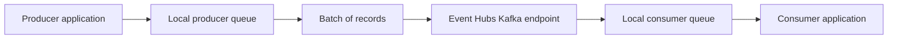
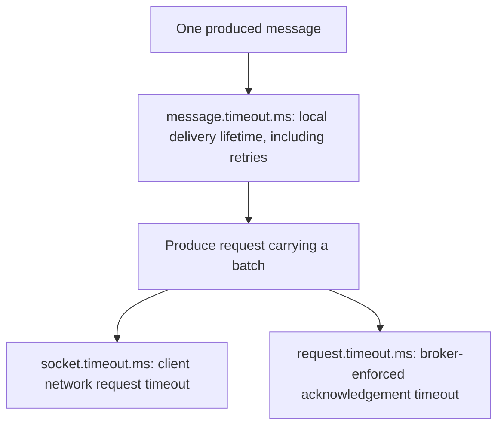
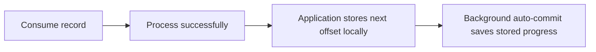

# Kafka configuration explained

This guide explains the settings used by `Parchwell.Kafka` for readers who are new to Kafka. It describes the implemented baseline and the documented meaning of each setting, rather than reporting measured Event Hubs behavior. Start here, then use the [baseline guide](kafka-baseline.md) for registration code and the rules used to select values.

## The pieces these settings control

A **producer** is an application that sends records, also called messages. A **consumer** reads them. A **topic** is a named stream divided into **partitions**, and an **offset** identifies a position within a partition. A **broker** is a Kafka server; in this repository clients connect to Azure Event Hubs' Kafka endpoint instead of a Kafka cluster we operate. Microsoft maps an Event Hubs namespace to a Kafka cluster and an event hub to a topic. [Microsoft's conceptual mapping][ms-overview], [partition and offset concepts][ms-features], [native producer/consumer introduction][introduction].

The diagram shows where buffering and processing happen; it is not a timing measurement. The producer can batch records before sending them, and the consumer can fetch records ahead of the application reading them. [Producer batching][batching], [consumer prefetch settings][n-queued-min-messages].

A **consumer group** identifies consumers working together and their saved reading progress. For a consumer that subscribes through group coordination, **assignment** decides which member reads which partitions; a **rebalance** changes that assignment. The verifier in this repository instead uses direct assignment with explicit starting offsets. [Group identity][n-group-id], [assignment][n-partition-assignment-strategy], [repository verifier contract][oracle].

## How to read the tables

- **All roles** means both producers, the enrichment consumer and the verifier consumer. The producer roles are load generation and enrichment output. Their baseline producer settings are the same. [Role mapping][catalogue].
- **Consumer** means enrichment and verifier unless the row distinguishes them. Group membership timers and assignment strategies describe subscribing consumers; the verifier's direct assignment does not turn it into a group-coordination test. [Role mapping][catalogue], [verifier contract][oracle].
- Values are configuration literals from the [implemented catalogue][catalogue] and [approved contract][plan], not benchmark results. A required input is supplied by the caller; it is not an example deployment value.
- `ms` means milliseconds; `60000` ms is `60` seconds and `300000` ms is `5` minutes. These are unit conversions of the source-cited timeout values, not measurements. `bytes` means bytes. For the queue settings named `kbytes`, the pinned native implementation multiplies the producer value by `1024` and the consumer value by `1000` to obtain bytes. Those are queue-data units, not a promise about total process memory. [Timeout values][n-socket-timeout-ms], [delivery lifetime][n-message-timeout-ms], [native queue conversions][queue-units].
- A key's link opens its pinned definition. The explanations of changing a setting describe its documented control or tradeoff, not a recommendation to change this repository's baseline. [Baseline selection rules](kafka-baseline.md#source-selection-and-conflicts).

## Connection, identity and observation

These entries apply to all roles. The namespace and client ID come from the caller; the remaining baseline values come from the catalogue. [Implemented common settings][catalogue].

| Setting | Baseline | What it means and what changing it controls |
|---|---|---|
| [`bootstrap.servers`][n-bootstrap-servers] | `<namespace>.servicebus.windows.net:9093` | The address the client contacts to discover the service. Supply this repository's `NamespaceName` input; the factory builds the endpoint. Changing the namespace changes the destination. Microsoft's Kafka endpoint uses the shown host form and port. [Connection guidance][ms-config], [factory][factory]. |
| [`client.id`][n-client-id] | Required caller input | A label identifying the client. This repository requires a workload/pod identity for tracing. It is separate from the consumer group identity and authentication settings. [Input contract][plan]. |
| [`security.protocol`][n-security-protocol] | `sasl_ssl` | Selects SASL authentication over the SSL/TLS transport. SASL selects the authentication mechanism; the secure transport carries the connection. Keep the approved protocol for this baseline. [Native secure transport][secure-transport]. |
| [`sasl.mechanism`][n-sasl-mechanism] | `OAUTHBEARER` | Selects token-based authentication. ADR-003 chooses a custom refresh handler using workload identity; setting this string alone does not implement that handler. [Authentication design][authentication], [deferred implementation][plan]. |
| [`sasl.oauthbearer.method`][n-sasl-oauthbearer-method] | `default` | Selects the login method. The alternative `oidc` enables the native token-acquisition path and requires its own supporting settings. Our approved custom-handler path retains `default`. [Authentication design][authentication]. |
| [`sasl.oauthbearer.metadata.authentication.type`][n-sasl-oauthbearer-metadata-authentication-type] | `none` | Does not select the native metadata-authentication paths. In particular, this baseline does not select `azure_imds`; ADR-003 selects workload identity through our future handler. [Authentication design][authentication]. |
| [`enable.sasl.oauthbearer.unsecure.jwt`][n-enable-sasl-oauthbearer-unsecure-jwt] | `false` | Keeps the built-in unsecured development/test token handler disabled. Enabling it would select behavior the native reference explicitly excludes from production use. |
| [`enable.ssl.certificate.verification`][n-enable-ssl-certificate-verification] | `true` | Checks the server's certificate. Turning it off disables that verification; it is not a connection-failure remedy for this baseline. |
| [`ssl.endpoint.identification.algorithm`][n-ssl-endpoint-identification-algorithm] | `https` | Checks the broker hostname against its certificate. Here `https` names the checking algorithm; `security.protocol` still selects the transport. `none` would disable hostname verification. |
| [`socket.keepalive.enable`][n-socket-keepalive-enable] | `true` | Enables TCP keepalive on broker sockets. It does not specify the operating system's keepalive timer values. Microsoft specifically recommends enabling it for librdkafka. [Microsoft guidance][ms-config]. |
| [`metadata.max.age.ms`][n-metadata-max-age-ms] | `180000` ms | Limits the age of cached cluster/topic metadata. A smaller age lowers the cache-age limit; this is separate from DNS caching. Microsoft's librdkafka recommendation supplies this value. [Microsoft guidance][ms-config]. |
| [`connections.max.idle.ms`][n-connections-max-idle-ms] | Explicit `0` | Controls closing broker connections after inactivity. Zero disables this client idle-close setting; it does not promise the server or network will keep a connection open. Explicit zero also differs from omitting the setting because of native Azure default-selection heuristics. [Conflict explanation](kafka-baseline.md#source-selection-and-conflicts). |
| [`broker.address.ttl`][n-broker-address-ttl] | `1000` ms | How long the client caches broker-address lookup results. A smaller value shortens this cache lifetime; it is separate from the topic metadata cache. |
| [`socket.max.fails`][n-socket-max-fails] | `1` failure | Disconnects a broker connection after this many send failures, such as request timeouts; the client reconnects automatically. The native reference recommends retaining this value to avoid client/broker desynchronization. |
| [`statistics.interval.ms`][n-statistics-interval-ms] | `15000` ms | How often native statistics are emitted. A statistics callback is also required; the mapping library does not implement the later statistics bridge. Zero disables emission. ADR-007 selects our interval. [Telemetry design][telemetry], [current scope][plan]. |

The baseline configures authentication properties but cannot yet authenticate a live workload by itself: token acquisition and refresh are explicitly deferred. [Approved authentication scope][plan].

## Producer delivery: acknowledgements, timeouts and retries

An **acknowledgement**, or **ack**, is the broker's response to a produce request. A **retry** is a further send attempt by the library after a retryable error. Neither an ack setting nor a delivery timeout, on its own, proves that the consuming application processed the record. [Native delivery handling][delivery], [repository delivery contract][processing].

The timeout names answer different questions:

These are overlapping limits, not consecutive waiting periods to add together. For a produce request, the client uses the smaller of `socket.timeout.ms` and the remaining `message.timeout.ms` of the first message in the batch. `request.timeout.ms` is enforced by the broker when acknowledgements are enabled. [Network timeout][n-socket-timeout-ms], [local delivery timeout][n-message-timeout-ms], [broker timeout][n-request-timeout-ms].

| Setting | Producer baseline | What it means and what changing it controls |
|---|---|---|
| [`acks`][n-acks] | `-1` (`all`) | Requests acknowledgement once all in-sync replicas (broker copies) have committed the message, under Kafka's documented semantics. Changing the acknowledgement mode changes what the broker must confirm before responding; it does not define application processing success. This is a client setting description, not a measured statement about Event Hubs' internal replication. |
| [`request.timeout.ms`][n-request-timeout-ms] | `60000` ms | The broker-enforced wait for a produce acknowledgement. Increasing it changes that broker-side timeout, not the local message's overall delivery lifetime. This setting is producer-only. |
| [`socket.timeout.ms`][n-socket-timeout-ms] | `60000` ms | The default client network-request timeout. On produce, remaining message lifetime can shorten it as described above. Raising only the broker timeout does not raise this limit. |
| [`message.timeout.ms`][n-message-timeout-ms] | `300000` ms | The maximum local time available to deliver a message, including library retries. A delivery error occurs when this lifetime or the retry count is exceeded. Zero means an infinite local lifetime, which this baseline does not select. |
| [`message.send.max.retries`][n-message-send-max-retries] | `2147483647` retries | The retry-count ceiling for a failing message. This large number does not imply an unlimited delivery lifetime: `message.timeout.ms` still applies. Retrying can reorder records when idempotence is disabled. |
| [`enable.idempotence`][n-enable-idempotence] | `false` | Leaves the native idempotent-producer feature disabled under ADR-015 until B04 decides it. Enabling it changes delivery/order guarantees and imposes compatible acknowledgement, retry and in-flight settings. It is not a standalone switch for exactly-once business processing. [Repository delivery choice][processing], [baseline decision][baseline-decision]. |
| [`max.in.flight`][n-max-in-flight] | `1000000` requests per broker connection | Limits how many requests can be outstanding on a connection. This is a ceiling, not a target request count. With retries enabled and idempotence disabled, multiple outstanding requests permit reordering. Enabling idempotence requires revisiting this baseline value. [Native ordering explanation][ordering]. |

The producer values for `request.timeout.ms`, `socket.timeout.ms` and `message.timeout.ms` are the shared A01 baseline contract: #54 owns the executable baseline; #14 owns scenario deltas and hypotheses. Microsoft's stated request-timeout default conflicts with the pinned native default; the [baseline guide](kafka-baseline.md#source-selection-and-conflicts) explains the selection. [Approved ownership and values][plan].

## Producer batching, size and local queues

**Batching** groups records into a request to reduce per-record overhead. A producer's local queue holds records waiting for delivery. Increasing a batch or queue allowance changes what the client may accumulate; it does not raise a server's accepted request size. [Native batching][batching], [request size][n-message-max-bytes].

**Latency** is the time a record takes to travel through the system; **throughput** is the rate of records or bytes handled. Batching trades time spent waiting for a batch against the overhead of sending separate requests. The native introduction describes why the balance depends on load. [Performance explanation][batching].

| Setting | Producer baseline | What it means and what changing it controls |
|---|---|---|
| [`linger.ms`][n-linger-ms] | `5` ms | Time allowed for records to accumulate into a batch. A larger value allows larger batches at the expense of extra accumulation delay; the native introduction explains that the resulting latency/throughput balance depends on load. [Batching tradeoff][batching]. |
| [`batch.size`][n-batch-size] | `1000000` bytes | The size limit for a batch, including protocol framing. The limit is applied after the first record is added, so a first record larger than this limit can still be included. This is not a strict maximum individual payload size. |
| [`message.max.bytes`][n-message-max-bytes] | `1000000` bytes | Maximum Kafka protocol request-message size on the client. The native reference warns that framing differences prevent strict enforcement at produce time and a request may exceed this by a message. Raising it does not raise the service's limit. |
| [`compression.type`][n-compression-type] | `none` | Selects batch compression. `none` leaves compression off; the native list of codecs is not an Event Hubs support list. Microsoft's librdkafka guidance limits the choice to `none` or `gzip`, and our approved baseline chooses `none`. [Microsoft guidance][ms-config]. |
| [`partitioner`][n-partitioner] | `consistent_random` | Chooses a partition from the record key using CRC32 hashing; empty and null keys are distributed randomly. Changing the partitioner changes the key-to-partition rule, so it is not merely a batch-size adjustment. |
| [`queue.buffering.max.messages`][n-queue-buffering-max-messages] | `100000` messages | Caps the producer queue's record count across topics and partitions. Zero disables this count limit. The byte-size setting below has higher priority. |
| [`queue.buffering.max.kbytes`][n-queue-buffering-max-kbytes] | `1048576` native kbytes | Caps the sum of queued message sizes across topics and partitions. The [pinned conversion][queue-units] uses `1024` bytes per unit. A higher value permits more queued message data; it is not a process-memory cap. |

The baseline uses `compression.type` and `max.in.flight` because these native aliases are also the keys read by the managed .NET properties. [Alias explanation](kafka-baseline.md#source-selection-and-conflicts), [native aliases][n-compression-type], [managed configuration source][managed].

## Producer delivery notifications

A **delivery report** tells the application the final delivery result observed by the producer. Our future harness uses those reports as evidence; configuring them does not implement its ledger or prove consumer-side outcomes. [Native delivery reports][delivery], [ledger design][ledger], [current implementation scope][plan].

| Setting | Producer baseline | What it means and what changing it controls |
|---|---|---|
| [`dotnet.producer.enable.background.poll`][m-background-poll] | `true` | Starts the managed producer's background polling thread for delivery reports and events when a producer is built. With `false`, application code must call `Poll` manually. The configuration factory itself does not build a producer. [Factory scope][factory]. |
| [`dotnet.producer.enable.delivery.reports`][m-delivery-reports] | `true` | Enables delivery-result notifications. Disabling them selects fire-and-forget behavior and removes evidence the planned harness needs. [Ledger contract][ledger]. |
| [`dotnet.producer.delivery.report.fields`][m-delivery-fields] | `all` | Retains all optional delivery-report fields, including persistence status. Omitting fields may reduce overhead, but the oracle requires the status field to remain enabled. [Oracle evidence requirements][oracle]. |

## Consumer membership and fetching

**Heartbeats** tell the group coordinator that a member is alive. A call to `Consume` asks the client for another record; the maximum interval between those calls is a separate processing-progress check. A **fetch request** asks the service for records, which may be held in the local consumer queue before the application consumes them. [Session timer][n-session-timeout-ms], [poll timer][n-max-poll-interval-ms], [prefetch][n-queued-min-messages].

| Setting | Consumer baseline | What it means and what changing it controls |
|---|---|---|
| [`group.protocol`][n-group-protocol] | `classic` | Not supported on our Event Hubs Premium namespace on 2026-10-28: the namespace did not advertise a KIP-848 ConsumerGroupHeartbeat API version usable by librdkafka 2.16.0, so a consumer with `group.protocol=consumer` did not join and this unsupported-API path raised no application error; this is a source-supported inference from pod logs ([C08](../../results/C08/2026-10-28.md)). The `classic` baseline selects the original group coordination protocol. Changing it to `consumer` changes the coordination model and which settings apply; it is not simply a performance tweak. |
| [`partition.assignment.strategy`][n-partition-assignment-strategy] | `range,roundrobin` | Lists supported assignment strategies in preference order. `range` divides each topic's ordered partitions into ranges for members; `roundrobin` distributes partitions around eligible members in turn. The group selects a shared strategy; it does not apply both simultaneously. [Range implementation][range], [round-robin implementation][roundrobin]. |
| [`session.timeout.ms`][n-session-timeout-ms] | `30000` ms | How long the coordinator can go without a member's heartbeats before removing it and triggering reassignment. A larger value lengthens this failure-detection allowance. This is a `classic` group setting. |
| [`heartbeat.interval.ms`][n-heartbeat-interval-ms] | `3000` ms | The interval between group-liveness heartbeats. It does not set how long application processing may take between `Consume` calls. |
| [`max.poll.interval.ms`][n-max-poll-interval-ms] | `300000` ms | Maximum allowed interval between calls to consume messages. Exceeding it marks a subscribing member failed and causes a rebalance; offset commits may no longer be possible. Heartbeats do not replace those calls. |
| [`socket.timeout.ms`][n-socket-timeout-ms] | `60000` ms | The client network-request timeout. For consumer fetch requests, native code uses `fetch.wait.max.ms` plus this timeout. The producer-only `request.timeout.ms` is not emitted for consumers. [Role mapping][catalogue]. |
| [`fetch.wait.max.ms`][n-fetch-wait-max-ms] | `500` ms | Maximum time the broker may wait to fill a fetch response to its minimum-size target. It is not a timer for the application's processing function. |
| [`queued.min.messages`][n-queued-min-messages] | `100000` messages per partition | The minimum record count the client tries to maintain in its local queue for each topic/partition. This is a prefetch target, not a requirement to wait for that many records before processing. The queue-size cap below takes priority. |
| [`queued.max.messages.kbytes`][n-queued-max-messages-kbytes] | `65536` native kbytes | Limits queued, prefetched message data. For the high-level consumer the cap applies to its shared queue across partitions. The [pinned conversion][queue-units] uses `1000` bytes per unit. Fetching can overshoot this value; the native reference identifies the per-partition fetch-size setting as the overshoot source. |
| [`fetch.max.bytes`][n-fetch-max-bytes] | `52428800` bytes | Maximum data requested for a fetch response. The first batch from the first non-empty partition can exceed it so the consumer can make progress; it is not a strict response-memory ceiling. |
| [`fetch.message.max.bytes`][n-fetch-message-max-bytes] | `1048576` bytes per partition initially | Initial per-partition fetch-size allowance. If a record is larger, the client can gradually increase the allowance to fetch the whole record. Lowering it is not a way to reject all larger records. |
| [`receive.message.max.bytes`][n-receive-message-max-bytes] | `100000000` bytes | A protocol-response size safety limit. It must leave room above `fetch.max.bytes` for protocol overhead; the native reference gives the required relationship. Reducing only this value can make the size settings incompatible. |

These membership settings are emitted for both consumer roles to keep their configurations explicit. The verifier still uses direct assignment and explicit start offsets, so its correctness depends on the verifier contract below. [Catalogue][catalogue], [ADR-013][oracle].

## Consumer progress: store, commit and reset

**Store** means updating the next offset eligible for commit in the client's local memory. **Commit** means saving that progress through the high-level consumer's broker-based offset management. These operations are distinct: our enrichment design stores only after processing, while background auto-commit periodically saves the stored progress. [Native store definition][n-enable-auto-offset-store], [offset management][offset-management], [store-after-process explanation][store-after-process], [ADR-005][processing].

This diagram describes the approved enrichment design, not processing code supplied by the configuration factory. A crash after processing but before commit can result in repeat processing; ADR-005 explicitly expects duplicates and requires consumers to handle them. [Delivery design][processing], [configuration-only scope][plan].

| Setting | Enrichment / verifier | What it means and what changing it controls |
|---|---|---|
| [`group.id`][n-group-id] | Required `EnrichmentGroupId` / `parchwell-verifier` | Identifies a consumer group. Consumers sharing the ID belong to the same group. Enrichment requires a stable caller-supplied ID; ADR-013 fixes the verifier ID rather than creating a group for each run. [Input contract][plan], [verifier contract][oracle]. |
| [`enable.auto.commit`][n-enable-auto-commit] | `true` / `false` | Enables periodic saving of stored offsets for enrichment. The verifier disables it. Turning it off does not, by itself, prevent a consumer from looking up previously committed start offsets; explicit assignment with offsets is a separate operation. |
| [`auto.commit.interval.ms`][n-auto-commit-interval-ms] | `5000` ms / omitted as unspecified | The high-level consumer's auto-commit interval. It governs when stored progress is saved, not when a record finishes processing. The verifier does not rely on it because its contract neither stores nor commits progress. [Verifier omissions][catalogue]. |
| [`enable.auto.offset.store`][n-enable-auto-offset-store] | `false` / omitted as unspecified | With automatic storage disabled, enrichment must explicitly store the offset after processing. This does not disable background commits. The verifier's direct-assignment contract does not use offset storage, so the factory leaves the property out rather than emitting `false`. [Processing design][processing], [approved omission][plan]. |
| [`auto.offset.reset`][n-auto-offset-reset] | `latest` / `error` | The action when there is no initial stored offset or the desired offset is out of range. Enrichment selects the largest/latest offset; the verifier raises an error instead of silently resetting. This setting does not mean every restart ignores a usable saved offset. |
| [`isolation.level`][n-isolation-level] | `read_committed` / `read_committed` | Controls visibility of transactionally written records: this value returns transactional records only after commitment. It concerns Kafka transaction visibility, not the consumer offset commit described above. It does not enable a transactional producer or define the oracle for a transaction scenario. [Transaction-scenario boundary][oracle]. |

`latest` is the native synonym for the documented `largest` default and is understood by the managed .NET enum getter. The factory emits the actual managed-compatible spelling. [Native reset values][n-auto-offset-reset], [managed spelling explanation](kafka-baseline.md#source-selection-and-conflicts).

## Topic creation and deliberately omitted settings

**Omitted** means the key is absent from the emitted native configuration. `Excluded` metadata records a path outside this baseline; `Unspecified` records a setting the current role does not depend on. Neither disposition means the client receives a null value or that the underlying native default becomes disabled. [Metadata behavior](kafka-baseline.md#deliberate-omissions), [factory emission][factory].

| Setting | Baseline treatment | Meaning and reason for the treatment |
|---|---|---|
| [`allow.auto.create.topics`][n-allow-auto-create-topics] | Producers `true`; consumers `false` | Allows requesting automatic creation for non-existent topics; the native definition also requires broker-side auto-creation to be enabled. The producer/consumer difference preserves their approved native defaults. It is not proof that Event Hubs will create a missing topic; Terraform owns this repository's topics. [Provisioning design][topics], [approved selection][plan]. |
| [`group.instance.id`][n-group-instance-id] | Consumers: omitted, `Unspecified` | A stable per-member identity enabling static group membership, distinct from the shared `group.id`. Leaving it absent retains dynamic membership. Static membership can avoid some transient rebalances, but is a separate inventory scenario. [Native static membership][static-membership], [baseline omissions][plan]. |
| [`transactional.id`][n-transactional-id] | Producers: omitted, `Excluded` | Enables a transactional producer and identifies it across restarts. The baseline excludes transactions under ADR-015; B05 owns that scenario. This omission does not change `isolation.level` on consumers. [Baseline decision][baseline-decision]. |
| [`delivery.report.only.error`][n-delivery-report-only-error] | Producers: omitted, `Excluded` | The native setting suppresses successful delivery reports. Confluent .NET rejects this native key's presence even when its value is false; use the managed delivery-report settings above. [Managed validation][managed-producer]. |
| [`sasl.username`][n-sasl-username] | All roles: omitted, `Excluded` | A username for PLAIN/SCRAM authentication. This repository chooses the OAUTHBEARER path instead. [Authentication design][authentication]. |
| [`sasl.password`][n-sasl-password] | All roles: omitted, `Excluded` | The corresponding PLAIN/SCRAM password. No password is supplied by this baseline. [Authentication design][authentication]. |
| `sasl.jaas.config` | All roles: omitted, `Excluded` | Java authentication configuration shown in Microsoft's connection-string example. It is not part of our .NET workload-identity configuration. [Microsoft's Java example][ms-config], [authentication design][authentication]. |
| [`sasl.oauthbearer.client.id`][n-sasl-oauthbearer-client-id] | All roles: omitted, `Excluded` | Application identifier for the native OIDC path; it is not the `client.id` tracing label. ADR-003 selects our custom-handler path instead. [Authentication design][authentication]. |
| [`sasl.oauthbearer.client.secret`][n-sasl-oauthbearer-client-secret] | All roles: omitted, `Excluded` | Client secret for the native OIDC path. The approved workload-identity design does not use this credential. [Authentication design][authentication]. |
| [`sasl.oauthbearer.token.endpoint.url`][n-sasl-oauthbearer-token-endpoint-url] | All roles: omitted, `Excluded` | Token issuer endpoint used by native OIDC. Token acquisition belongs to the separately planned custom provider, so no native OIDC endpoint is emitted. [Scope][plan]. |
| [`sasl.oauthbearer.scope`][n-sasl-oauthbearer-scope] | All roles: omitted, `Excluded` | Access scope for the native OIDC path. Its omission does not mean our eventual custom token request has no scope; ADR-003 defines that separate request. [Authentication design][authentication]. |

## Reading a configuration problem

Use these questions to choose which definitions to read before changing a value. They are a reading aid, not diagnoses from measured runs.

| Question | Start with |
|---|---|
| Which timeout expired? | Distinguish the broker ack timer, client network timer and local message lifetime in [producer delivery](#producer-delivery-acknowledgements-timeouts-and-retries). |
| Why can a record be processed again? | Read [store versus commit](#consumer-progress-store-commit-and-reset) and ADR-005's duplicate-handling contract. |
| Why did a consumer leave its group? | Read the separate heartbeat/session and consume-call timers in [consumer membership](#consumer-membership-and-fetching). |
| Why is data waiting locally? | Check the producer batch/queue allowances or consumer prefetch allowances; they control different queues. |
| Why did the verifier fail instead of starting elsewhere? | Its explicit start-offset and reset-error rules protect the run's evidence; read [ADR-013][oracle]. |

For the complete machine-readable selection reasons and inventory tags, read the [catalogue][catalogue]. For how to build the configurations, register options or run verification, continue with the [baseline guide](kafka-baseline.md).

## Sources

Kafka property definitions below are pinned to librdkafka and Confluent.Kafka `v2.16.0`. Microsoft links identify the official pages and a pinned source revision used when writing this explanation. Repository links identify the implementation and design authority; none is a published scenario result.

[catalogue]: ../../src/Parchwell.Kafka/Configuration/BaselineSettingsCatalog.cs
[factory]: ../../src/Parchwell.Kafka/Configuration/KafkaConfigurationFactory.cs
[plan]: https://github.com/collaborationwithothers/eventhubs-kafka-dotnet/issues/54#issuecomment-6174869137
[authentication]: ../blueprint.md#adr-003-entra-only-authentication-with-aks-workload-identity-and-a-custom-oauthbearer-refresh-handler
[processing]: ../blueprint.md#adr-005-at-least-once-delivery-with-store-after-process-offsets-and-idempotent-consumers
[telemetry]: ../blueprint.md#adr-007-single-azure-monitor-backbone
[ledger]: ../blueprint.md#adr-012-the-oracle-is-a-per-message-ledger-joined-into-four-outcome-classes
[oracle]: ../blueprint.md#adr-013-a-run-is-the-window-between-high-watermarks-recorded-before-and-after-the-load-generator
[baseline-decision]: ../blueprint.md#adr-015-the-baseline-is-microsofts-guidance-every-setting-the-harness-depends-on-explicit-and-tagged-preview-features-never-enter-it
[topics]: ../blueprint.md#adr-002-terraform-owns-topics-partition-counts-are-fixed-for-compacted-hubs
[ms-overview]: https://github.com/MicrosoftDocs/azure-docs/blob/7c2e0f03f1d09711af435b3c13b50ac0ef50d287/articles/event-hubs/azure-event-hubs-apache-kafka-overview.md#apache-kafka-and-azure-event-hubs-conceptual-mapping
[ms-features]: https://github.com/MicrosoftDocs/azure-docs/blob/7c2e0f03f1d09711af435b3c13b50ac0ef50d287/articles/event-hubs/event-hubs-features.md
[ms-config]: https://github.com/MicrosoftDocs/azure-docs/blob/7c2e0f03f1d09711af435b3c13b50ac0ef50d287/articles/event-hubs/apache-kafka-configurations.md#librdkafka-configuration-properties
[introduction]: https://github.com/confluentinc/librdkafka/blob/v2.16.0/INTRODUCTION.md
[batching]: https://github.com/confluentinc/librdkafka/blob/v2.16.0/INTRODUCTION.md#performance
[secure-transport]: https://github.com/confluentinc/librdkafka/blob/v2.16.0/INTRODUCTION.md#ssl
[delivery]: https://github.com/confluentinc/librdkafka/blob/v2.16.0/INTRODUCTION.md#producer-message-delivery-success
[ordering]: https://github.com/confluentinc/librdkafka/blob/v2.16.0/INTRODUCTION.md#reordering
[offset-management]: https://github.com/confluentinc/librdkafka/blob/v2.16.0/INTRODUCTION.md#offset-management
[store-after-process]: https://github.com/confluentinc/librdkafka/blob/v2.16.0/INTRODUCTION.md#at-least-once-processing
[static-membership]: https://github.com/confluentinc/librdkafka/blob/v2.16.0/INTRODUCTION.md#static-consumer-groups
[queue-units]: https://github.com/confluentinc/librdkafka/blob/v2.16.0/src/rdkafka.c#L2766-L2791
[managed]: https://github.com/confluentinc/confluent-kafka-dotnet/blob/v2.16.0/src/Confluent.Kafka/Config_gen.cs
[managed-producer]: https://github.com/confluentinc/confluent-kafka-dotnet/blob/v2.16.0/src/Confluent.Kafka/Producer.cs#L726-L732
[m-background-poll]: https://github.com/confluentinc/confluent-kafka-dotnet/blob/v2.16.0/src/Confluent.Kafka/Config_gen.cs#L1508-L1517
[m-delivery-reports]: https://github.com/confluentinc/confluent-kafka-dotnet/blob/v2.16.0/src/Confluent.Kafka/Config_gen.cs#L1520-L1527
[m-delivery-fields]: https://github.com/confluentinc/confluent-kafka-dotnet/blob/v2.16.0/src/Confluent.Kafka/Config_gen.cs#L1530-L1538
[range]: https://github.com/confluentinc/librdkafka/blob/v2.16.0/src/rdkafka_range_assignor.c#L34-L52
[roundrobin]: https://github.com/confluentinc/librdkafka/blob/v2.16.0/src/rdkafka_roundrobin_assignor.c#L32-L51

[n-acks]: https://github.com/confluentinc/librdkafka/blob/v2.16.0/CONFIGURATION.md#L190
[n-allow-auto-create-topics]: https://github.com/confluentinc/librdkafka/blob/v2.16.0/CONFIGURATION.md#L63
[n-auto-commit-interval-ms]: https://github.com/confluentinc/librdkafka/blob/v2.16.0/CONFIGURATION.md#L139
[n-auto-offset-reset]: https://github.com/confluentinc/librdkafka/blob/v2.16.0/CONFIGURATION.md#L206
[n-batch-size]: https://github.com/confluentinc/librdkafka/blob/v2.16.0/CONFIGURATION.md#L176
[n-bootstrap-servers]: https://github.com/confluentinc/librdkafka/blob/v2.16.0/CONFIGURATION.md#L9
[n-broker-address-ttl]: https://github.com/confluentinc/librdkafka/blob/v2.16.0/CONFIGURATION.md#L32
[n-client-id]: https://github.com/confluentinc/librdkafka/blob/v2.16.0/CONFIGURATION.md#L7
[n-compression-type]: https://github.com/confluentinc/librdkafka/blob/v2.16.0/CONFIGURATION.md#L174
[n-connections-max-idle-ms]: https://github.com/confluentinc/librdkafka/blob/v2.16.0/CONFIGURATION.md#L35
[n-delivery-report-only-error]: https://github.com/confluentinc/librdkafka/blob/v2.16.0/CONFIGURATION.md#L177
[n-enable-auto-commit]: https://github.com/confluentinc/librdkafka/blob/v2.16.0/CONFIGURATION.md#L138
[n-enable-auto-offset-store]: https://github.com/confluentinc/librdkafka/blob/v2.16.0/CONFIGURATION.md#L140
[n-enable-idempotence]: https://github.com/confluentinc/librdkafka/blob/v2.16.0/CONFIGURATION.md#L162
[n-enable-sasl-oauthbearer-unsecure-jwt]: https://github.com/confluentinc/librdkafka/blob/v2.16.0/CONFIGURATION.md#L101
[n-enable-ssl-certificate-verification]: https://github.com/confluentinc/librdkafka/blob/v2.16.0/CONFIGURATION.md#L88
[n-fetch-max-bytes]: https://github.com/confluentinc/librdkafka/blob/v2.16.0/CONFIGURATION.md#L147
[n-fetch-message-max-bytes]: https://github.com/confluentinc/librdkafka/blob/v2.16.0/CONFIGURATION.md#L145
[n-fetch-wait-max-ms]: https://github.com/confluentinc/librdkafka/blob/v2.16.0/CONFIGURATION.md#L143
[n-group-id]: https://github.com/confluentinc/librdkafka/blob/v2.16.0/CONFIGURATION.md#L128
[n-group-instance-id]: https://github.com/confluentinc/librdkafka/blob/v2.16.0/CONFIGURATION.md#L129
[n-group-protocol]: https://github.com/confluentinc/librdkafka/blob/v2.16.0/CONFIGURATION.md#L134
[n-heartbeat-interval-ms]: https://github.com/confluentinc/librdkafka/blob/v2.16.0/CONFIGURATION.md#L132
[n-isolation-level]: https://github.com/confluentinc/librdkafka/blob/v2.16.0/CONFIGURATION.md#L151
[n-linger-ms]: https://github.com/confluentinc/librdkafka/blob/v2.16.0/CONFIGURATION.md#L167
[n-max-in-flight]: https://github.com/confluentinc/librdkafka/blob/v2.16.0/CONFIGURATION.md#L14
[n-max-poll-interval-ms]: https://github.com/confluentinc/librdkafka/blob/v2.16.0/CONFIGURATION.md#L137
[n-message-max-bytes]: https://github.com/confluentinc/librdkafka/blob/v2.16.0/CONFIGURATION.md#L10
[n-message-send-max-retries]: https://github.com/confluentinc/librdkafka/blob/v2.16.0/CONFIGURATION.md#L168
[n-message-timeout-ms]: https://github.com/confluentinc/librdkafka/blob/v2.16.0/CONFIGURATION.md#L192
[n-metadata-max-age-ms]: https://github.com/confluentinc/librdkafka/blob/v2.16.0/CONFIGURATION.md#L18
[n-partition-assignment-strategy]: https://github.com/confluentinc/librdkafka/blob/v2.16.0/CONFIGURATION.md#L130
[n-partitioner]: https://github.com/confluentinc/librdkafka/blob/v2.16.0/CONFIGURATION.md#L196
[n-queue-buffering-max-kbytes]: https://github.com/confluentinc/librdkafka/blob/v2.16.0/CONFIGURATION.md#L165
[n-queue-buffering-max-messages]: https://github.com/confluentinc/librdkafka/blob/v2.16.0/CONFIGURATION.md#L164
[n-queued-max-messages-kbytes]: https://github.com/confluentinc/librdkafka/blob/v2.16.0/CONFIGURATION.md#L142
[n-queued-min-messages]: https://github.com/confluentinc/librdkafka/blob/v2.16.0/CONFIGURATION.md#L141
[n-receive-message-max-bytes]: https://github.com/confluentinc/librdkafka/blob/v2.16.0/CONFIGURATION.md#L12
[n-request-timeout-ms]: https://github.com/confluentinc/librdkafka/blob/v2.16.0/CONFIGURATION.md#L191
[n-sasl-mechanism]: https://github.com/confluentinc/librdkafka/blob/v2.16.0/CONFIGURATION.md#L92
[n-sasl-oauthbearer-client-id]: https://github.com/confluentinc/librdkafka/blob/v2.16.0/CONFIGURATION.md#L104
[n-sasl-oauthbearer-client-secret]: https://github.com/confluentinc/librdkafka/blob/v2.16.0/CONFIGURATION.md#L107
[n-sasl-oauthbearer-metadata-authentication-type]: https://github.com/confluentinc/librdkafka/blob/v2.16.0/CONFIGURATION.md#L125
[n-sasl-oauthbearer-method]: https://github.com/confluentinc/librdkafka/blob/v2.16.0/CONFIGURATION.md#L103
[n-sasl-oauthbearer-scope]: https://github.com/confluentinc/librdkafka/blob/v2.16.0/CONFIGURATION.md#L108
[n-sasl-oauthbearer-token-endpoint-url]: https://github.com/confluentinc/librdkafka/blob/v2.16.0/CONFIGURATION.md#L110
[n-sasl-password]: https://github.com/confluentinc/librdkafka/blob/v2.16.0/CONFIGURATION.md#L99
[n-sasl-username]: https://github.com/confluentinc/librdkafka/blob/v2.16.0/CONFIGURATION.md#L98
[n-security-protocol]: https://github.com/confluentinc/librdkafka/blob/v2.16.0/CONFIGURATION.md#L64
[n-session-timeout-ms]: https://github.com/confluentinc/librdkafka/blob/v2.16.0/CONFIGURATION.md#L131
[n-socket-keepalive-enable]: https://github.com/confluentinc/librdkafka/blob/v2.16.0/CONFIGURATION.md#L29
[n-socket-max-fails]: https://github.com/confluentinc/librdkafka/blob/v2.16.0/CONFIGURATION.md#L31
[n-socket-timeout-ms]: https://github.com/confluentinc/librdkafka/blob/v2.16.0/CONFIGURATION.md#L25
[n-ssl-endpoint-identification-algorithm]: https://github.com/confluentinc/librdkafka/blob/v2.16.0/CONFIGURATION.md#L89
[n-statistics-interval-ms]: https://github.com/confluentinc/librdkafka/blob/v2.16.0/CONFIGURATION.md#L39
[n-transactional-id]: https://github.com/confluentinc/librdkafka/blob/v2.16.0/CONFIGURATION.md#L160
